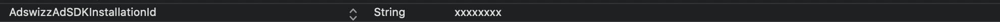
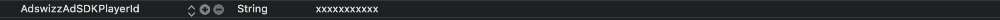
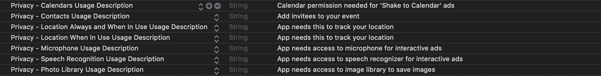
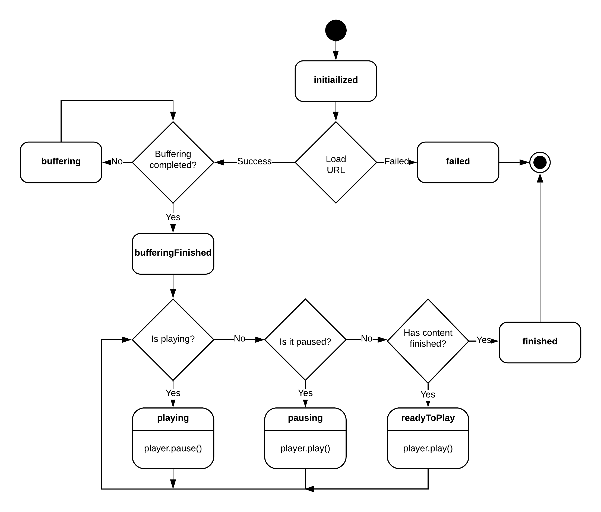
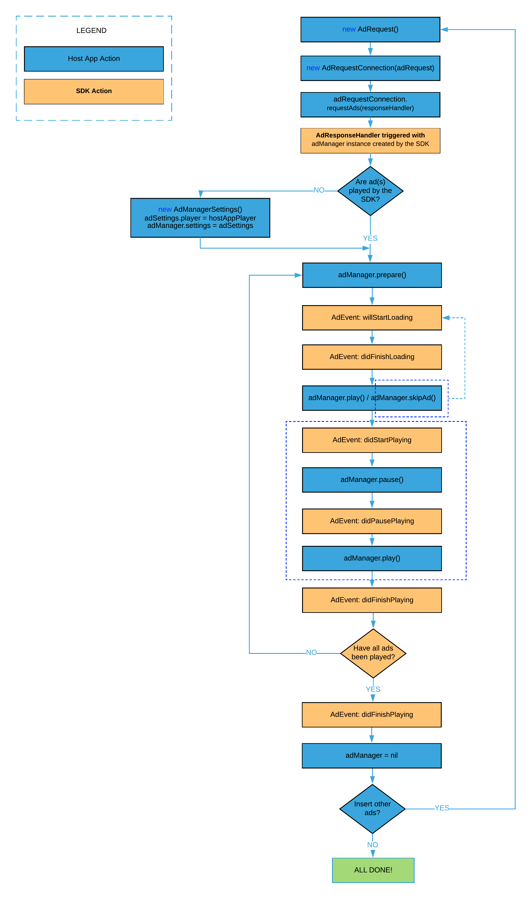

# **AdswizzSDK - Integration**
   * [<strong>Get started</strong>](#get-started)
      * [Prerequisites](#prerequisites)
      * [Dependencies](#dependencies)
      * [Adding the SDK to your Xcode project](#adding-the-sdk-to-your-xcode-project)
      * [Changes in your Info.pList file](#changes-in-your-infoplist-file)
      * [Changes to your app distribution](#changes-to-your-app-distribution)
      * [Your first ad request](#your-first-ad-request)
      * [Working with AdManager object](#working-with-admanager-object)
   * [<strong>Companion Banner</strong>](#companion-banner)
      * [Adding an AdCompanionView](#adding-an-adcompanionview)
      * [Setting up](#setting-up)
      * [Companion events](#companion-events)
      * [Extra exposure time for an AdCompanionView](#extra-exposure-time-for-an-adcompanionview)
   * [<strong>Interactive ads</strong>](#interactive-ads)
      * [Voice enabled interactive ads](#voice-enabled-interactive-ads)
      * [Handling voice recording](#handling-voice-recording)
      * [Handling interactive ad events](#handling-interactive-ad-events)
   * [<strong>Server Side Insertion</strong>](#server-side-insertion)
      * [AdswizzAdStreamManager operations](#adswizzadstreammanager-operations)
         * [play](#play)
         * [pause](#pause)
         * [resume](#resume)
         * [stop](#stop)
      * [AdStreamManagerDelegate protocol](#adstreammanagerdelegate-protocol)      
   * [<strong>Debugging AdswizzSDK</strong>](#debugging-AdswizzSDK)
   * [<strong>Playing ads using your player</strong>](#playing-ads-using-your-player)
      * [MediaPlayerState protocol](#mediaplayerstate-protocol)
         * [currentDuration](#currentduration)
         * [currentPlayHead](#currentplayhead)
         * [metadataItem](#metadataitem)
         * [playerStatus](#playerstatus)
         * [isBufferingWhilePaused](#isbufferingwhilepaused)
         * [lastError](#lasterror)
         * [capabilities](#capabilities)
         * [stateInfo](#stateinfo)
   * [<strong>AdManager life cycle</strong>](#admanager-life-cycle)
      * [AdManager operations](#admanager-operations)
      * [AdManager protocol](#admanager-protocol)
         * [prepare](#prepare)
         * [play](#play)
         * [pause](#pause)
         * [skipAd](#skipad)
         * [reset](#reset)
   * [<strong>AdswizzSDK general settings</strong>](#AdswizzSDK-general-settings)
      * [Companion banner](#companion-banner)
         * [Extra exposure time for an AdCompanionView](#extra-exposure-time-for-an-adcompanionview)
      * [Location](#location)
         * [Enable significant changes for location](#enable-significant-changes-for-location)
         * [Location accuracy](#location-accuracy)
      * [Privacy](#privacy)
         * [GDPR](#gdpr)
         * [CCPA](#ccpa)


# Get started

AdswizzSDK facilitates the ad lifecycle management, right from your application. 
Sensing listeners environment, it crafts the overall ad exercise for superior addressability and augmented interactivity.

On top, in a client side insertion scenario, it retrieves the ad with its associated assets, and handles the reporting operations.<br>
In a server side insertion scenario, it takes the pressure off your app by making the interactivity and assets easily available.


## Prerequisites

*   Xcode 10+
*   Swift 5.0+ if the integration app uses Swift or Objective-C
*   Framework binaries - either via CocoaPods or archive


## Dependencies

AdswizzSDK for iOS depends on two external libraries in order to support voice recognition in interactive voice ads, namely *Amazon’s AWSCore* and *Facebook’s SocketRocket*. <br>
It also relies on *SwiftProtobuf* to handle the serialized communication with Adswizz cloud services. (???)please validate
These dependencies are automatically added if you choose to integrate the SDK using CocoaPods. If choose the manual integration you will have to provide them at link time.


## Adding the SDK to your Xcode project

1. Using CocoaPods 

    You can easily integrate AdswizzSDK into your project. If you already have a pod file, you just need to add the following line:
    ```ruby
    pod 'AdswizzSDK', :git => "https://github.com/adswizz/ad-sdk-ios.git" 
    ```
    After modifying the podfile, run `pod install`. You will be prompted to enter the security credentials to access the AdswizzSDK repository. You can obtain the credentials from your Adswizz partner integration manager. Once authorization is successful, external dependencies will be added automatically. These dependencies include Amazon’s AWSCore library, Facebook’s SocketRocket and SwiftProtobuf. Since AdswizzSDK.framework is built using BUILD_LIBRARY_FOR_DISTRIBUTION = YES, all Swift dependencies must be built the same way. As a [workaround](https://github.com/CocoaPods/CocoaPods/issues/9232), you need to add a post_install hook in your Podfile:
    ```ruby
    post_install do |installer|
     installer.pods_project.targets.each do |target|
         # propagate 'BUILD_LIBRARY_FOR_DISTRIBUTION' build setting
         if target.name == "SwiftProtobuf"
           target.build_configurations.each do |config|
               xcconfig_path = config.base_configuration_reference.real_path
               # read from xcconfig to build_settings dictionary
               build_settings = Hash[*File.read(xcconfig_path).lines.map{|x| x.split(/\s*=\s*/, 2)}.flatten]
               build_settings["BUILD_LIBRARY_FOR_DISTRIBUTION"] = 'YES'
               # write build_settings dictionary to xcconfig
               File.open(xcconfig_path, "w") do |file|
                 build_settings.each{ |k, v|
                   file.write("#{k} = #{v}")
                 }
               end
           end
         end
     end
    end
    ```


2. Manual

    Unzip the AdswizzSDK archive, which contains AdswizzSDK.framework binary and its corresponding dSYM and bcsymbolmap files. Drop the AdswizzSDK.framework file in your project’s Frameworks directory. Make sure AdswizzSDK.framework is listed in the “Embedded Binaries” section of your target. Make sure to add AWSCore.framework and SocketRocket.framework in your project as well.

## Changes in your Info.pList file

After adding AdswizzSDK.framework to your application, you’ll also need to add some keys in the Info.pList. Let’s split these in 2 categories:


1. Settings for the framework:
    1. Add "**_AdswizzSDKInstallationId_**" as a string setting. This is a unique string provided by your Adswizz Integration Manager. This setting **is mandatory** and if not set in your app’s Info.pList the initialize method of the AdswizzSDK will throw an error.
    

    2. Add "**_AdswizzAdSDKPlayerId_**"(??? AdSDK) string setting. This is a unique string provided by an Adswizz PIM. This setting **is mandatory** and if not set in your app’s Info.pList the initialize method of the AdswizzSDK will throw an error.
    

    3. Add "**_AdswizzAdSDKAWSIdentityPoolIdRegion_**"(??? AdSDK) as a string setting. This string will be provided by your AdsWizz Integration Manager and should look like this: "aws_region:xxxxxxxx-xxxx-xxxx-xxxx-xxxxxxxxxxxxx". This setting is **optional**, but not setting it will affect voice detection during interactive ads.    
    
    
2. Settings for permissions(**required**):
    1. Add **_NSCalendarsUsageDescription_** entry. There are interactive ads that, once acted upon, add events in the Calendar. For this, the SDK requires access to the Calendar.
    2. Add **_NSContactsUsageDescription_** entry. As events are added to the Calendar, the user might be interested in inviting friends along. For this, the SDK requires access to the Contacts.
    3. Add **_NSLocationWhenInUseUsageDescription_** entry. One of the best targeting criterion for ads is users’s location. The SDK only updates location when in the foreground. For this, the SDK requires access to Location - While the app is in use.
    4. Add **_NSLocationAlwaysAndWhenInUseUsageDescription_** entry. To enhance the location-based targeting capability, the SDK can leverage the location information, when the app is running in background. For this, the SDK requires access to Location - Always.
    5. Add **_NSMicrophoneUsageDescription_** entry. Interactive voice ads depend on the user being able to interact with the ad, through voice. For this, the SDK requires access to the Microphone.
    6. Add **_NSSpeechRecognitionUsageDescription_** entry. Once the user interact with an interactive voice ad, the SDK needs to convert voice into text, in order to comprehend the command. For this, the SDK will require access to SpeechKit.
    7. Add **_NSPhotoLibraryUsageDescription_** entry. One of the actions users can perform on an interactive ad, is saving a coupon or a banner to the photo library. For this, the SDK requires access to the Photo Library.
    


## Changes to your app distribution

AdswizzSDK.framework is a fat library, as both simulator and device binaries are bundled together. When you upload your app in the AppStore you will need to remove the simulator part from the AdswizzSDK.framework. For that, go to your target’s app “Build Phases” page and tap on “New Run Script Phase” option, and paste the following script:


```bash
if [ "$CONFIGURATION" == "Debug" ]; then
echo "Skip frameworks cleaning in debug version"
exit 0
fi

APP_PATH="${TARGET_BUILD_DIR}/${WRAPPER_NAME}"

# This script loops through the frameworks embedded in the application and
# removes unused architectures.
find "$APP_PATH" -name '*.framework' -type d | while read -r FRAMEWORK
do
FRAMEWORK_EXECUTABLE_NAME=$(defaults read "$FRAMEWORK/Info.plist" CFBundleExecutable)
FRAMEWORK_EXECUTABLE_PATH="$FRAMEWORK/$FRAMEWORK_EXECUTABLE_NAME"
echo "Executable is $FRAMEWORK_EXECUTABLE_PATH"

EXTRACTED_ARCHS=()

for ARCH in $ARCHS
do
echo "Extracting $ARCH from $FRAMEWORK_EXECUTABLE_NAME"
lipo -extract "$ARCH" "$FRAMEWORK_EXECUTABLE_PATH" -o "$FRAMEWORK_EXECUTABLE_PATH-$ARCH"
EXTRACTED_ARCHS+=("$FRAMEWORK_EXECUTABLE_PATH-$ARCH")
done
```


## Your first ad request

You first need to configure the AdswizzSDK. The recommended place to do that is in your **_AppDelegate_** class on **_didFinishLaunchingWithOptions_** function. Here is a snippet of what this might look like:


```swift
import UIKit
import AdswizzSDK

@UIApplicationMain
class AppDelegate: UIResponder, UIApplicationDelegate {
......
func application(_ application: UIApplication, didFinishLaunchingWithOptions launchOptions: [UIApplication.LaunchOptionsKey: Any]?) -> Bool {
  do {
     try AdswizzSDK.shared.initialize()
  } catch {
     print(error)
  }
.......
}
.......
}
```


Your Adswizz Integration Manager will provide you a unique sdk installation id which you need to add in your Info.pList under the **_AdswizzSDKInstallationId_** key. You are now ready for your first ad request. 
Next, let's create an **_AdswizzAdRequest_** object and configure it.


```swift
var adRequest: AdswizzAdRequest!
do {
      adRequest = try AdswizzAdRequest.Builder()
              .with(server: "SERVER_PROVIDED_BY_PIM")
              .with(zoneId: "ZONEID_PROVIDED_BY_PIM")
              .build()
} catch {
     print(error)
}
```


_Ad server__ and _zoneId__ will be provided to you by your Adswizz Integration Manager. 

Moving next, you need create an **_AdRequestConnection_** object and call requestAds with the ad request object.


```swift
let adRequestConnection = AdRequestConnection(for: adRequest)
adRequestConnection.requestAds { [weak self] adManager, error in
     self?.didReceiveResponse(adManager, error)
}
```

Subsequent to this request, the SDK will return an error if the call failed or an **_AdManager_** object if the result was a success.


## Working with AdManager object

If the request to the Adswizz Ad server was successful, the SDK will return an **_AdManager_** object which you will own. This will be the way the SDK will communicate events back to your application. 
To get this communication channel open you need to set up a delegate for the **_AdManager_** that conforms to the **_AdManagerDelegate_** protocol. 
The **_AdManager_** will call `func adManager(_ adManager: AdManager, didReceiveAdEvent event: AdEvent)` whenever events of interest occur in the SDK. Please consult AdEventType enum for a list of possible events from the AdswizzSDK. If an error happens in the SDK while using this object, `func adManager(_ adManager: AdManager, didReceiveAd ad: AdData?, error: Error)` will be called.

As a first step, an **_AdManager_** needs to be set up. You can create an **_AdManagerSettings_** object and pass it to your newly created **_AdManager_** instance. In this object you can specify if you want to play the ad with the SDK’s internal player or use a player of your choice that must conform to the **_MediaPlayerState_** protocol.

Next, you need to call the _.prepare()_ method on the **_AdManager_** object. This will buffer the ads if you decide the play them with the internal player. Here is how it looks like.


```swift
import AdswizzSDK

class YourModelClass: AdManagerDelegate {
   var adManager: AdManager?
.....
func didReceiveResponse(_ adManager: AdManager?, _ error: Error?) {
    ......
    self.adManager = adManager   // Keep a strong reference of this object
    adManager?.delegate = self   // Get notifications from the Ad SDK
    let settings = AdManagerSettings() // Not required
    //settings.player = yourPlayer     // Optional
    adManager?.prepare()   // Start buffering the ads in the AdManager
}
......


......
func adManager(_ adManager: AdManager, didReceiveAdEvent event: AdEvent) {
    switch event.event {
      case .didFinishLoading:
           adManager.play() //Start playing the next ad in the AdManager
      case .didFinishPlaying:
          break // Current ad has finished playing
      case .allAdsDidFinishPlaying:
            break // All ads from the AdManager have finished
      default:
          break
    }
}
......
}
```


If you decided to use the SDK internal player, to actually start the **_AdManager_** rolling the ads you must call the _.play()_ method inside the **_AdManager_** object. 
If you provide the player, then you only need to start playing the ad in your player and the AdswizzSDK will observe the **_MediaPlayerState_** interface and sense when the ad has finished. In this case, calling **_adManager.play()_** is not necessary.


# Companion Banner

AdswizzSDK lets you configure companion banner(s) if your Integration Manager provides you a companion zone id.


## Adding an AdCompanionView

Companion views can be added from storyboard/xib when you add a view. Just specify the **_AdCompanionView_** class. You can also add the view programmatically. 
Once created, the SDK will keep track of all of your companion views and automatically fill them with ad related content as the ad is playing.


## Setting things up

When you create an **_AdswizzAdRequest_** object for the first time, you need to configure the **_companionZones_** ??? with the value provided by your Integration Manager.


```swift
adRequest = try AdswizzAdRequest.Builder()
              .with(server: "SERVER_PROVIDED_BY_INTEGRATION_MANAGER")
              .with(zoneId: "ZONEID_PROVIDED_BY_INTEGRATION_MANAGER")
              .with(playerId: "PLAYERID_PROVIDED_BY_INTEGRATION_MANAGER")
                .with(companionZones: "COMPANION_PROVIDED_BY_INTEGRATION_MANAGER")
                .build()
```


Once the request is made, if there is any companion ???(banner) associated with the ad, it will be loaded into your **_AdCompanionView_** object.


## Companion events

You can associate a delegate to your **_AdCompanionView_** ??? that conforms to the **_AdCompanionViewDelegate_** protocol. You will be notified when the ad loaded the companion view, if the companion view was displayed, or if it ended the display. If there was an error while loading the companion ???(view,banner) you will be notified through this delegate. Also, you can decide whether or not to override click through ???(what exactly) on the companion view. 

You can also deactivate companion view temporarily by setting the **_active_** member to false.


# Interactive ads

Adswizz interactive ads require some permissions on your app. Please refer to the “Changes in you Info.pList” section to operate the necessary changes.


## Voice enabled interactive ads

Adswizz SDK depends on a few external, third party libraries in order to delivery interactive voice ads (Amazon’s **AWSCore.framework** and Facebook’s **SocketRocket.framework**). 
To properly set up the dependencies, you need to provide inside your Info.pList a string key called **_AdswizzSDKAWSIdentityPoolIdRegion_** with the value received from your Adswizz Integration Manager. Failing to add this key will reduce the ability of voice detection while the app is in the background.


## Handling voice recording

Apple recommends that your app’s UI reflect when recording started or stopped. AdswizzSDK provides a way to notify your app that recording has begun or stopped:


```swift
extension AppDelegate: AdswizzSDKDelegate {
    func configureAdswizzSDK() {
       AdswizzSDK.initialize(installationId: "YOUR_INSTALLATION_ID")
       AdswizzSDK.setDelegate(self)
    }
   
   func adswizzSDKRecordingStarted(_ adswizzSDK: AdswizzSDK) {
       // Update your UI to reflect that the SDK is recording
   }

   func adswizzSDKRecordingStopped(_ adswizzSDK: AdswizzSDK) {
       // Update your UI to reflect that the SDK is not recording anymore
   }
}
```


## Handling interactive ad events

While the **_AdMangerDelegate_** object (???) provides a list of events through **_AdEventType_** covering the life cycle of an ad, it does not provide information on interactive ads. 
To get more insight on what is happening while an interactive ad is playing you can set the **_interactiveDelegate_** on the **_AdManager_** ??? object. While implementing **_InteractiveAdManagerDelegate_** you will need to provide code ???(what code) to present a PKAddPassesViewController in case the AdswizzSDK needs to save a coupon in the Wallet.


```swift
class YourModelClass {
......
func didReceiveResponse(_ adManager: AdManager?, _ error: Error?) {
    ......
    // Get interactive ad notifications from the SDK
    adManager?.interactiveDelegate = self
    ......
 }
......
extension YourModelClass: InteractiveAdManagerDelegate {
func interactiveAdManager(_ adManager: AdManager, shouldPresentCoupon pkpassData: Data) {
    do {
          let receivedPass = try PKPass(data: data)
          if let vc = PKAddPassesViewController(pass: receivedPass) {
               // Here you can present the view controller
            } 
    } catch {
    }
}
    
func interactiveAdManager(_ adManager: AdManager, didReceiveAdEvent event: InteractiveAdEvent) {
  switch event.event {
    case .willBeSkipped:
     // Ad will be skipped as a result of an action during interactive ad
     break
    case .skipped:
     // Ad was skipped as a result of an action during interactive ad                 
     break
    case .extended:
     // Ad was extended with a new media as a result of an action
     break
    default:
      break
    }
}
}
```

# Server Side Insertion

AdswizzSDK handles interactive ad insertions, while playing HLS or ICY live streams from Ad Insertion Servers. This is possible by reading the player's metadata for specific Adswizz data and convert it in Adswizz interactive formats or companion banners.
To get started, you need to create an **_AdswizzAdStreamManager_** ??? object with a URL pointing to the ad server your Integration Manager provide you.


```swift
import AdswizzSDK

class YourModelClass: AdStreamManagerDelegate {
   var streamManager: AdswizzAdStreamManager?

func prepareForPlay() {
....
do {
    streamManager = try AdswizzAdStreamManager.Builder()
        .with(adServer: "SERVER_PROVIDED_BY_INTEGRATION_MANAGER")           //Mandatory
        .with(httpProtocol: .https)                         //Optional: http or https protocol for the ad server. If not provided https will be chosen.
        .with(companionZones: "COMPANION_PROVIDED_BY_INTEGRATION_MANAGER")  //Optional: companion zone provided by a Integration Manager
        .build()
} catch {
    print(error)
}
...
}

```
At this point the **_AdswizzAdStreamManager_** object ??? can be configured with a companion zone that will be used in case the ad break defines a companion zone in the metadata but the reference to its location is missing in the VAST response.??? (is it VAST response)
Once the stream object is constructed you need to set the delegate and decide whether or not you want to play the stream with your player or let the SDK do it for you:

```swift
streamManager?.delegate = self
```

If you decide to play the stream with your player, you need to provide a MediaPlayerState object ??? with the following code:


```swift
let settings = AdStreamManagerSettings()
settings.player = yourPlayer
streamManager?.adStreamManagerSettings = settings
```

## AdswizzAdStreamManager operations
### play

To start playing a stream, call this function from **_AdswizzAdStreamManager_** with an URL to a valid AIS server. 
You should call this function even if you are playing the stream with your own player, because the URL will be enhanced with extra parameters that enable the delivery of interactive ads and companion banners. In return ???(to what), **_AdswizzSDK_** will call back `func adStreamManager(_ adstreamManager: AdStreamManager, willStartPlaying url: URL)` with the newly formatted URL.

### pause

To pause a stream that is played by the SDK internal player, call this function. If you are using your own player this will have no effect.


### resume

To resume a stream that is played by the SDK internal player, call this function. If you are using your own player this will have no effect.


### stop

To stop a stream that is played by the SDK internal player, call this function. If you are using your own player this will have no effect.


## AdStreamManagerDelegate protocol
Notifications sent from **_AdswizzSDK_** to your app are implemented in the AdStreamManagerDelegate protocol. 

### func adStreamManager(_ adstreamManager: AdStreamManager, willStartPlaying url: URL)
After calling the play function in the **_AdswizzAdStreamManager_** object, you will be called on this function with the url decorated with the extra parameters. 
Here you can instruct your player to start playing the stream, in case you have chosen to use your own player. 
If you decided to use the SDK internal player, you don't need to do anything at this step.

```swift
func adStreamManager(_ adstreamManager: AdStreamManager, willStartPlaying url: URL) {
  yourPlayer.play(url)
}
```

### func adStreamManager(_ adstreamManager: AdStreamManager, stateChanged state: MediaPlayerStatus)
Whenever the SDK internal player or your own player state changes, you will get notified in this function. Use the states here to update your UI accordingly.

### func adStreamManager(_ adstreamManager: AdStreamManager, metadataChanged metadata: [AVMetadataItem])
Whenever the metadata is changed on the stream played by the SDK internal player, you will be notified here. 
If you opted to play the stream with your own player, this func won't be called.

### func adStreamManager(_ adstreamManager: AdStreamManager, adBreakStarted manager: AdManager)
When an ad break is detected in your stream, you will get a **_AdManager_** object containing the current running ad. You can handle this object the same way you did after getting it from an **_AdswizzAdRequest_**, except you are not obligated to keep a reference to the object. 
Here is how it might look in your app:

```swift
func adStreamManager(_ adstreamManager: AdStreamManager, adBreakStarted manager: AdManager) {
    //let settings = AdManagerSettings()
    //settings.player = yourAdPlayer     // optional step were you tell the AdManager that you want to play the ads
    //manager.adManagerSettings = settings
    manager?.delegate = self             // register for notification on this AdManager
    manager?.interactiveDelegate = self  // register for interactive ads notifications
}
```

During the ad break, you will get updates on the status of the ad if you implement the **_AdMangerDelegate_** protocol or the **_InteractiveAdManagerDelegate_** protocol.
When you get this **_AdManager_** object, the SDK internal player will automatically play the ad, since it is part of the stream. During the ad time, **_AdManager_** will not react to operations such as play or pause. However, you can skip the ad break or reset the whole **_AdManager_** object. Most of the times there will be only one ad in the **_AdManager_** object but you can expect other ads to be inserted from the SDK if the ad is extended ??? (didn't understand).

### func adStreamManager(_ adstreamManager: AdStreamManager, adBreakEnded manager: AdManager)
When the ad break from the stream has ended you will get notified to clean up anything related to your **_AdManager_**.

```swift
func adStreamManager(_ adstreamManager: AdStreamManager, adBreakEnded manager: AdManager) {
    manager?.delegate = nil
    manager?.interactiveDelegate = nil
}
```

### func adStreamManagerWillReconnect(_ adstreamManager: AdStreamManager)
While interacting with an ad in the ad break, the stream might interrupt due to actions like skip ad or extend ad. At this time the SDK will inform you that will reconnect to the stream so the current ad will not be served again.

### func adStreamManagerPlayerShouldPause(_ adstreamManager: AdStreamManager)
When deciding to play with an external player the SDK might inform you to pause the ad playing.

### func adStreamManagerPlayerShouldResume(_ adstreamManager: AdStreamManager)
When deciding to play with an external player the SDK might inform you to resume the ad playing.


# Debugging AdswizzSDK

The SDK uses an internal logger called **_AdLogger_**. By default, the logging level is set to none, meaning that nothing gets logged. Should you need the SDK logging events, you can enable a different logging level; verbose is the one with the highest density, hence we do not recommend its use in production. 
You can also provide a new destination for the logger (e.g.: pipe it to your app logger). By default, the SDK dumps log events in the console.


```swift
extension AppDelegate: AdswizzSDKDelegate {
    func configureAdswizzSDK() {
      ......
      AdLogger.shared.level = .info
      AdLogger.shared.destination = self
      ......
    }
}
......
extension AppDelegate: AdLoggerDestination {
  func log(_ level: AdLogger.Level, functionName: String, fileName: String, lineNumber: Int, line: String) {
      //Pipe it to your logger
  }
}
```


# Playing ads using your player

By default, AdswizzSDK is configured to play the ad media using its internal player.
If you prefer playing the ad with your own player, you must configure the **_AdManager_** object received after an **_AdConnectionRequest_** with a new **_AdManagerSettings_** object. Here you can provide the player that must conform to the **_MediaPlayerState_** protocol. This protocol will notify the SDK that the player was changed, via KVO. 
Here is how you set up your own player:

```swift
class YourModelClass {
    var yourPlayer: YourPlayer
......
func didReceiveResponse(_ adManager: AdManager?, _ error: Error?) {
    ......
    // Get interactive ad notifications from the SDK
    Let adManagerSettings = AdManagerSettings()
    adManagerSettings.player = yourPlayer
    adManager?.adManagerSettings = adManagerSettings
    ......
 }
......

class YourPlayer: NSObject, MediaPlayerState {
    @objc dynamic public var currentPlayhead: TimeInterval = 0
    @objc dynamic public var playerStatus = MediaPlayerStatus.initialized
    @objc dynamic public var metadataItem: [AVMetadataItem]?
    @objc public var currentDuration: TimeInterval = 0
}
```


Let’s break down the **_MediaPlayerState_** protocol.


## MediaPlayerState protocol
### currentDuration

Your player needs to report the current duration ???(or total duration) of the media to the AdswizzSDK, as soon as possible. The media duration is required to compute quartile events or progress events in the SDK. If it is **not possible** to report the media duration, then **set it to 0**. If the SDK reads 0 from currentDuration, it will rely on the VAST response media to compute ???(is it compute) the file duration. If the VAST duration is missing as well, the quartile/progress events will be triggered at the end of the media player in the correct order but not when they actually happened.


### currentPlayHead

For a good reporting of the quartile/progress events, your player should update its current position throughout the entire ad duration. It is **highly recommended** that your player updates this value at an interval of **1 second**. Updating at a higher frequency (<1s) might incur performance issues. If your player skips forward or backward as the ad is playing, immediately update this member accordingly to reflect the action taken. This will affect the way quartile events are fired by the SDK.


### metadataItem

If your player can read metadata from the media that is playing, it should report it through this member. While this is not necessary for a client side insertion ???(is it optional or not recommended), it makes more sense when you are playing a stream. ???(makes more sense or it's recommended?)


### playerStatus

While your player is playing the ad it should update this member so that the AdswizzSDK can start monitoring the status of the ad through your player. **Failing to update** this member accordingly will not generate the desired events from **_AdManager_** object ???(will render **_AdManager_** incapable of generating normal? events).  
Upon receiving the ad url from the AdManager???(general question - shouldn't we mark **_AdManager_** as an object throughout the entire doc) on **_willStartLoading_** event in ???(we need to rephrase this one, as it's hard to comprehend)

```swift
func adManager(_ adManager: AdManager, didReceiveAdEvent event: AdEvent)
```

put your player in **_initialized_** state. 
If your player cannot load the ad url, the player should report the **_failure_** state. You also need to set this state in case the error occurs during the ad playback, and the ad cannot be played anymore. 
When you set **_failure_** or **_unknown_** as the state of your player, the SDK will terminate the current ad that was sent in **_willStartLoading_**, and inform your app that the media player state is unknown ???(what about the failure). The AdManager will move to the next ad, if available.

If your player is buffering data, you can report that to the SDK by setting the state to **_buffering_**. Once your player finishes buffering, you need to report **_bufferingFinished_**. Reporting **_buffering_** and **_bufferingFinished_** ensures that quartile/progress events are reported correctly and are not subject to network interruptions. Once your player is ready to play the ads (after buffering enough data), it can report a state of **_readyToPlay_**, meaning the player’s play method might be called. This state is optional and it resembles the AVPlayer currentItem readyToPlay status. If your player started the ad playback, set the state to **_playing_**. If you pause the playback, set the state to **_pause_**. Similarly, **Resume** will change the state to **_playing_** again. When the player has finished playing the ad, set the state to **_finished_**.

Here is a state machine for your player to implement.


### isBufferingWhilePaused

If your player continues to buffer data after it was paused, set this property to true. When you are playing a stream, this is a good way to let the SDK decide whether or not it should reconnect your stream. ???(not sure it makes sense)

### lastError

If your player encountered an error while playing an ad, report it in this property. This will help the SDK to better report errors back to the ad server.

### capabilities

If your player has specific capabilities (skip, mute, autoplay, autoplay when muted, fullscreen or it can display an icon), list them in this property. SDK will relay this information to the ad server, and will ultimately help achieve better targetability. If you are not interested in this feature, then set this property to nil.

### stateInfo

This is a collection of IAB specific states (skipped, muted, autoplayed, fullscreen) that your player might go through. Reporting these accordingly will help the SDK relay this information to the ad server, and will ultimately help achieve for better targetability. If you are not interested in this feature, then set this property to nil.


# AdManager life cycle

After requesting your first ad from the Adswizz ad server, you are ready to play the ads from the AdManager object. Keep in mind that you might receive more than one ad from the server but you are not required to play them all. If you decide to play multiple ads in your app, you need to listen to the events that the AdManager ??? (or **_AdManager_ - general question) sends to your app and decide what is the appropriate action to take. Here is a diagram of the AdManager state.
???(diagram is low below, should we move it up?)


## AdManager operations

Once presented with an AdManager ???(object) one could call different actions on it. Let’s break them down.

## AdManager protocol
### prepare

You call this method to begin cycling through the ads in the AdManager ???(object). If you decided to let the SDK handle the playback of the ads, this method ensures that the internal player is starting to buffer enough data so that ad playback starts smoothly. After calling this method, the first ad is beginning to load. The SDK will trigger **_willStartLoading_** event informing your app that buffering has begun for the ad. If the SDK is playing the ad, you will also get **_didFinishLoading_** event for the first ad. If you are playing the ad, you will not get this message since your player is responsible to start the buffering process.


### play

If you decided to let the SDK play the ads you will need to call **_play_** method on **_didFinishLoading_** (recommended). Calling this method while you are handling the ad playback has no effect in the SDK. You can call this method after you paused the AdManager to resume playback. AdManager will trigger a **_didStartPlaying_** event back to your app for confirmation.


### pause

If you decided to let the SDK play the ads, you can call **_pause_** method whenever you need to stop playing the ads in the AdManager. Calling this method while you are handling the ad playback has no effect in the SDK. AdManager will trigger a **_didPausePlaying_** event back to your app for confirmation.


### skipAd

If you need to skip an ad, you can call this method to skip the current ad from the AdManager. This method applies even if you decided to take control of the ad playback. Your app will receive a **_didFinishPlaying_** event for the current ad, and if the AdManager has a new ad you will receive **_willStartLoading_** for that one. If no ads are available, an **_allAdsDidFinishPlaying_** will be sent, signaling that all ads got processed in the AdManager.


### reset

If you decided to skip all the ads in the AdManager from the current one you can call this method ???(did not understand; from the current one onwards or how?). For each ad you skip, your app will trigger **_didFinishPlaying_**, and a **_allAdsDidFinishPlaying_** event will be sent at the end. Looping through the ad again will need a call to **_prepare_** function.



# AdswizzSDK general settings

## Companion banner

### Extra exposure time for an AdCompanionView

By default, the **_AdCompanionView_** will end displaying the content after the ad finishes playing. If you need to keep the companion on the screen for a longer period of time (or indefinitely), you can configure it like this.


```swift
let adCompanionOptions = AdCompanionOptions()
adCompanionOptions.extraExposureTime = 1.2 // these are seconds.
// if you need the companion forever on the screen
// adCompanionOptions.extraExposureTime = .greatestFiniteMagnitude
AdswizzSDK.setAdCompanionOptions(adCompanionOptions)
```

## Location

### Enable significant changes for location

By default, **_AdswizzSDK_** will collect location updates using _startUpdatingLocation API_ from _CLLocationManager_, meaning this option is set to **_false_**. If you prefer to limit the location updates only to those significant changes, set this property to **_true_**.

```swift
AdswizzSDK.shared.enableLocationSignificantChanges = true
```

### Location accuracy
By default **_AdswizzSDK_** location accuracy is set to the nearest kilometer. You can update this to a new _CLLocationAccuracy_ value.

```swift
AdswizzSDK.shared.locationAccuracy = kCLLocationAccuracyBest
```

## Privacy

### GDPR

AdsWizz services are GDPR compliant. As a result **_AdswizzSDK_** will decorate urls that connect to Adswizz services accordingly to reflect the desired GDPR user consent. To modify the GDPR consent you need to configured it like this:

```swift
AdswizzSDK.shared.gdprConsent = <Desired_GDPR_Consent>
```

If not configured, the default value for GDPR consent in **_AdswizzSDK_** will be  **_notApplicable_**. Other possible values are:
  * **_notAsked_**: the user was not asked yet about GDPR consent
  * **_granted_**: the user has granted access
  * **_denied_**: the user has denied access

### CCPA

With the introduction of CCPA in US, **_AdswizzSDK_** gives you the possibility to forward the user consent accordingly.

```swift
AdswizzSDK.shared.ccpaConfig = AdswizzCCPAConfig.Builder()
                                                  .with(explicitNotice: <Desired_CCPA_Consent>)
                                                  .with(optOut: <Desired_CCPA_Consent>)
                                                  .with(lspa: <Desired_CCPA_Consent>)
                                                  .build()

```

The default value for **_explicitNotice_**, **_optOut_** and **_lspa_** is **_notApplicable_**. Other possibile values are **_yes_** and **_no_**.