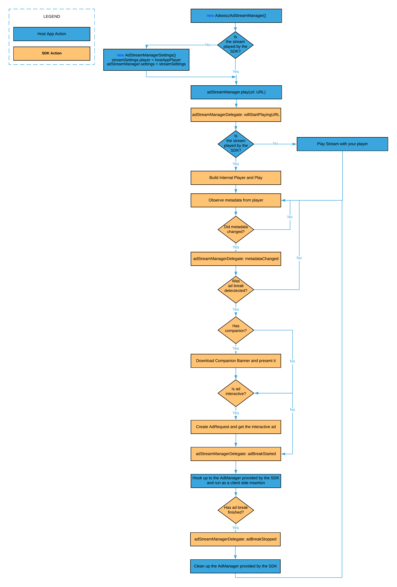

 [](https://www.adswizz.com) 
# **AdswizzSDK for iOS - Integration guide**
- [Before you start](#before-you-start)
  * [What is ‘Client-Side Insertion’](#what-is-client-side-insertion)
  * [What is ‘Server-Side Insertion’](#what-is-server-side-insertion)
  * [Prerequisites for ‘Client-Side Insertion’](#prerequisites-for-client-side-insertion)
  * [Prerequisites for ‘Server-Side Insertion’](#prerequisites-for-server-side-insertion)
- [Get started](#get-started)
  * [Prerequisites](#prerequisites)
  * [Changelog](#changelog)
  * [Dependencies](#dependencies)
  * [Adding the SDK to your Xcode project](#adding-the-sdk-to-your-xcode-project)
  * [Changes in your Info.pList file](#changes-in-your-infoplist-file)
  * [SDK initialization and setup](#sdk-initialization-and-setup)
- [Client-Side Insertion](#client-side-insertion)
  * [Setting up your zone(s) for ad request](#setting-up-your-zone-for-ad-request)
  * [Your first ad request](#your-first-ad-request)
  * [Working with AdManager object](#working-with-admanager-object)
    + [Setup AdManager](#setup-admanager)
    + [Precaching ads in AdManager](#precaching-ads-in-admanager)
    + [Start AdManager](#start-admanager)
  * [AdManager life cycle](#admanager-life-cycle)
    + [AdManager properties](#admanager-properties)
      - [ads](#ads)
      - [analyticsCustomData](#analyticscustomdata)
    + [AdManager operations](#admanager-operations)
    + [AdManager protocol](#admanager-protocol)
      - [prepare](#prepare)
      - [play](#play)
      - [pause](#pause)
      - [skipAd](#skipad)
      - [reset](#reset)
- [Server-Side Insertion](#server-side-insertion)
  * [Precaching before playing](#precaching-before-playing)
  * [AdswizzAdStreamManager operations](#adswizzadstreammanager-operations)
    + [prepare](#prepare-1)
    + [play](#play-1)
    + [pause](#pause-1)
    + [resume](#resume)
    + [stop](#stop)
  * [AdStreamManagerDelegate protocol](#adstreammanagerdelegate-protocol)
- [Interactive ads](#interactive-ads)
  * [Voice enabled interactive ads](#voice-enabled-interactive-ads)
  * [Handling voice recording](#handling-voice-recording)
  * [Handling interactive ad events](#handling-interactive-ad-events)
- [Companion Banner](#companion-banner)
  * [Adding an AdCompanionView](#adding-an-adcompanionview)
  * [Setting things up](#setting-things-up)
  * [Companion events](#companion-events)
- [Video ads](#video-ads)
  * [Adding an AdVideoView](#adding-an-advideoview)
  * [Setup video support](#setup-video-support)
  * [Subclassing AdVideoView](#subclassing-advideoview)
  * [Video events](#video-events)
  * [Viewability](#viewability)
    + [Friendly obstructions](#friendly-obstructions)
    + [Video player state](#video-player-state)
  * [Playing video ads using your player](#playing-video-ads-using-your-player)
- [Debugging AdswizzSDK](#debugging-adswizzsdk)
- [Playing ads using your player](#playing-ads-using-your-player)
  * [MediaPlayerState protocol](#mediaplayerstate-protocol)
    + [currentDuration](#currentduration)
    + [currentPlayHead](#currentplayhead)
    + [metadataItem](#metadataitem)
    + [playerStatus](#playerstatus)
    + [isBufferingWhilePaused](#isbufferingwhilepaused)
    + [lastError](#lasterror)
    + [capabilities](#capabilities)
    + [stateInfo](#stateinfo)
    + [volume](#volume)
- [AdswizzSDK general settings](#adswizzsdk-general-settings)
  * [Companion banner](#companion-banner)
    + [Extra exposure time for an AdCompanionView](#extra-exposure-time-for-an-adcompanionview)
    + [Preferred resource type](#preferred-resource-type)
  * [Location](#location)
    + [Enable significant changes for location](#enable-significant-changes-for-location)
    + [Location accuracy](#location-accuracy)
  * [Privacy](#privacy)
    + [GDPR](#gdpr)
    + [CCPA](#ccpa)
- [AdswizzSDK Analytics](#adswizzsdk-analytics)
  * [Customize AnalyticsEvent](#customize-analyticsevent)
    + [Custom analytics data through AdRequest](#custom-analytics-data-through-adrequest)
    + [Custom analytics data through Ad Manager](#custom-analytics-data-through-ad-manager)
- [Open Measurement in AdswizzSDK](#open-measurement-in-adswizzsdk)
  * [Video controls obstructions](#video-controls-obstructions)
- [(Optional) Tracking permission request](#optional-tracking-permission-request)
  * [TrackingPermissionController](#trackingpermissioncontroller)
  * [TrackingPermissionConfiguration](#trackingpermissionconfiguration)
      - [TrackingPermissionUIElement](#trackingpermissionuielement)
  * [Behaviour](#behaviour)
  * [Other considerations](#other-considerations)
- [(Optional) Prepare your application for advanced targetability capabilities](#optional-prepare-your-application-for-advanced-targetability-capabilities)
  * [Handle data collection](#handle-data-collection)
  * [Privacy implications](#privacy-implications)
  * [Technical prerequisites](#technical-prerequisites)
- [(Optional) Interoperability with PAL SDK](#interoperability-with-pal-sdk)
  * [What you need to do](#what-you-need-to-do)
- [Sample projects](#sample-projects)
  * [BasicAdRequestExample](#basicadrequestexample)
  * [BasicAdRequestExampleObjC](#basicadrequestexampleobjc)
  * [BasicAdStreamExample](#basicadstreamexample)
  * [BasicAdStreamExampleObjC](#basicadstreamexampleobjc)
  * [ExternalPlayerExample](#externalplayerexample)
  * [BasicVideoAdExample](#basicvideoadexample)
  * [BasicTrackingPermissionExample](#basictrackingpermissionexample)
  * [BasicEmptyAdsExample](#basicemptyadsexample)
# **AdswizzWatchSDK for WatchOS - Integration guide**
- [AdswizzWatchSDK](#adswizzwatchsdk)
  * [What is AdswizzWatchSDK](#what-is-adswizzwatchsdk)
  * [What it does do](#what-it-does-do)
  * [What it doesn't do](#what-it-doesnt-do)
  * [Prerequisites for a successful integration](#prerequisites-for-a-successful-integration)
  * [Cases when updating 'Now Playing' information from iOS won't start the WatchOS companion app](#cases-when-updating-now-playing-information-from-ios-wont-start-the-watchos-companion-app)
- [Integrating AdswizzWatchSDK](#integrating-adswizzwatchsdk)
  * [Prerequisites](#prerequisites-1)
  * [Adding the SDK to your Xcode project](#adding-the-sdk-to-your-xcode-project-1)
  * [SDK integration](#sdk-integration)
    + [Watch Extension state](#watch-extension-state)
    + [Forwarding messages from WCSession to AdswizzWatchSDK/AdswizzSDK](#forwarding-messages-from-wcsession-to-adswizzwatchsdkadswizzsdk)
    + [Sending messages from AdswizzWatchSDK/AdswizzSDK to WCSession](#sending-messages-from-adswizzwatchsdkadswizzsdk-to-wcsession)
    + [Running your WatchOS companion app in the background](#running-your-watchos-companion-app-in-the-background)
- [Debugging AdswizzWatchSDK](#debugging-adswizzsdk-1)
- [Sample projects](#sample-projects-1)
  * [BasicAdRequestWatchExample](#basicadrequestwatchexample)
    + [Getting started](#getting-started)
    + [Running the sample](#running-the-sample)
- [Privacy implications](#privacy-implications-1)

# Before you start

This guide is addressed to the iOS Developers who want to integrate AdswizzSDK in their iOS apps. AdswizzSDK is not thread safe, so it is expected that all the calls to the SDK and any updates to the MediaPlayerState are done on the main thread. AdswizzSDK does all the heavy lifting on background queues, so that the main queue remains responsive.
You'll find below a quick overview, as more details are provided for each scenario in their respective section.

Starting with iOS 14, Apple fundamentally changed the way the Identifier For Advertisers (IDFA) value can be accessed. Part of the App Tracking Transparency framework, the process implies a 2-steps approach:
STEP1) **The integrator (host app) is responsible** for setting up a NSUserTrackingUsageDescription to display a system-permission alert request, and then call requestTrackingAuthorization(completionHandler:) to present the app-tracking authorization request to the end user.
STEP2) Provided end users will grant permission for tracking, AdsWizz SDK will employ the new framework to read the IDFA value.

**N.B.: AdsWizz SDK will not show the request for permission dialogue, as the publisher is responsible for controlling and designing the user experience for obtaining the tracking consent. We encourage you to involve your product, UX/UI and engineering teams in the process of designing the best solution. It is very important that you ensure a high opt-in rate for the Tracking permission, as strong business value (higher CPMs) is dependent on being able to read the IDFA value.**

## What is ‘Client-Side Insertion’

For client-side scenario you may use any streaming server and you are not required to use an AIS (Ads Insertion Server). 
Your app is responsible for the built-in logic to decide when to start and end an ad break by fetching ads from the ad server and playing them with your apps's audio/video capabilities.
The SDK will handle all communication during ad fetching with the ad server while being in charge with displaying companion banner and performing various event reporting (impressions & quartiles).

## What is ‘Server-Side Insertion’

For server-side scenario it is required to have an AIS (Ads Insertion Server) as a streaming server with the audio ads being automatically inserted on the server-side. The streaming server and the SDK split their responsibilities as follows:

**Streaming Server:**
*  detects ad breaks and inserts audio ads into the audio stream
*  updates metadata to make it possible for the SDK to synchronize companion banner with the audio content and to detect interactive ads

**SDK:**
*  decorates audio stream URL to increase targetability of ads
*  detects all events associated with an ad break (start, stop, change of ad)
*  retrieves, displays, synchronizes companion banner with the audio content based on metadata information
*  retrieves and process interactivity metadata information based on metadata information

## Prerequisites for ‘Client-Side Insertion’

In order to successfully integrate the ‘Client-Side Insertion’ you will need to set/provide the following information for your **_AdswizzAdRequest_** object within **_AdRequestConnection_**:
*  adServer = the name of AdServer used to fetch ads from
*  zoneId = identifier of zone used to retrieve audio/video ads from
*  companionZones = (optional) identifier of zone to retrieve creatives to be displayed by the companion banner
*  (optional) list of custom site variables used for ads selection (e.g referrer)

The following can be set as general AdswizzSDK parameters:
*  (optional) GDPR consent value
*  (optional) CCPA (U.S. privacy string) consent value
*  (optional) location accuracy
*  (optional) location enable significant changes

## Prerequisites for ‘Server-Side Insertion’

In order to successfully integrate the ‘Server-Side Insertion’ you will need to set/provide the following information for your **_AdswizzAdStreamManager_** object:
*  adServer = the name of Adserver used to insert ads from
*  companionZones = (optional) identifier of zone to retrieve creatives to be displayed by the companion banner
*  adStreamURL = URL of audio stream (pass it to **_AdswizzAdStreamManager_**'s play() method)

The following can be set as general AdswizzSDK parameters:
*  (optional) GDPR consent value
*  (optional) CCPA (U.S. privacy string) consent value
*  (optional) location accuracy
*  (optional) location enable significant changes

# Get started

AdswizzSDK facilitates the ad lifecycle management, right from your application. 
Sensing listeners environment, it crafts the overall ad exercise for superior addressability and augmented interactivity.

On top, in a client-side insertion scenario, it retrieves the ad with its associated assets, and handles the reporting operations.<br>
In a server-side insertion scenario, it takes the pressure off your app by making the interactivity and assets easily available.


## Prerequisites

*   Xcode 12+
*   Swift 5.0+ if the integration app uses Swift or Objective-C
*   Framework binaries - either via CocoaPods 1.9.3+ or archive

## Changelog

Please check [here](changelog.md) the latest AdswizzSDK version and all the new changes & fixes it comes with. 

## Dependencies

AdswizzSDK.framework dependes on the following frameworks:
*   AWSCore.framework
*   AdswizzSDKPrivacyData.framework (1.0.6)

AdswizzSDK for iOS depends on *Amazon’s AWSCore* as an external library in order to support trackability used by the [AdswizzSDK Analytics](#adswizzsdk-analytics).<br>
*AdswizzSDKPrivacyData* is a source library which implements Privacy-Sensitive API that requires user permission. *AdswizzSDKPrivacyData* can be configured to exclude any sensitive API at built time.
These dependencies are automatically added if you choose to integrate the SDK using CocoaPods. If you choose the manual integration you will have to provide them at link time.


## Adding the SDK to your Xcode project

1. Using CocoaPods 

    AdswizzSDK is delivered as an xcframework, so the best way to integrate it is through Cocoapods. The recommended version for Cocoapods is 1.9.3 or newer. If you already have a pod file, you just need to add the following lines:
    ```ruby
    pod 'AdswizzSDKPrivacyData', :git => "https://ADSWIZZ_GITHUB_TOKEN@github.com/adswizz/ad-sdk-ios-privacydata.git"
    pod 'AdswizzSDK',            :git => "https://ADSWIZZ_GITHUB_TOKEN@github.com/adswizz/ad-sdk-ios.git" 
    ```
    Replace **_ADSWIZZ_GITHUB_TOKEN_** with token you received from AdsWizz. You can obtain a token from your AdsWizz partner integration manager. After modifying the podfile, run `pod install`. You will be prompted to enter a username. Enter any valid email address. Don't leave this value empty or the install will fail. When prompted for password enter the token repository provided by AdsWizz. Once authorization is successful, external dependencies will be added automatically. These dependencies include Amazon’s AWSCore library. Since AdswizzSDK.framework is built using BUILD_LIBRARY_FOR_DISTRIBUTION = YES, all Swift dependencies must be built the same way. This includes AdswizzSDKPrivacyData.framework. As a [workaround](https://github.com/CocoaPods/CocoaPods/issues/9232), you need to add a post_install hook in your Podfile:
    
    ```ruby
    post_install do |installer|
       installer.pods_project.targets.each do |target|
            if target.name == "AdswizzSDKPrivacyData"
             target.build_configurations.each do |config|
              path = config.base_configuration_reference.real_path
              update_xcconfig(path, { "BUILD_LIBRARY_FOR_DISTRIBUTION" => "YES"
    # Exclude senstive API. Uncomment the line bellow and exclude what permission you don't want to add to your app.            
    #                               , "SWIFT_ACTIVE_COMPILATION_CONDITIONS" => "NO_IDFA_ACCESS NO_SPEECH_ACCESS NO_CONTACTS_ACCESS NO_CALENDAR_ACCESS NO_CAMERA_ACCESS NO_LOCATION_ACCESS NO_MICROPHONE_ACCESS NO_MOTION_ACTIVITY_ACCESS"
                                    })
             end
           end
       end
    end

    def update_xcconfig(path, new_values)
      build_settings = Hash[*File.read(path).lines.map{|x| x.split(/\s*=\s*/, 2)}.flatten]
      new_values.each { |k, v|
        build_settings[k] = "#{v}\n"
      }
      File.open(path, "w") do |file|
        build_settings.each{ |k, v|
          file.write("#{k} = #{v}")
        }
      end
    end
    ```

2. Manual

    Unzip the AdswizzSDK archive, which contains AdswizzSDK.xcframework binary. Drop the AdswizzSDK.xcframework file in your project’s Frameworks directory. Make sure AdswizzSDK.xcframework is listed in the **_Embedded Binaries_** section of your target. Make sure to add AWSCore.framework in your project as well. <br>
    AdswizzSDKPrivacyData.framework can be added as a submodule from https://github.com/adswizz/ad-sdk-ios-privacydata repo and selecting the appropriate tag. Next, you need to add AdswizzSDKPrivacyData.xcodeproj to your workspace or project. If you choose to add the xcodeproj from the repo you will need to add a step to make AdswizzSDKPrivacyData.xcodeproj compile. By design, AdswizzSDKPrivacyData.xcodeproj needs a **_CustomConfig.xcconfig_** in the AdswizzSDKPrivacyData project directory. This file is placed in .gitignore so you need to copy or create it every time you build or archive your scheme. To achieve this, you can create a **_New Run Script Action_** in **your scheme's** **_Build_** section or **_Archive_** section.

    1. If you don't want to create a custom xcconfig file add:
    ```
    "<YOUR_SUBMODULE_LOCATION>/AdswizzSDKPrivacyData/AdswizzSDKPrivacyData/CreateCustomConfig.sh"
    ```
    This will create an empty **_CustomConfig.xcconfig_** in submodule directory.

    2. If you want to create a custom xcconfig file add:
    ```
    yes | cp -rf "<YOUR_LOCATION>/<CUSTOM_FILE>.xcconfig" "<YOUR_SUBMODULE_LOCATION>/AdswizzSDKPrivacyData/CustomConfig.xcconfig"
    ```
    In this example, <CUSTOM_FILE>.xcconfig is a xcconfig file kept in your repo, and you just copy it in the ad-sdk-ios-privacydata repo.

    You can add the same step to the **_Archive_** section as well.

## Changes in your Info.pList file

After adding AdswizzSDK.xcframework to your application, unless you will pass the required settings programmatically when AdswizzSDK is initialized (**_installationId_** and **_playerId_**), you’ll also need to add some keys in the Info.pList. Let’s split these in 2 categories:


1. Settings for the framework:
    1. Add "**_AdswizzAdSDKInstallationId_**" as a string setting. This is a unique string provided by your AdsWizz Integration Manager. If not provided programmatically, this setting is **mandatory** and, if not set in your app’s Info.pList, the initialize method of the AdswizzSDK will throw an error.
    
    More details at [SDK initialization and setup](#sdk-initialization-and-setup).

    2. Add "**_AdswizzAdSDKPlayerId_**" string setting. This is a unique string provided by your AdsWizz Integration Manager. If not provided programmatically, this setting is **mandatory** and, if not set in your app’s Info.pList, the initialize method of the AdswizzSDK will throw an error.
    
    More details at [SDK initialization and setup](#sdk-initialization-and-setup).
    
2. Settings for permissions(**optional**):
    1. Add **_NSCalendarsUsageDescription_** entry. There are interactive ads that, once acted upon, add events in the Calendar. For this, the SDK requires access to the Calendar. If you don't want to add this entry use **NO_CALENDAR_ACCESS** compilation switch for AdsiwzzSDKPrivacyData.framework either in the Podfile(if you use CocoaPods) or in the CustomConfig.xcconfig(manual installation).
    2. Add **_NSContactsUsageDescription_** entry. As events are added to the Calendar, the user might be interested in inviting friends along. For this, the SDK requires access to the Contacts. For this, the SDK requires access to the Calendar. If you don't want to add this entry use **NO_CONTACTS_ACCESS** compilation switch for AdsiwzzSDKPrivacyData.framework either in the Podfile(if you use CocoaPods) or in the CustomConfig.xcconfig(manual installation).
    3. Add **_NSLocationWhenInUseUsageDescription_** entry. One of the best targeting criteria for ads is users’ location. The SDK only updates location when in the foreground. For this, the SDK requires access to Location - While the app is in use. If you don't want to add this entry use **NO_LOCATION_ACCESS** compilation switch for AdsiwzzSDKPrivacyData.framework either in the Podfile(if you use CocoaPods) or in the CustomConfig.xcconfig(manual installation).
    4. Add **_NSLocationAlwaysAndWhenInUseUsageDescription_** entry. To enhance the location-based targeting capability, the SDK can leverage the location information, when the app is running in background. For this, the SDK requires access to Location - Always. If you don't want to add this entry use **NO_LOCATION_ACCESS** compilation switch for AdsiwzzSDKPrivacyData.framework either in the Podfile(if you use CocoaPods) or in the CustomConfig.xcconfig(manual installation).
    5. Add **_NSMicrophoneUsageDescription_** entry. Interactive voice ads depend on the user being able to interact with the ad, through voice. For this, the SDK requires access to the Microphone. If you don't want to add this entry use **NO_MICROPHONE_ACCESS** compilation switch for AdsiwzzSDKPrivacyData.framework either in the Podfile(if you use CocoaPods) or in the CustomConfig.xcconfig(manual installation).
    6. Add **_NSSpeechRecognitionUsageDescription_** entry. Once the user interacts with an interactive voice ad, the SDK needs to convert voice into text, in order to comprehend the command. For this, the SDK will require access to SpeechKit. If you don't want to add this entry use **NO_SPEECH_ACCESS** compilation switch for AdsiwzzSDKPrivacyData.framework either in the Podfile(if you use CocoaPods) or in the CustomConfig.xcconfig(manual installation).
    7. Add **_NSPhotoLibraryUsageDescription_** entry. One of the actions users can perform on an interactive ad, is saving a coupon or a banner to the photo library. For this, the SDK requires access to the Photo Library. If you don't want to add this entry use **NO_PHOTO_ACCESS** compilation switch for AdsiwzzSDKPrivacyData.framework either in the Podfile(if you use CocoaPods) or in the CustomConfig.xcconfig(manual installation).
    8. Add **_NSMotionUsageDescription_** entry. For better targetting AdsWizz can use CMMotionActivityManager to determine what aaccitivity is the user engaged in. For this, the SDK requires ccess to the device’s motion data. If you don't want to add this entry use **NO_MOTION_ACTIVITY_ACCESS** compilation switch for AdsiwzzSDKPrivacyData.framework either in the Podfile(if you use CocoaPods) or in the CustomConfig.xcconfig(manual installation).
    9. Add **_NSUserTrackingUsageDescription_** entry. If you want to use the AdswizzSDK tracking framework to assist you in asking users' consent for accessing IDFA, add this in your app's Info.plist. If you don't want to add this entry, use **NO_IDFA_ACCESS** compilation switch for AdsiwzzSDKPrivacyData.framework either in the Podfile (if you use CocoaPods) or in the CustomConfig.xcconfig(manual installation).

    


## SDK initialization and setup

In order to properly integrate AdswizzSDK in your app, you first need to initialize the AdswizzSDK with an optional configuration.
There are two mandatory string settings that allow AdswizzSDK to be initialized properly: **_installationId_** and **_playerId_**.
You can either set them in your Info.plist file with **_AdswizzAdSDKInstallationId_** key and **_AdswizzAdSDKPlayerId_** respectively (see [Changes in your Info.pList file](#changes-in-your-infoplist-file)), or set them programmatically in which case the Info.plist values will be overridden.

To programmatically set the **_installationId_** and **_playerId_** string settings you use a configuration object which is an instance of **_AdswizzSDKConfig_**.

The recommended place to initialize the AdswizzSDK is in your **_AppDelegate_** class on **_didFinishLaunchingWithOptions_** function. Here is a snippet of what this might look like:


```swift
import UIKit
import AdswizzSDK

@UIApplicationMain
class AppDelegate: UIResponder, UIApplicationDelegate {
......
func application(_ application: UIApplication, didFinishLaunchingWithOptions launchOptions: [UIApplication.LaunchOptionsKey: Any]?) -> Bool {
  //the configuration object is optional, unless you want to override the Info.plist values
  //or simply didn't add the string settings in your app's Info.plist
  let config = AdswizzSDKConfig(playerId: "yourPlayerId", installationId: "yourInstallationId")
  do {
     try AdswizzSDK.shared.initialize(with: config)
  } catch {
     print(error)
  }
.......
}
.......
}
```


Your AdsWizz Integration Manager will provide you with unique SDK installation ids which you need to add in your Info.pList under the **_AdswizzSDKInstallationId_** key and **_AdswizzSDKPlayerId_** respectively. You are now ready for your first ad request in a client-side scenario, or playing a live stream in case of the server-side insertion approach.


# Client-Side Insertion


In this scenario, AdswizzSDK lets you decide when and where to request ads from an Ads Insertion Server and subsequently play those ads in your application.

## Setting up your zone(s) for ad request

Following the SDK initialization, the next step would be to create and configure one or more **_AdswizzAdZone_** objects before passing them to your **_AdswizzAdRequest_** object.

```swift
var zone: AdswizzAdZone!
do {
      zone = try AdswizzAdZone.Builder()
          .with(zoneId: "ZONEID_PROVIDED_BY_PIM")         // mandatory
          .with(maxAds: maximum_number_of_ads)            // optional
          .with(maxDuration: maximum_duration_in_seconds) // optional
          .build()
} catch {
     print(error)
}
```

_zoneId__ will be provided to you by your Adswizz Integration Manager.

Note that `maxAds` and `maxDuration` properties are completely optional. Also, if you're using a single zone to configure the **_AdswizzAdRequest_** object, these properties will have no effect, so you can skip setting them.

## Your first ad request

Once you've created and configure your **_AdswizzAdZone_** objects, you are ready to create an **_AdswizzAdRequest_** object and configure it. Consider the example below where it uses a configured zone from the previous code snippet above:

```swift
var adRequest: AdswizzAdRequest!
do {
      adRequest = try AdswizzAdRequest.Builder()
              .with(server: "SERVER_PROVIDED_BY_PIM")
              .with(zone: zone)
              .build()
} catch {
     print(error)
}
```

The _Ad server__ will be provided to you by your Adswizz Integration Manager.
If your specific use case involves dealing with multiple zones, your AdsWizz Integration Manager will provide you all the required zone ids. You will then be able to set and use multiple distinct and unique **_AdswizzAdZone_** objects. Here's an example of multiple zone request:

```swift
let zone1: AdswizzAdZone!
let zone2: AdswizzAdZone!
let zone3: AdswizzAdZone!
var adRequest: AdswizzAdRequest!
do {
      adRequest = try AdswizzAdRequest.Builder()
              .with(server: "SERVER_PROVIDED_BY_PIM")
              .with(zones: [zone1, zone2, zone3])
              .build()
} catch {
     print(error)
}
```
Please note that the order you pass the zones is important, as the AdsWizz Ad Server will take that into account during ad selection.

**Custom request parameters**

You may use custom parameters (key-value pairs) in your **_AdswizzAdRequest_** objects, in order to send various information, such as the TCF v2 consent string, some publisher specific Ids, first-party targeting data, etc.
Here is an example:

```swift
let adRequest = try AdswizzAdRequest.Builder()
        ...
        .with(additionalCustomParameters: "key1=URLEncodedValue1&key2=URLEncodedValue2&...")
        ...
```

Note that it is your responsability to properly URL encode the custom parameters values as well as the keys themselves (if needed).
Failing to do that would result in an error being thrown by the **_AdswizzAdRequest.Builder()_** when attempting to `build()` the request.

**AdRequestConnection**

Moving next, you need create an **_AdRequestConnection_** object and call requestAds with the ad request object.

```swift
let adRequestConnection = AdRequestConnection(for: adRequest)
adRequestConnection.requestAds { [weak self] adManager, error in
     self?.didReceiveResponse(adManager, error)
}
```

Subsequent to this request, the SDK will return an error if the call failed or an **_AdManager_** object if the result was a success.


## Working with AdManager object

If the request to the AdsWizz Ad server was successful, the SDK will return an **_AdManager_** object which you will own. This will be the way the SDK will communicate events back to your application. 
To get this communication channel open you need to set up a delegate for the **_AdManager_** that conforms to the **_AdManagerDelegate_** protocol. 
The **_AdManager_** will call `func adManager(_ adManager: AdManager, didReceiveAdEvent event: AdEvent)` whenever events of interest occur in the SDK. Please consult **_AdEventType_** enum for a list of possible events from the AdswizzSDK. If an error happens in the SDK while using this object, `func adManager(_ adManager: AdManager, didReceiveAd ad: AdData?, error: Error)` will be called. Here are a few cases when the **_AdManager_** will report an error:
  * ad playback failed due to an internal player error
  * calling `prepare()`, `play()` or `pause()` on the **_AdManager_** instance during a server side scenario (live streaming). More details at [AdStreamManagerDelegate protocol](#adstreammanagerdelegate-protocol) when the ad break starts

The SDK is also able to request data in order for your application to benefit from additional customisation while working with the **_AdManager_** object. To be able to customise the behaviour you need to set up a datasource for the **_AdManager_** that conforms to the **_AdManagerDatasource_** protocol.
Through the **_AdManagerDatasource_** protocol, when firing VAST tracking URLs, the SDK is currently able to ask for your additional custom tracking URLs which will be fired along using the same engine thus ensuring retryability and other improvements under the hood.
The **_AdManagerDatasource_** protocol allows your integration to pass your own custom tracking URLs for the following use cases:
* VAST events by calling `adManager(_ adManager: AdManager, ad: AdData, trackingEventUrls event: VastTrackingEvent) -> [URL]` method. It passes the **_VastTrackingEvent_** for which the SDK could fire your custom additional URLs. Check the `VastTrackingEvent` enum for possible values
* VAST errors by calling `adManager(_ adManager: AdManager, ad: AdData, trackingErrorUrls errorCode: VastErrorCode) -> [URL]` method. It passes the **VastErrorCode** for which the SDK could fire your custom additional URLs. Check the `VastErrorCode` enum for possible values
* Impressions by calling `adManagerImpressionUrls(_ adManager: AdManager, ad: AdData) -> [URL]` method
* Companion banner click URLs by calling `adManagerCompanionClickTrackingUrls(_ adManager: AdManager, ad: AdData, _ companion: Companion) -> [URL]` method. It passes the VAST **_Companion_** object loaded by the current ad. When a companion banner is tapped, the SDK could fire your custom additional URLs.
* Video view click URLs by calling `adManagerVideoClickTrackingUrls(_ adManager: AdManager, ad: AdData) -> [URL]` method. When the video view is tapped, the SDK could fire your custom additional URLs.

### Setup AdManager

As a first step, an **_AdManager_** needs to be set up. This will be done by creating an **_AdManagerSettings_** object and pass it to your newly created **_AdManager_** instance. In this object you can specify if you want to play the ad with the SDK’s internal player or use a player of your choice that must conform to the **_MediaPlayerState_** protocol.
Additionally, you can instruct **_AdManager_** which level of asset quality it should match from the available creatives for an ad. This can be done by setting the appropriate **_AdAssetQuality_** property on your instance of **_AdManagerSettings_**. By default the AdswizzSDK will attempt to select an ad asset which matches the **_.high_** quality.
You can fine tune it by using the other available quality levels such as **_.medium_** or **_.low_**.
Setting the quality level to **_.auto_** will let the SDK choose the best asset (in terms of performance and quality) by taking into account optimizations such as network connection (cellular/WiFi).

**_AdManager_** is also capable of pre-caching the creatives assets for all of its ads before/while actually playing them. This is done by setting the appropriate **_AdCachePolicy_** on your instance of **_AdManagerSettings_**. By default the AdswizzSDK does not (pre-)cache the ads.

Optionally, if you also want to support video rendering (in case of video ads), you will have to set an instance of **_AdVideoView_** to **_videoView_** property on your **_AdManagerSettings_** instance. It does not need to be visible at this point. The actual video rendering is synced with the video ad playback.

Next, you need to call the _.prepare()_ method on the **_AdManager_** object. This will buffer the ads if you decide the play them with the internal player.
Here is how it looks like.

```swift
import AdswizzSDK

class YourModelClass: AdManagerDelegate {
   var adManager: AdManager?
.....
func didReceiveResponse(_ adManager: AdManager?, _ error: Error?) {
    ......
    self.adManager = adManager   // Keep a strong reference of this object
    adManager?.delegate = self   // Get notifications from the Ad SDK
    adManager?.datasource = self // Further customise the Ad SDK
    
    let settings = AdManagerSettings()    // Not required
    //settings.assetQuality = .medium     // Optional, defaults to .high
    //settings.player = yourPlayer        // Optional
    //settings.addCachePolicy(.assets)    // Optional, by default the AdManager will not use its pre-caching capability
    //settings.videoView = <AdVideoView instance> // Optional, defaults to nil
    adManager.adManagerSettings = settings

    adManager?.prepare()   // Start buffering the ads in the AdManager
}
......

......
func adManager(_ adManager: AdManager, didReceiveAdEvent event: AdEvent) {
    switch event.event {
      case .readyForPlay:
           adManager.play() //Start playing the next ad in the AdManager
      case .didFinishPlaying:
          break // Current ad has finished playing
      case .adCompleted:
          break // Current ad is completed
      case .allAdsCompleted:
            break // All ads from the AdManager have finished
      default:
          break
    }
}
......

// Called when AdswizzSDK fires urls for VAST tracking events. See `VastTrackingEvent` enum for possible event values.
func adManager(_ adManager: AdManager, ad: AdData, trackingEventUrls event: VastTrackingEvent) -> [URL] {
    //return your custom tracking URLs for `event` which the SDK should fire along with VAST event tracking URLs
}

// Called when AdswizzSDK fires urls for VAST errors. See `VastErrorCode` enum for possible error values.
func adManager(_ adManager: AdManager, ad: AdData, trackingErrorUrls errorCode: VastErrorCode) -> [URL] {
    //return your custom tracking URLs for `errorCode` which the SDK should fire along with VAST error tracking URLs
}

// Called when AdswizzSDK fires urls for impression tracking.
func adManagerImpressionUrls(_ adManager: AdManager, ad: AdData) -> [URL] {
    //return your custom tracking URLs which the SDK should fire along with impression tracking URLs
}
......
}
```

### Precaching ads in AdManager

Pre-caching the media (creative) assets will allow for your app to serve audio ads in poor network or possibly complete lack of network connection. This will improve user experience because an ad can play instantly or prevent buffering mid ad.
AdswizzSDK offers the capability of a caching like experience, by expanding the size of the buffer to allow for essentially buffering the entire media asset from each ad managed by **_AdManager_**.

You can access the underlaying **_asset_** property of an **_ad_** data, which provides additional information for that particular media asset. 
This **_AdAsset_** interface makes it easy to get access to the following information:
  * **_data_**: the asset's track data (byte array). Might be missing
  * **_mediaUrl_**: the selected media file uri for the asset. The result of your choice of AdAssetQuality
  * **_mimeType_**: the asset's creative type. For audio ads expect values to include, but not limited to "audio/mpeg" and "audio/aac"
  * **_expectedContentLength_**: the asset's expected data length in bytes
  * **_state_**: the asset's status. See AdAssetState for all possible states
  * **_delegate_**: asset delegate. Optional. If set it will notify your app with asset progress during loading

If you enable the **_.assets_** cache option through your **_AdManagerSettings_** instance, and after you set it on **_AdManager_** object, calling _.prepare()_ on **_AdManager_** instance will trigger the pre-caching mechanism.
To take full advantage of this behaviour you would ideally call _.prepare()_ in advance, before playing the ads with either the internal player or your own. This allows AdswizzSDK to download and store the media assets for _all_ of its ads and maximizes effectiveness. However, you are not required to adhere to this strategy.

Here is how it looks like with the pre-caching enabled.

```swift
import AdswizzSDK

class YourModelClass: AdManagerDelegate, AdAssetDelegate {
   var adManager: AdManager?
.....
func didReceiveResponse(_ adManager: AdManager?, _ error: Error?) {
    ......
    self.adManager = adManager   // Keep a strong reference of this object
    adManager?.delegate = self   // Get notifications from the Ad SDK
    
    let settings = AdManagerSettings()
    //settings.player = yourPlayer      // Optional
    settings.addCachePolicy(.assets)    // Instruct the AdManager to trigger the pre-caching mechanism
    adManager.adManagerSettings = settings

    adManager?.prepare()   // Start pre-caching the ads in the AdManager
}
......

......
func adManager(_ adManager: AdManager, didReceiveAdEvent event: AdEvent) {
    switch event.event {
      case .preparingForPlay:
           event.ad?.asset.delegate = self //Optional, get notifications for this ad's asset
      case .readyForPlay:
           adManager.play() //Start playing the next ad in the AdManager
      case .didFinishPlaying:
          break // Current ad has finished playing
      case .adCompleted:
          break // Current ad is completed
      case .allAdsCompleted:
            break // All ads from the AdManager have finished
      default:
          break
    }
}
......

......
func adAsset(_ asset: AdAsset, didFinishDownloadingData data: Data) {
    //At this point the asset data is fully downloaded
    //...
}
    
func adAsset(_ asset: AdAsset, didDownload data: Data, bytesDownloaded: Int64, outOf bytesExpected: Int64) {
    //Called when a new slice of data has been downloaded for the asset.
    //Progress can be calculated as a 0...1 range e.g `bytesDownloaded` / `bytesExpected`
    //...
}
    
func adAsset(_ asset: AdAsset, downloadingFailedWith error: Error) {
    //Called when encountered an error during data's download for the asset
    //...
}
......
}
```

### Start AdManager

If you decided to use the SDK internal player, to actually start the **_AdManager_** rolling the ads you must call the _.play()_ method inside the **_AdManager_** object. 
If you provide the player, then you only need to start playing the ad in your player and the AdswizzSDK will observe the **_MediaPlayerState_** interface and sense when the ad has finished. In this case, calling **_adManager.play()_** is not necessary.

## AdManager life cycle

After requesting your first ad from the AdsWizz ad server, you are ready to play the ads from the AdManager object. Keep in mind that you might receive more than one ad from the server, but you are not required to play them all. If you decide to play multiple ads in your app, you need to listen to the events that the **_AdManager_** sends to your app and decide what is the appropriate action to take. Here is a diagram of the AdManager state. If you want the AdManager to play the ads with the internal player, follow the left diagram. If you want to use your own player, follow the diagram on the right.


### AdManager properties

Once obtained, an **_AdManager_** object has a few properties which could prove useful for your integration.

#### ads

Represents the collection of playable ads (received and parsed from the VAST XML) that are currently stored by the Ad Manager object. This collection can safely be accessed right after the **_AdManager_** object was obtained, before calling the **_prepare_** method or even during ad(s) playback. A zero count value means the Ad Manager will not play any ad.

Based on the `ads` array, you can access or calculate other metrics such as:

- ads `count` with `adManager.ads.count`
- total ads duration as the total number of seconds for all playable ads currently stored by the **_AdManager_** object i.e by using the following snippet:

```swift
import AdswizzSDK

/// Extend AdManager to obtain potentially useful metrics using the `ads` array
extension AdManager {
    /// The current number of playbable ads
    var adCount: Int {
        return ads.count
    }
        
    /// The total number of seconds for all playable ads
    var totalAdsDuration: TimeInterval {
        return ads.compactMap { $0.duration }.reduce(0, +)
    }
}

```

#### analyticsCustomData

Set an object that conforms to **_AnalyticsCustomData_** protocol to provide key-value custom attributes to all **_AnalyticsEvent_** instances triggered by the AdswizzSDK for Analytics purposes. Read more at [AdswizzSDK Analytics](#adswizzsdk-analytics).

### AdManager operations

Once presented with an **_AdManager_** object one could call different actions on it. Let’s break them down.

### AdManager protocol
#### prepare

You call this method to begin cycling through the ads in the **_AdManager_** object. If you decided to let the SDK handle the playback of the ads, this method ensures that the internal player is starting to buffer enough data so that ad playback starts smoothly. After calling this method, the first ad is beginning to load. The SDK will trigger **_preparingForPlay_** event informing your app that buffering has begun for the ad. If the SDK is playing the ad, you will also get **_readyForPlay_** event for the first ad. If you are playing the ad, you will not get this message since your player is responsible to start the buffering process.


#### play

If you decided to let the SDK play the ads you will need to call **_play_** method on **_readyForPlay_** (recommended). Calling this method while you are handling the ad playback has no effect in the SDK. You can call this method after you paused the AdManager to resume playback. AdManager will trigger a **_didStartPlaying_** event back to your app for confirmation. 

#### pause

If you decided to let the SDK play the ads, you can call **_pause_** method whenever you need to stop playing the ads in the AdManager. Calling this method while you are handling the ad playback has no effect in the SDK. AdManager will trigger a **_didPausePlaying_** event back to your app for confirmation.


#### skipAd

If you need to skip an ad, you can call this method to skip the current ad from the AdManager. This method applies even if you decided to take control of the ad playback. If current ad already started to play, your app will receive a **_didFinishPlaying_** event followed by an **_adCompleted_** event, and if the AdManager has a new ad you will receive **_preparingForPlay_** for that one. If no ads are available, an **_allAdsCompleted_** will be sent, signaling that all ads got processed in the AdManager.


#### reset

If you decided to skip all the upcoming ads in the **_AdManager_** object, you can call this method. For each ad you skip, your app will trigger **_adCompleted_**, and an **_allAdsCompleted_** event will be sent at the end. Looping through the ad again will need a call to **_prepare_** function.
However, it is not recommended for an AdManager to be reused after a `reset()` call especially if at least one or more ads have already been played. This recommendation helps to avoid/reduce impression deduplication for the same ads being played repeatedly.


# Server-Side Insertion

AdswizzSDK handles interactive ad insertions, while playing HLS or ICY live streams from Ad Insertion Servers. This is possible by reading the player's metadata for specific AdsWizz data and convert it in AdsWizz interactive formats or companion banners.
To get started, you need to create an **_AdswizzAdStreamManager_** object with a URL pointing to the ad server your Integration Manager provided you.


```swift
import AdswizzSDK

class YourModelClass: AdStreamManagerDelegate {
   var streamManager: AdswizzAdStreamManager?

func prepareForPlay() {
....
do {
    streamManager = try AdswizzAdStreamManager.Builder()
        .with(adServer: "SERVER_PROVIDED_BY_INTEGRATION_MANAGER")           //Mandatory
        .with(httpProtocol: .https)                         //Optional: http or https protocol for the ad server. If not provided https will be chosen.
        .with(companionZones: "COMPANION_PROVIDED_BY_INTEGRATION_MANAGER")  //Optional: companion zone provided by a Integration Manager
        .build()
} catch {
    print(error)
}
...
}

```
At this point the **_AdswizzAdStreamManager_** object can be configured with a companion zone that will be used in case the ad break defines a companion zone in the metadata but the reference to its location is missing in the stream metadata.
Once the stream object is constructed you need to set the delegate and decide whether or not you want to play the stream with your player or let the SDK do it for you:

```swift
streamManager?.delegate = self
```

If you decide to play the stream with your player, you need to provide a **_MediaPlayerState_** object with the following code:


```swift
let settings = AdStreamManagerSettings()
settings.player = yourPlayer
streamManager?.adStreamManagerSettings = settings
```

## Precaching before playing

This applies only when deciding to play a stream using the internal player. If you require a smooth transition between a user action to play a stream and the actual stream playing, you can call `prepare(with url: URL) throws` on your stream manager object ahead of `play(with url: URL) throws` and **_AdswizzSDK_** will make sure to buffer at most 10 seconds from your stream. You can call this function multiple times to refresh the buffer. This function is optional. Events from calling `prepare` will be received in `func adStreamManager(_ adstreamManager: AdStreamManager, stateChanged state: MediaPlayerStatus)`.

## AdswizzAdStreamManager operations

### prepare

When playing the stream with the internal player, call this to have a buffer ready when you call play. This is optional. Calling this while the stream is playing or pausing will have no effect. If you call this function events from the buffering stage, it will be availabe through **_AdStreamManagerDelegate_** within stateChanged function. Usually, the events received here will be **_buffering_**, **_bufferingFinished_** and **_readyToPlay_**. You won't be notified when all 10 seconds will be buffered but you can rely on **_readyToPlay_** state that **_AdswizzAdStreamManager_** can begin to play smoothly.

### play

To start playing a stream, call this function from **_AdswizzAdStreamManager_** with an URL to a valid AIS server. 
You should call this function even if you are playing the stream with your own player, because the URL will be enhanced with extra parameters that enable the delivery of interactive ads and companion banners. As a response, **_AdswizzSDK_** will call back `func adStreamManager(_ adstreamManager: AdStreamManager, willStartPlaying url: URL)` with the newly formatted URL.

### pause

To pause a stream that is played by the SDK internal player, call this function. If you are using your own player this will have no effect. If you are using the internal player, the stream will continue to buffer internally for some 60 seconds.

### resume

To resume a stream that is played by the SDK internal player, call this function. If you are using your own player this will have no effect.


### stop

To stop a stream that is played by the SDK internal player, call this function. If you are using your own player this will have no effect.


## AdStreamManagerDelegate protocol
Notifications sent from **_AdswizzSDK_** to your app are implemented in the **_AdStreamManagerDelegate_** protocol. 

### func adStreamManager(_ adstreamManager: AdStreamManager, willStartPlaying url: URL)
After calling the play function in the **_AdswizzAdStreamManager_** object, you will be called on this function with the url decorated with the extra parameters. 
Here you can instruct your player to start playing the stream, in case you have chosen to use your own player. 
If you decided to use the SDK internal player, you don't need to do anything at this step.

```swift
func adStreamManager(_ adstreamManager: AdStreamManager, willStartPlaying url: URL) {
  yourPlayer.play(url)
}
```

### func adStreamManager(_ adstreamManager: AdStreamManager, stateChanged state: MediaPlayerStatus)
Whenever the SDK internal player or your own player state changes, you will get notified in this function. Use the states here to update your UI accordingly.

### func adStreamManager(_ adstreamManager: AdStreamManager, metadataChanged metadata: [AVMetadataItem])
Whenever the metadata is changed on the stream played by the SDK internal player, you will be notified here. 
If you opted to play the stream with your own player, this func won't be called.

### func adStreamManager(_ adstreamManager: AdStreamManager, adBreakStarted manager: AdManager)
When an ad break is detected in your stream, you will get a **_AdManager_** object containing the current running ad. You can handle this object the same way you did after getting it from an **_AdswizzAdRequest_**, except you are not obligated to keep a reference to the object. 
Here is how it might look in your app:

```swift
func adStreamManager(_ adstreamManager: AdStreamManager, adBreakStarted manager: AdManager) {
    //let settings = AdManagerSettings()
    //settings.player = yourAdPlayer     // optional step were you tell the AdManager that you want to play the ads
    //manager.adManagerSettings = settings
    manager?.delegate = self             // register for notification on this AdManager
    manager?.interactiveDelegate = self  // register for interactive ads notifications
}
```

During the ad break, you will get updates on the status of the ad if you implement the **_AdMangerDelegate_** protocol or the **_InteractiveAdManagerDelegate_** protocol.
When you get this **_AdManager_** object, the SDK internal player will automatically play the ad, since it is part of the stream. During the ad time, **_AdManager_** will not react to operations such as play or pause. However, you can skip the ad break or reset the whole **_AdManager_** object. Most of the times there will be only one ad in the **_AdManager_** object but you can expect other ads to be inserted from the SDK if the ad is extended. This can happen, for instance, when the listener interacts with an ad (i.e. ShakeMe), in order to listen an extension of the ad (more details on a topic).

### func adStreamManager(_ adstreamManager: AdStreamManager, adBreakEnded manager: AdManager)
When the ad break from the stream has ended you will get notified to clean up anything related to your **_AdManager_**.

```swift
func adStreamManager(_ adstreamManager: AdStreamManager, adBreakEnded manager: AdManager) {
    manager?.delegate = nil
    manager?.interactiveDelegate = nil
}
```

### func adStreamManagerWillReconnect(_ adstreamManager: AdStreamManager)
While interacting with an ad in the ad break, the stream might interrupt due to actions like skip ad or extend ad. At this time the SDK will inform you that will reconnect to the stream so the current ad will not be served again.

### func adStreamManagerPlayerShouldPause(_ adstreamManager: AdStreamManager)
When deciding to play with an external player the SDK might inform you to pause the ad playing.

### func adStreamManagerPlayerShouldResume(_ adstreamManager: AdStreamManager)
When deciding to play with an external player the SDK might inform you to resume the ad playing.

Here is a diagram of the AdswizzAdStreamManager state.




# Interactive ads

AdsWizz interactive ads require some permissions on your app. Please refer to the “Changes in you Info.pList” section to operate the necessary changes.


## Voice enabled interactive ads

AdsWizz SDK is able to deliver interactive voice ads with the ability of voice detection while the app is in the foreground.


## Handling voice recording

Apple recommends that your app’s UI reflect when recording started or stopped. AdswizzSDK provides a way to notify your app that recording has begun or stopped:


```swift
extension AppDelegate: AdswizzSDKDelegate {
    func configureAdswizzSDK() {
       AdswizzSDK.initialize(installationId: "YOUR_INSTALLATION_ID")
       AdswizzSDK.setDelegate(self)
    }
   
   func adswizzSDKRecordingStarted(_ adswizzSDK: AdswizzSDK) {
       // Update your UI to reflect that the SDK is recording
   }

   func adswizzSDKRecordingStopped(_ adswizzSDK: AdswizzSDK) {
       // Update your UI to reflect that the SDK is not recording anymore
   }
}
```


## Handling interactive ad events

While the **_AdMangerDelegate_** object provides a list of events through **_AdEventType_** covering the life cycle of an ad, it does not provide information on interactive ads. 
To get more insight on what is happening while an interactive ad is playing you can set the **_interactiveDelegate_** on the **_AdManager_** object. While implementing **_InteractiveAdManagerDelegate_** you will need to provide the code below to present a _PKAddPassesViewController_ in case the AdswizzSDK needs to save a coupon in the Wallet.


```swift
class YourModelClass {
......
func didReceiveResponse(_ adManager: AdManager?, _ error: Error?) {
    ......
    // Get interactive ad notifications from the SDK
    adManager?.interactiveDelegate = self
    ......
 }
......
extension YourModelClass: InteractiveAdManagerDelegate {
func interactiveAdManager(_ adManager: AdManager, shouldPresentCoupon pkpassData: Data) {
    do {
          let receivedPass = try PKPass(data: data)
          if let vc = PKAddPassesViewController(pass: receivedPass) {
               // Here you can present the view controller
            } 
    } catch {
    }
}
    
func interactiveAdManager(_ adManager: AdManager, didReceiveAdEvent event: InteractiveAdEvent) {
  switch event.event {
    case .willBeSkipped:
     // Ad will be skipped as a result of an action during interactive ad
     break
    case .skipped:
     // Ad was skipped as a result of an action during interactive ad                 
     break
    case .extended:
     // Ad was extended with a new media as a result of an action
     break
    default:
      break
    }
}
}
```


# Companion Banner

AdswizzSDK lets you configure companion banner(s) if your Integration Manager provides you a companion zone id.


## Adding an AdCompanionView

Companion views can be added from storyboard/xib when you add a view. Just specify the **_AASDKAdCompanionView_** ObjC class. You can also add the view programmatically. 
Once created, the SDK will keep track of all of your companion views and automatically fill them with ad related content as the ad is playing. By default an **_AdCompanionView_** instance is inactive, meaning that as long as it's not visible on screen it won't load the content (during the ad break). You can "deactivate" companion view at any time temporarily by either hiding it, resizing it to .zero bounds or removing it from its superview(s). The SDK will automatically keep track of your companion state and stop or resume rendering.


## Setting things up

When you create an **_AdswizzAdRequest_** object for the first time, you need to fill in the **_companionZones_** with the value provided by your Integration Manager.


```swift
adRequest = try AdswizzAdRequest.Builder()
              .with(server: "SERVER_PROVIDED_BY_INTEGRATION_MANAGER")
              .with(zoneId: "ZONEID_PROVIDED_BY_INTEGRATION_MANAGER")
              .with(companionZones: "COMPANION_PROVIDED_BY_INTEGRATION_MANAGER")
              .build()
```


Once the request is made, if there is any companion banner associated with the ad, it will be loaded into your **_AdCompanionView_** object.


## Companion events

You can associate a delegate to your **_AdCompanionView_** object that conforms to the **_AdCompanionViewDelegate_** protocol. You will be notified when the ad loaded the companion view, if the companion view was displayed, or if it ended the display. If there was an error while loading the companion banner, you will be notified through this delegate. Also, you can decide whether or not to override click through target URL on the companion banner. 

# Video ads

AdswizzSDK is capable of handling video content when an ad server delivers video ads. There are a couple of steps needed to make sure that your users are presented with the video content when playing video ads.

## Adding an AdVideoView

**_AdVideoView_** is an instance of **_UIView_** responsible for rendering video content during video ads playback. Just like companion views, a video view can be created either programatically or through storyboard/xib when you add a plain view. In case of a storyboard make sure to specify the **_AASDKAdVideoView_** ObjC class. 

Once created, you have ownership over this view and you can add it to your hierarchy like any other UI component.

## Setup video support

The first step is to let the SDK know that you wish to render video content to your users when video ads are played. To do that, you'll need to pass an instance of **_AdVideoView_** when setting up Ad Manager (after it was obtained following an Ad Request) via **_AdManagerSettings_**. For more details see [Setup AdManager](#setup-admanager).

At this point the video view instance doesn't have to be visible / added to your hierarchy yet. But remember that you own the video view instance and it is your responsability to keep track of.

The next step is to decide when to present / dismiss the video view. Video rendering in **_AdVideoView_** is synced with the actual ad playback. This means that you can use the ad events from **_AdManagerDelegate_**. See an example below:

```swift
import AdswizzSDK

class YourModelClass: AdManagerDelegate {
   var adManager: AdManager?
......
func adManager(_ adManager: AdManager, didReceiveAdEvent event: AdEvent) {
    switch event.event {
      case .readyForPlay:
            // Check if current ad is video
            if let ad = event.ad, ad.adType == .video {
                // Now would be the time to show your AdVideoView instance
                //...
            }
           adManager.play() //Start playing the next ad in the AdManager
      case .adCompleted:
            // Check if current ad is video
            if let ad = event.ad, ad.adType == .video {
                // Now you should hide your AdVideoView instance
                //...
            }
            // Current ad has finished playing
      case .allAdsCompleted:
            break // All ads from the AdManager have finished
      default:
          break
    }
}
......
}
```

The **_AdVideoView_** will render video content during the video ad playback. After the video ad finished playing, the video view may be dismissed.
You can only set one **_AdVideoView_** instance on an Ad Manager. But you can reuse the same video view instance for multiple Ad Managers if you wish so.

## Subclassing AdVideoView

**_AdVideoView_** can be subclassed and used just like any other **_UIView_** based component. However you should not temper with the private and internal subviews managed by the SDK. Nor should you disable user interaction on **_AdVideoView_** because by doing so you will prevent from correctly reporting click through or click trackings.


# Video events

There are no specific video events to respond to, however you can set a delegate to your **_AdVideoView_** instance that conforms to the **_AdVideoViewDelegate_** protocol. Just like companion views, you will be notified to decide whether or not to override click through target URL on the video view. 

# Viewability

Viewability enables AdswizzSDK to allow third party verification measurement for both audio and video ads. See [Open Measurement in AdswizzSDK](#open-measurement-in-adswizzsdk) for more details.

## Friendly obstructions

When there are any native elements which are part of the **_AdVideoView_** container, such as a skip button, some logo text, or other kind of overlay, you should register them as "friendly" obstructions to prevent them from counting towards coverage of the video ad during playback. This applies to any ancestor or peer views in the **_AdVideoView_** hierarchy and all subviews of this view will be automatically treated as part of the ad.

After you identify such elements that should be marked as friendly, you can create an **_AdVideoFriendlyObstruction_** object by passing in the **_view_** which is causing the obstruction, a **_purpose_** (see `AdVideoFriendlyObstructionPurpose` enum for all possible cases) and an optional **_detailed reason_**. After that, just
register the newly created obstruction object to your **_AdVideoView_** instance.


```swift
import UIKit
import AdswizzSDK

var videoView: AdVideoView?
.....

let closeButton = UIButton()
videoView.addSubview(closeButton)
.....

let obstruction = AdVideoFriendlyObstruction(view: closeButton,
                                          purpose: .closeAd,
                                   detailedReason: "Close button")
videoView.register(obstruction)

```

When you're done with them, these obstructions can be removed by calling:

```swift
videoView.unregisterAllFriendlyObstructions()
```

## Video player state

Rounding up the viewability support, AdswizzSDK enables you to communicate your **_AdVideoView_** video player state by using the **_AdVideoState_** property. Set the state whenevar the video view transitions to one of the following:

### normal
The video view's default playback size.

### expanded
The video view has expanded from its original size.

### collapsed
The video view has been reduced from its original size. The video is still potentially visible.

### fullscreen
The video view has entered fullscreen mode.

### minimized
The video view is `collapsed` in such a way that the video is hidden. However the ad was not fully removed from the player environment. The video may or may not still be progressing in this state, and sound may be audible. Unlike the collapsed state where the video view is big enough to display it’s content, in the minimized state the video view is only big enough to offer a control that enables your user to redisplay the ad if desired.
Note that the video view will automatically handle app state changed by setting the video `state` to `minimized` while the app is in background. When the app becomes active again, the video view restores `state` to its previous value.


```swift
import UIKit
import AdswizzSDK

// Default state is .normal.
var videoView: AdVideoView?
.....

// When your video view transitions to another state (e.g fullscreen).
// Inform AdswizzSDK for any state change for viewability purposes.
videoView.state = .fullscreen

```

# Playing video ads using your player

When you play video ads with your own player conforming to **_MediaPlayerState_**, it is your responsability to implement video rendering within **_AdVideoView_**. The recommended way is to implement your own **_UIView_** subclass with an **_AVPlayerLayer_** as backing layer, and add it below all other subviews from **_AdVideoView_**. Here is an example of how you may acccomplish this:


```swift
import UIKit
import AVFoundation

class PlayerView: UIView {
    var player: AVPlayer? {
        get {
            return playerLayer.player
        }
        set {
            playerLayer.player = newValue
        }
    }
    
    var playerLayer: AVPlayerLayer {
        return layer as! AVPlayerLayer
    }
    
    // Override UIView property
    override static var layerClass: AnyClass {
        return AVPlayerLayer.self
    }
}
......

class YourAdVideoView: AdVideoView {
    lazy var renderingView: PlayerView = {
        return PlayerView(frame: .zero)
    }()

    override init(frame: CGRect) {
        super.init(frame: frame)
        
        // Make sure your rendering view is added below all other views managed by AdVideoView
        insertSubview(playerView, at: 0)

        // Setup constraints for rendering view to cover the entire parent view
        // ...
    }
}

```

If you follow the approach above, remember to pass **_YourAdVideoView_** instance when setting up Ad Manager through **_AdManagerSettings_**.


# Debugging AdswizzSDK

The SDK uses an internal logger called **_AdLogger_**. By default, the logging level is set to none, meaning that nothing gets logged. Should you need the SDK logging events, you can enable a different logging level; verbose is the one with the highest density, hence we do not recommend its use in production. 
You can also provide a new destination for the logger (e.g.: pipe it to your app logger). By default, the SDK dumps log events in the console.


```swift
extension AppDelegate: AdswizzSDKDelegate {
    func configureAdswizzSDK() {
      ......
      AdLogger.shared.level = .info
      AdLogger.shared.destination = self
      ......
    }
}
......
extension AppDelegate: AdLoggerDestination {
  func log(_ level: AdLogger.Level, functionName: String, fileName: String, lineNumber: Int, line: String) {
      //Pipe it to your logger
  }
}
```


# Playing ads using your player

By default, AdswizzSDK is configured to play the ad media using its internal player.
If you prefer playing the ad with your own player, you must configure the **_AdManager_** object received after an **_AdConnectionRequest_** with a new **_AdManagerSettings_** object. Here you can provide the player that must conform to the **_MediaPlayerState_** protocol. This protocol will notify the SDK that the player was changed, via KVO. You can also check the AdManager life cycle diagram (right one) to see what is expected from your player, so that the AdManger can function properly.

Here is how you set up your own player:

```swift
class YourModelClass {
    var yourPlayer: YourPlayer
......
func didReceiveResponse(_ adManager: AdManager?, _ error: Error?) {
    ......
    // Get interactive ad notifications from the SDK
    Let adManagerSettings = AdManagerSettings()
    adManagerSettings.player = yourPlayer
    adManager?.adManagerSettings = adManagerSettings
    ......
 }
......

class YourPlayer: NSObject, MediaPlayerState {
    @objc dynamic public var currentPlayhead: TimeInterval = 0
    @objc dynamic public var playerStatus = MediaPlayerStatus.initialized
    @objc dynamic public var metadataItem: [AVMetadataItem]?
    @objc public var currentDuration: TimeInterval = 0
}
```


Let’s break down the **_MediaPlayerState_** protocol.


## MediaPlayerState protocol
### currentDuration

Your player needs to report the total duration of the media to the AdswizzSDK, as soon as possible. The media duration is required to compute quartile events or progress events in the SDK. If it is **not possible** to report the media duration, then **set it to 0**. If the SDK reads 0 from currentDuration, it will rely on the data in the VAST metadata to get the file duration. If the info is missing in the VAST metadata as well, the quartile/progress events will be triggered at the end of the media player in the correct order but not when they actually happened.


### currentPlayHead

For a good reporting of the quartile/progress events, your player should update its current position throughout the entire ad duration. It is **highly recommended** that your player updates this value at an interval of **1 second**. Updating at a higher frequency (<1s) might incur performance issues. If your player skips forward or backward as the ad is playing, immediately update this member accordingly to reflect the action taken. This will affect the way quartile events are fired by the SDK.


### metadataItem

If your player can read metadata from the media that is playing, it should report it through this member. While this is not required for a client-side insertion, it is mandatory to relay this data when you are in the server-side insertion scenario.


### playerStatus

While your player is playing the ad it should update this member so that the AdswizzSDK can start monitoring the status of the ad through your player. **Failing to update** this member accordingly will render **_AdManager_** incapable of generating normal events.
You should put your player in the **_initialized_** state upon receiving the ad url from the **_AdManager_**, on **_preparingForPlay_** event in the following function:

```swift
func adManager(_ adManager: AdManager, didReceiveAdEvent event: AdEvent)
```


If your player cannot load the ad url, the player should report the **_failure_** state. You also need to set this state in case the error occurs during the ad playback, and the ad cannot be played anymore. 
When you set **_failure_** or **_unknown_** as the state of your player, the SDK will terminate the current ad that was sent in **_preparingForPlay_**, and inform your app that the media player state is **_unknown_**. The AdManager will move to the next ad, if available.

If your player is buffering data, you can report that to the SDK by setting the state to **_buffering_**. Once your player finishes buffering, you need to report **_bufferingFinished_**. Reporting **_buffering_** and **_bufferingFinished_** ensures that quartile/progress events are reported correctly and are not subject to network interruptions. Once your player is ready to play the ads (after buffering enough data), it can report a state of **_readyToPlay_**, meaning the player’s play method might be called. This state is optional and it resembles the AVPlayer currentItem readyToPlay status. If your player started the ad playback, set the state to **_playing_**. If you pause the playback, set the state to **_pause_**. Similarly, **Resume** will change the state to **_playing_** again. When the player has finished playing the ad, set the state to **_finished_**.

Here is a state machine for your player to implement.


### isBufferingWhilePaused

If your player continues to buffer data after it was paused, set this property to true. When you are playing a stream, this is a good way to let the SDK decide whether or not it should pick up from where it was paused or reconnect to the live stream again. 

### lastError

If your player encountered an error while playing an ad, report it in this property. This will help the SDK to better report errors back to the ad server.

### capabilities

If your player has specific capabilities (skip, mute, autoplay, autoplay when muted, fullscreen or it can display an icon), list them in this property. SDK will relay this information to the ad server and will ultimately help achieve better targetability. If you are not interested in this feature, then set this property to nil.

### stateInfo

This is a collection of IAB specific states (skipped, muted, autoplayed, fullscreen) that your player might go through. Reporting these accordingly will help the SDK relay this information to the ad server and will ultimately help achieve for better targetability. If you are not interested in this feature, then set this property to nil.

### volume

If your player can update the volume of the media, update this property with a value between 0.0 and 1.0. A value of 0.0 indicates silence; a value of 1.0 (the default) indicates full audio volume for the player instance.

# AdswizzSDK general settings

## Companion banner

### Extra exposure time for an AdCompanionView

By default, the **_AdCompanionView_** will end displaying the content after the ad finishes playing. If you need to keep the companion on the screen for a longer period of time (or indefinitely), you can configure it like this.


```swift
let adCompanionOptions = AdCompanionOptions()
adCompanionOptions.extraExposureTime = 1.2 // these are seconds.
// if you need the companion forever on the screen
// adCompanionOptions.extraExposureTime = .greatestFiniteMagnitude
AdswizzSDK.setAdCompanionOptions(adCompanionOptions)
```

### Preferred resource type

You can instruct **_AdswizzSDK_** to select and load a particular resource type for the **_AdCompanionView_** instance(s) by setting the `preferredResourceType` property for your **_AdCompanionOptions_** config. It let's you set one of the following:
* html - will select and load first valid html resource
* iFrame - will select and load first valid iFrame resource
* image - will select and load first valid static image resource

By default, **_AdswizzSDK_** selects the first available resource while querying the `Companion` associated data. Additionally when no resource is found which matches the preferred type, it also defaults to the first found valid resource.

```swift
let adCompanionOptions = AdCompanionOptions()
adCompanionOptions.preferredResourceType = .html // favor html resources
AdswizzSDK.setAdCompanionOptions(adCompanionOptions)
```

## Location

### Enable significant changes for location

By default, **_AdswizzSDK_** will collect location updates using _startUpdatingLocation API_ from _CLLocationManager_, meaning this option is set to **_false_**. If you prefer to limit the location updates only to those significant changes, set this property to **_true_**.

```swift
AdswizzSDK.shared.enableLocationSignificantChanges = true
```

### Location accuracy
By default, **_AdswizzSDK_** location accuracy is set to the nearest kilometer. You can update this to a new _CLLocationAccuracy_ value.

```swift
AdswizzSDK.shared.locationAccuracy = kCLLocationAccuracyBest
```

## Privacy

### GDPR

AdsWizz services are GDPR compliant. As a result, **_AdswizzSDK_** will decorate urls that connect to AdsWizz services accordingly to reflect the desired GDPR user consent. To modify the GDPR consent you need to configure it like this:

```swift
AdswizzSDK.shared.gdprConsent = <Desired_GDPR_Consent>
```

If not configured, the default value for GDPR consent in **_AdswizzSDK_** will be  **_notApplicable_**. Other possible values are:
  * **_notAsked_**: the user was not asked yet about GDPR consent
  * **_granted_**: the user has granted access
  * **_denied_**: the user has denied access

### CCPA

With the introduction of CCPA in US, **_AdswizzSDK_** gives you the possibility to forward the user consent accordingly.

```swift
AdswizzSDK.shared.ccpaConfig = AdswizzCCPAConfig.Builder()
                                                  .with(explicitNotice: <Desired_CCPA_Consent>)
                                                  .with(optOut: <Desired_CCPA_Consent>)
                                                  .with(lspa: <Desired_CCPA_Consent>)
                                                  .build()

```

The default value for **_explicitNotice_**, **_optOut_** and **_lspa_** is **_notApplicable_**. Other possibile values are **_yes_** and **_no_**.

# AdswizzSDK Analytics

**_AdswizzSDK_** framework collects and exposes information on SDK's events that occur during its lifecycle. It was built to log different event types (informative and errors) that cover both integration robustness and ad lifecycle management in both client-side and server-side scenarios.
To enable integrators complement their specific app analytics systems (e.g. Firebase, Mixpanel etc) with AdsWizz SDK internal events, the **_AdswizzSDK_** framework provides you with the ability to receive all the analytics events from the SDK and forward them to your own ingestion pipelines by implementing **_AnalyticsConnector_** protocol. 
If you want to learn more about the types of events you can listen and use, please reach out to your Integration Manager at AdsWizz.

AdsWizz may also use this mechanism to collect and analyze SDK performance metrics in order to identify integration specific issues that might affect capacity or impressions/opportunities ratio.

```swift
class YourAnalyticsConnector: AnalyticsConnector {
  func log(_ event: AnalyticsEvent, _ timestamp: Date) {
      //Store or send this event to your desired platform
      //This will be called on a background queue    
  }

  func send(forced: Bool) {
      //Get's called when the SDK uninitialize. There might be other times in the future were this gets called.
      //If forced is true you should be flushing the stored events ASAP. If it is false you can send your events whenever you want.
      //This will be called on a background queue    
  }
}
```

Possible events of interest for you might be those with the level set to **_error_**.

## Customize AnalyticsEvent

Additionally to being able to intercept and process Analytics events logged by AdswizzSDK through an **_AnalyticsConnector_** implementation, you can also add your own attributes associated wih all the **_AnalyticsEvent_** objects that are generated during the SDK's lifetime.
AdswizzSDK is able to pass down your key-value collection of custom attributes/properties for all events generated from the moment it is initialized, through requesting ads and during ads playback.
The exposed **_AnalyticsCustomData_** interface encapsulates any additional data you wish to pass for every **_AnalyticsEvent_**. Here is an example on how you might do that:

```swift
class YourCustomAnalyticsData {
    private let internalParams: [String: String]?
    //these represent your custom key-value collection
    var params: [String : Any]? { //required by `AnalyticsCustomData` protocol
        return internalParams
    }
    
    init(params: [String: String]? = nil) {
        self.internalParams = params
    }
}

extension YourCustomAnalyticsData: AnalyticsCustomData {}

```

The params you provide into `YourCustomAnalyticsData` will be reflected in the **_customParams_** property of the **_AnalyticsEvent_** objects.
To inject `YourCustomAnalyticsData` created above you need to pass it to AdswizzSDK using one of the approaches detailed below.

### Custom analytics data through AdRequest

You can instruct AdswizzSDK to track your custom analytics data by passing your object that implements **_AnalyticsCustomData_** to your **_AdRequest_** implementation or **_AdswizzAdRequest_** whichever you are using. Note that AdswizzSDK will keep a strong reference for your object that implements **_AnalyticsCustomData_**.

Here is an example using a custom **_AdRequest_**:

```swift
class CustomAdRequest: AdRequest {
    override var url: URL? {
        return internalUrl
    }
    private let internalUrl: URL?
    init(with url: URL?, analyticsCustomData: AnalyticsCustomData? = nil) {
        internalUrl = url
        super.init(analyticsCustomData: analyticsCustomData)
    }
}

...

let url: URL = <your URL here>
let customData = YourCustomAnalyticsData(params: ["key": <value>])
let adRequest = CustomAdRequest(with: url, analyticsCustomData: customData)

do {
    let connection = try AdRequestConnection(for: adRequest)
    ...
} catch {
    print(error)
}
...

```

Here is an example using the **_AdswizzAdRequest_**:

```swift
var adRequest: AdswizzAdRequest!
let customData = YourCustomAnalyticsData(params: ["key": <value>])
do {
      adRequest = try AdswizzAdRequest.Builder()
              .with(server: "SERVER_PROVIDED_BY_PIM")
              .with(zone: <zone>)
              .with(analyticsCustomData: customData)
              .build()
} catch {
     print(error)
}
...

do {
    let connection = try AdRequestConnection(for: adRequest)
    ...
} catch {
    print(error)
}
...

```

### Custom analytics data through Ad Manager

Another approach to pass `YourCustomAnalyticsData` is by using the **_analyticsCustomData_** property of the **_AdManager_** instance. Here you can update either the entire reference of the `YourCustomAnalyticsData` or alter only the `params` property. The AdswizzSDK will use the (updated) `params` to populate `customParams` property of any subsequent **_AnalyticsEvent_** triggered after your update.

```swift
var adManager: AdManager!
let customData = YourCustomAnalyticsData(params: ["key": <value>])
...

adManager.analyticsCustomData = customData
...

```

# Open Measurement in AdswizzSDK

**_AdswizzSDK_** includes the [Open Measurement SDK](https://iabtechlab.com/standards/open-measurement-sdk/), an industry standard developed by the IAB and designed to enable third-party viewability and verification measurement for audio and video ads served through VAST servers. **_Open Measurement_** is enabled by default in AdswizzSDK and ads must be configured to traffic **_<AdVerifications>_** in their VAST. Additionally, refrain from covering the **_AdVideoView_** container with any overlays (transparent or opaque) since these are taken into account by the OM SDK, marked as obstructions and therefore affect viewability and reporting.
For more info see [Viewability](#viewability) on how to register your overlays as "friendly" obstructions by using **_AdVideoFriendlyObstruction_** objects.

## Video controls obstructions

Video controls such as pause buttons or progress bars provide important playback information to your users. On mobile, it is common practice to render large, touch-friendly controls over the container which renders video content. When using **_AdswizzSDK_**, one way to show these controls is by adding them above the **_AdVideoView_** container. Usually, the controls are child elements of this view that covers (even partially) the underlying video player.
When video ad viewability is calculated through the Open Measurement SDK, all views overlaying the video content are considered obstructions and reduce the viewability rate. If an overlay (even fully transparent) sits above the entire video ad view, it is possible for inventory to be declared completely unviewable.
The Open Measurement SDK allows for video controls to be considered "friendly" obstructions that contribute to the user’s experience. Once registered as "friendly", these controls are excluded from ad viewability measurement.

Here are some examples of elements that are appropriate to be registered as friendly obstructions:
  * transparent overlays that might be used to capture user taps
  * playback buttons
    + pause
    + play
    + skip
    + fullscreen
    + minimize
    + Cast/Airplay
    + progress/seek
  * other playback relevant controls

Usually, elements like pop ups or dialogs should not be registered.

# (Optional) Tracking permission request

Since iOS 14, Apple introduced the new privacy framework **_AppTrackingTransparency_** which requires developers to request user's permission for the app to retrieve and use the identifier for advertisers (IDFA). AdswizzSDK can be used to achieve higher opt-in rates for accessing IDFA, and thus ensuring higher addressability for iOS SDK-enabled inventories. 

## TrackingPermissionController

To leverage Apple's **_AppTrackingTransparency_** framework and trigger a friendly consent alert, AdswizzSDK exposes a ready made **_UIViewController_** subclass named **_TrackingPermissionController_**. With this controller you can easily request the IDFA permission, which can be presented as-is or customized before presentation using a configuration object called **_TrackingPermissionConfiguration_**.

The **_TrackingPermissionController_** manages the entire request permission flow and notifies its delegate of status changes as well as when any errors may occur.

The presenting view controller has control over the flow and can dismiss the **_TrackingPermissionController_** programmatically at any given moment except when the actual IDFA permission is requested and the OS presented the system alert.

The **_TrackingPermissionController_** is meant to be **_presented_** modally instead of pushed onto a **_UINavigationController_**. You can use your own custom animation when to present it and the **_TrackingPermissionController_** will dismiss itself by internally calling **_dismiss(animated:completion:)_** and depending on user's choices (e.g when user decides to "skip").

Here is how you create and present a **_TrackingPermissionController_** instance:

```swift
class YourViewController: UIViewController {
    var trackingController: TrackingPermissionController?
......
func showTrackingController() {


    // First you should always check whether is appropriate to show the tracking controller.
    // Might be that either:
    // - user already granted permission to be tracked or
    // - user was exposed to the tracking controller before but hasn't decided yet (the IDFA permission status is not determined) or
    // - user declined permission
    // 
    // You can use `TrackingPermissionController`s `canPresentController()` static method which indicates if you should present the controller or not.
    // `canPresentController()` returns false only if either: 
    // - user already granted permission to be tracked.
    // - user can't be asked because IDFA permission is restricted. Read more about AdswizzSDKPrivacyData.framework and how a permission ends up restricted.

    // It will return true when either:
    //
    // - user was exposed to the tracking controller before but hasn't decided yet (the IDFA permission status is not determined) or
    // - user declined permission (here the `TrackingPermissionController` checks if user changed its mind and guides it to Settings -> Privacy -> Tracking)

    if !TrackingPermissionController.canPresentController() {
        // The controller should not be presented. 
        return
    }

    // Customize the title
    let title = "Here goes a custom title"

    // Customize the message. Optional. It defaults to a generic usage description.
    let message = "Here you explain your users why you need to track them"

    // Customize the content image. Optional. It defaults to a generic image.
    let contentImage = UIImage(named: "yourAssetName")

    // Customize the logo image. Optional. If left nil it won't be shown.
    let headerImage = UIImage(named: "yourAssetName")

    // A convenient initializer which returns a `TrackingPermissionController` instance
    // and let's you configure all its customisable elements visible to your users.
    let controller = TrackingPermissionController.trackingController(title: title,
                                                                     message: message,
                                                                     contentImage: contentImage,
                                                                     headerImage: headerImage)
    trackingController = controller // Keeping a reference is optional. It only becomes useful if you want to interrupt the flow and dismiss it programatically
    trackingController.delegate = self // Optional. See below the delegate methods

    present(controller, animated: true, completion: {
        // do something after controller was presented
        .....
    })
 }
......

extension YourViewController: TrackingPermissionControllerDelegate {

    // This method gets called when the tracking permission dismissed itself. It marks the end of the tracking permission flow.
    func tracking(_ controller: TrackingPermissionController, didFinishWith status: TrackingStatus) {
        // You can check the returned `status`. See `TrackingStatus` enum for possible values.
        // The controller was already dismissed at this point.
    }
    
    // This method gets called when the tracking permission controllere encountered an error.
    func tracking(_ controller: TrackingPermissionController, didFailed error: Error) {
        // Handle error. The controller was already dismissed at this point.
    }
}
```

## TrackingPermissionConfiguration

If you want to further customise the appearance and style of the **_TrackingPermissionController_** you can create a configuration object and pass it onto the controller's initializer.

The **_TrackingPermissionConfiguration_** allows you to style **_TrackingPermissionUIElement_** objects. A **_TrackingPermissionUIElement_** configures a single customisable element component (Skip button, content tittle, etc.) with basic attributes like:
  * content (String)
  * color
  * font

Here is how you can create a configuration of your own:

```swift
class YourViewController: UIViewController {
......
func showTrackingController() {
    if !TrackingPermissionController.canPresentController() {
        // The controller should not be presented. 
        return
    }

    // Customize title
    let title = TrackingPermissionUIElement.Builder().with(content: "Your custom title").with(color: .black).with(font: .boldSystemFont(ofSize: 15)).build()

    // Customize message
    let message = TrackingPermissionUIElement.Builder().with(content: "Your message").with(color: .darkGray).with(font: .systemFont(ofSize: 12)).build()

    // Customize `skip` button appearance and style
    let skip = TrackingPermissionUIElement.Builder().with(content: "Not now").with(color: .blue).with(font: .boldSystemFont(ofSize: 12)).build()

    // Customize main `action` button appearance and style
    let action = TrackingPermissionUIElement.Builder().with(content: "Grant permission").with(color: .blue).with(font: .boldSystemFont(ofSize: 12)).build()

    // Build the config
    let headerImage = ..... // Optional. Pass nil if you want to hide it
    let contentImage = ..... // Optional. Defaults to a generic image provided by AdswizzSDK
    let backgroundColor = .systemBackground // Optional. Defaults to .white or .black (in Dark Mode)
    let config = TrackingPermissionConfiguration.Builder()
          .with(title: title)
          .with(description: message)
          .with(headerImage: headerImage)
          .with(contentImage: contentImage)
          .with(skip: skip)
          .with(action: action)
          .with(backgroundColor: backgroundColor)
          .build()

    // Initialize a `TrackingPermissionController` instance with `config`.
    let controller = TrackingPermissionController(configuration: config)

    ......

    present(controller, animated: true, completion: {
        // do something after controller was presented
        .....
    })
 }
......

```

## Behaviour

The tracking request permission controller is able to cover two flows, depending on the IDFA permission status:
  * `.notAsked`: It shows the main initial screen with a bottom right **_action_** button to proceed. This is the normal flow, where user can be presented with the OS alert for granting permission.
  * `.denied`: It shows the main initial screen with a bottom stretched **_action_** button. This is a flow where your app wants another chance for the user to reconsider and grant permission via Settings → Privacy → App tracking

If the IDFA permission is either `.granted` or `.cantAsk` the **_TrackingPermissionController_** will signal that it should not present the controller (via `canPresentController()` static method).

## Other considerations

The **_TrackingPermissionController_** internally was implemented with best practices in mind. Please note that:
  * all internal labels (including button titles) adhere to the Apple’s **_dynamic type_** meaning that they should respond to changes in **_Settings → Accessibility → Display & Text Size → Larger Text_**.
  * by default the **_TrackingPermissionController_** supports dark mode in its default configuration. If any colour/styling customisation is added, it is your app's responsibility to handle appearance changes by updating the configuration on the controller. Or by using adaptive colors and images (for header logo/content image).
  * the **_TrackingPermissionController_** has support for autorotation by using the presenting controller’s **_shouldAutorotate()_** and **_supportedInterfaceOrientations()_** autorotation setup. If the parent controller allows autorotation, the **_TrackingPermissionController_** will rotate accordingly.

# (Optional) Prepare your application for advanced targetability capabilities

## Handle data collection

AdswizzSDK framework can provide several device information using a data collector module. You can choose to control data collection by toggling the **_disableDataCollection_** property on **_AdswizzSDK_** shared instance. Defaults to `false`.
As best practice, your app should get user's preference and then honour that input to opt-in or opt-out by instructing **_AdswizzSDK_** to collect data or not.
Ideally you would sync data collection consent with the GDPR/CCPA consent if it applies. e.g: if user declined its GDPR consent you should also set **_disableDataCollection_** to `true`.

## Privacy implications

Please be advised that if you choose to enable the Raw Data Signal Collection, you will have to inform your customers that your application handles and processes personal anonymized data. <br>
**We highly encourage you to loop your product and legal teams in the process of defining the best way to reflect this in your application’s Privacy Policy.**

---------------------------------------------------------------------------------------------------------------------------------------------------
| Data collected for <br>**_Device Targeting_** | Data collected for <br>**_Contextual Targeting_** | Data collected for <br>**_User Targeting_**|
|:-----------------|:---------------------|:--------------|
| * device name and locale <br>* screen brightness level<br>* audio volume level<br>* battery level and status (charging/not charging)<br>* bundle id<br>* operating system version and name | * bluetooth devices (currently connected and history)<br>* WiFi Status (true/false) and WiFi network name / SSID (if connected)<br>* network carrier name and country<br>* accelerometer, GPS and gyroscope data<br>* headphone jack status (plugged/unplugged)<br>* time zone information (in GMT format)<br>* daylight saving time status (true/false) | * idfa (identifierForAdvertising) status (enabled/disabled) and ID (if enabled) |


## Technical prerequisites

As of iOS 13, WiFi data can only be retrieved if the app entitlements contains the `Access Wi-Fi Information` capability.
In order to set it, go to your app's target, select Signing & Capabilities and add `Access Wi-Fi Information` capability by tapping the "+" button above.

# (Optional) Interoperability with PAL SDK

AdswizzSDK can work with Google's PAL SDK to access video demand from DV360. AdswizzSDK is not directly linked to PAL SDK but exposes a public API to facilitate the communication.

## What you need to do
First, you need to make sure PAL SDK's **_PALNonceManager_** class conforms to AdswizzSDK's **_PALManagerProtocol_** protocol:

```swift
import AdswizzSDK
import ProgrammaticAccessLibrary

//Make sure to conform to Adswizz's PALManagerProtocol
extension NonceManager: PALManagerProtocol {    
}
```
**_PALManagerProtocol_** protocol resembles **_PALNonceManager_** public class from PAL SDK's version 2.3.1.

Next you need get a hold of PALNonceManager object from PAL SDK. While filling the data for a PALNonceRequest you might need(not mandatory) to add OMID specific data:

```swift
....
        let request = NonceRequest()
        request.omidPartnerName = AdswizzSDK.shared.omidPartner
        request.omidPartnerVersion = AdswizzSDK.shared.omidPartnerVersion
        request.omidVersion = AdswizzSDK.shared.omidVersion
        
        nonceLoader?.delegate = self
        nonceLoader?.loadNonceManager(with: request)
....
```
This can be retrieved from AdswizzSDK, as seen above.

Once you get a **_PALNonceManager_** there is a final step to do: link AdswizzSDK with the **_PALNonceManager_** object. It is very important to keep a strong reference to the **_PALNonceManager_** object as AdswizzSDK is using a weak reference.

```swift
extension PALNonceManagerResolver: NonceLoaderDelegate {
  func nonceLoader(_ nonceLoader: NonceLoader, with request: NonceRequest, didLoad nonceManager: NonceManager) {
      self.nonceManager = nonceManager //keep the nonce manager in your app
      AdswizzSDK.shared.palManager = nonceManager //link with AdswizzSDK
  }

  func nonceLoader(_ nonceLoader: NonceLoader, with request: NonceRequest, didFailWith error: Error) {
  }
}
```

# Sample projects

Best way to see the AdswizzSDK in action is by studying the example projects included in the `/Samples` folder. Download the `/Samples` folder using the below `git` command:
```properties
$ git clone https://github.com/adswizz/ad-sdk-ios.git
Username: adswizz-sdk
Password: your_access_token (provided by AdsWizz)
 ```

The examples are structured as separate projects in the **_Examples.workspace_**. Note that the samples workspace uses Cocoapods to install AdswizzSDK and necessary dependencies. To succesufully build and run the samples you first need to run a `pod install` to make sure all the neccessary dependencies are downloaded and resolved properly.
Next, open **_Examples.workspace_** and run each sample individually by selecting the aproppriate target and click 'Run' in XCode.

## BasicAdRequestExample

This sample demonstrates a basic client-side insertion scenario by showing how to create and customize an **_AdswizzAdRequest_**. It shows how to use it to create an **_AdRequestConnection_** and finally request ads. Next, it demonstrates basic usage of an instance of **_AdManager_** once it is obtained from the SDK. It also creates and displays an **_AdCompanionView_** while playing ad(s).
The sample attempts to simulate an app which plays its normal content and ocassionaly requests ads, pauses content, plays ads and finally resumes to normal content again.
Additionally it shows a basic **_AdManagerDatasource_** protocol implementation for further customising the **_AdManager_** object.

## BasicAdRequestExampleObjC

The same sample from above fully written in Objective-C. It demonstrates how even though AdswizzSDK is a Swift framework, it can still be used in an Objective-C project.

## BasicAdStreamExample

This sample demonstrates a basic server-side insertion scenario by showing how to create and customize an **_AdswizzAdStreamManager_**. It shows how to play/stop/pause/resume a live stream. It also creates and displays an **_AdCompanionView_** during ad break(s).

## BasicAdStreamExampleObjC

The same sample from above fully written in Objective-C.

## ExternalPlayerExample

This sample demonstrates how to implement your external player using **_MediaPlayerState_** protocol in order for **_AdswizzSDK_** to properly work. Also, this sample shows how you could debug events in the SDK by using **_AdLogger_** with a verbose level.

## BasicVideoAdExample

This sample shows a basic approach on how to handle video ads playback and rendering by using an instance of **_AdVideoView_**. It also covers viewability support by showcasing basic usage for "friendly" obstructions and video player states.

## BasicTrackingPermissionExample

This sample demonstrates basic usage for **_TrackingPermissionController_** in the default configuration. It also shows how to customize the logo element with Dark Mode support.

## BasicEmptyAdsExample

This sample shows how to handle cases when an **_AdRequestConnection_** delivers an Ad Manager object with no ads to play.

# AdswizzWatchSDK

This guide is for the iOS developers who want to integrate **_AdswizzWatchSDK_** in their WatchOS companion apps, in order to extend the audio ad experience and interactivity on these devices.
You will find below a quick overview. More details will be provided for each scenario in their respective section.

## What is AdswizzWatchSDK?
**_AdswizzWatchSDK_** is an extension of the **_AdswizzSDK_**, specifically built for WatchOS (6.0+) companion apps that will enable you to use AdsWizz interactive ads on the listener's watch. **_AdswizzWatchSDK_** is dependent on **_AdswizzSDK_** in order to work properly.

## What it does do
**_AdswizzWatchSDK_** will enhance **_AdswizzSDK_** capabilities to deliver rich audio ads and engage with listeners in a context relevant, non-intrusive manner. Thus, **_AdswizzWatchSDK_** relies on a good integration of **_AdswizzSDK_** version 7.0 or above.
If, for example **_AdswizzSDK_** will have to play a shake-me ad on the phone it will also sense 'shake-me' events on the watch using **_AdswizzWatchSDK_**.
If the communication with the watch is viable, **_AdswizzWatchSDK_** will also collect some data from the listener to improve the targeting capabilities. Information collected on the watch will be listed below.

## What it doesn't do
**_AdswizzWatchSDK_** can't function without **_AdswizzSDK_**. It can't request ads from an ad server nor is it able to play media files. It won't make any network requests and all its communication is with **_AdswizzSDK_**. It is important to note that **_AdswizzWatchSDK_** is just an extension of **_AdswizzSDK_**.

## Prerequisites for a successful integration
In order for **_AdswizzSDK_** to use the **_AdswizzWatchSDK_** on the listener's watch, you need to make sure that your iOS app automatically opens the WatchOS companion app before the ad break starts. To do that, your iOS app needs to update the [Now Playing](https://developer.apple.com/documentation/mediaplayer/becoming_a_now_playable_app) information. When updating Now Playing in the iOS app, your WatchOS companion app will be automatically started. To recap, here's a list of things to keep in mind when integrating **_AdswizzWatchSDK_**:
* make sure your app is compliant with [Now Playing](https://developer.apple.com/documentation/mediaplayer/becoming_a_now_playable_app)
* make sure you update Now Playing information every time an ad is about to be played. Ideally, you can sync it with the **_preparingForPlay_** event you receive with the **_AdManager_** object. This will increase the probability that your WatchOS companion app will start on the watch.
* make sure your companion app has not opted out for [Auto-launch Audio App](https://developer.apple.com/library/archive/documentation/General/Reference/InfoPlistKeyReference/Articles/watchOSKeys.html)

## Cases when updating 'Now Playing' information from iOS won't start the WatchOS companion app
* If the user has launched another app on his watch and this is in the foreground, WatchOS will not bring in foreground the corresponding WatchOS companion app even if the iOS app updated the 'Now Playing' information.
* User has set “Auto-Launch Audio Apps” to false on WatchOS settings (Settings/General/Wake Screen).

# Integrating AdswizzWatchSDK
## Prerequisites

*   Xcode 10+
*   Swift 5.0+ if the integration app uses Swift, or Objective-C
*   Framework binaries - via CocoaPods

## Adding the SDK to your Xcode project
**_AdswizzWatchSDK_** is delivered as an xcframework, so the best way to integrate it is through Cocoapods. The recommended version for Cocoapods is 1.9.3 or newer. If you already have a pod file, you just need to add the following line in your watch extension target:

```ruby
    pod 'AdswizzWatchSDK', :git => "https://github.com/adswizz/ad-sdk-ios.git"
```
 
After modifying the podfile, run `pod install`. You will be prompted to enter the security credentials to access the AdswizzSDK repository. You can obtain the credentials from your AdsWizz partner integration manager. Once authorization is successful, the framework will be installed.

## SDK integration
**_AdswizzWatchSDK_** doesn't need to be initialized.

### Watch Extension state
**_AdswizzWatchSDK_** needs to be informed of the state of your WatchOS extension. Here is how you can do that in ExtensionDelegate class:

```swift
import WatchKit
import WatchConnectivity

class ExtensionDelegate: NSObject, WKExtensionDelegate {
    //Wrapper around WCSessionDelegate
    private lazy var sessionDelegate: SessionDelegate = {
        return SessionDelegate()
    }()

    override init() {
        super.init()
        // Activate the session asynchronously as early as possible.
        // In the case of being background launched with a task, this may save some background runtime budget.
        //
        WCSession.default.delegate = sessionDelegate
        WCSession.default.activate()
    }

    func applicationDidBecomeActive() {
        //notify AdswizzWatchSDK that extension is active
        AdswizzWatchSDK.shared.applicationDidBecomeActive()
    }

    func applicationWillResignActive() {
        //notify AdswizzWatchSDK that extension will be inactive
        AdswizzWatchSDK.shared.applicationWillResignActive()
    }

    func applicationWillEnterForeground() {
        //notify AdswizzWatchSDK that extension will enter foreground
        AdswizzWatchSDK.shared.applicationWillEnterForeground()
    }
    
    func applicationDidEnterBackground() {
        //notify AdswizzWatchSDK that extension entered background
        AdswizzWatchSDK.shared.applicationDidEnterBackground()
    }
}
```
Calling these **_AdswizzWatchSDK_** APIs is essential for **_AdswizzSDK_** to **_AdswizzWatchSDK_** communication.

Next, you need to link your **_WCSessionDelegate_** object to be notified by **_AdswizzWatchSDK_** or **_AdswizzSDK_** about watch messages you have to send to the other side.

```swift
#if os(iOS)
    let watchSession: WatchSession = AdswizzSDK.shared.watchSession.setDelegate(self)
#elseif os(watchOS)
    let watchSession: WatchSession = AdswizzWatchSDK.shared.watchSession.setDelegate(self)
#endif
```
This code is common to both platform iOS/WatchOS and can be treated in the same file that can be shared between your iOS app and your WatchOS extension.
Here is the setup of this common SessionDelegate class:

```swift
import Foundation
import WatchConnectivity
#if os(iOS)
import AdswizzSDK
#elseif os(watchOS)
import AdswizzWatchSDK
#endif

class SessionDelegate: NSObject {
#if os(iOS)
    let watchSession: WatchSession = AdswizzSDK.shared.watchSession
#elseif os(watchOS)
    let watchSession: WatchSession = AdswizzWatchSDK.shared.watchSession
#endif
    
    override init() {
        super.init()
        //set this object to handle WatchSessionDelegate
        watchSession.setDelegate(self)
    }
 }
```

### Forwarding messages from WCSession to AdswizzWatchSDK/AdswizzSDK
In SessionDelegate class we need to conform to WCSessionDelegate to handle two APIs that AdsWizz uses in order to send messages from iOS to WatchOS or vice-versa. Remember, this code is common to iOS (**_AdswizzSDK_**) and WatchOS (**_AdswizzWatchSDK_**).

```swift
extension SessionDelegate: WCSessionDelegate {
    func session(_ session: WCSession, didReceiveMessage message: [String : Any]) {
        //inspect the data
        //If it is from AdsWizz SDK's, forward it to the WatchSession
        if message.isAdswizzWatchData {
            watchSession.receivedMessage(message)
        }
        //handle your data
        ....
    }
    
    func session(_ session: WCSession, didReceiveApplicationContext applicationContext: [String : Any]) {
        //inspect the data
        //If it is from AdsWizz SDK's, forward it to the WatchSession
        if applicationContext.isAdswizzWatchData {
            watchSession.receivedMessage(applicationContext)
        }
        //handle your data
        ....
    }
}
```
**_AdswizzSDK_**/**_AdswizzWatchSDK_** provides an utility to inspect WatchOS-related messages and see if there is a need to forward them to the SDK.

### Sending messages from AdswizzWatchSDK/AdswizzSDK to WCSession
In SessionDelegate class we need to conform to **_WatchSessionDelegate_** to send messages over WCSession default object. When **_AdswizzSDK_**/**_AdswizzWatchSDK_** will call these functions all states regarding WCSession object will be verified internally in order to make the call.

```swift
extension SessionDelegate: WatchSessionDelegate {
    func sendMessage(_ data: [String : Any]) {
        //use sendMessage API to send a direct message to the other side.
        //The state of the WCSession was already verified internally in the SDK.
        WCSession.default.sendMessage(data, replyHandler: nil) { error in
            //log the error
        }
    }
    
    func updateApplicationContext(_ data: [String: Any]) {
        //use updateApplicationContext API to send the message.
        //The state of the WCSession has already been verified internally in the SDK.
        do {
            try WCSession.default.updateApplicationContext(data)
        } catch {
            //log the error
        }
    }
}
```

### Running your WatchOS companion app in the background
By default, most of the WatchOS companion apps will not run in the background, meaning the OS will not permit communication between iOS and WatchOS for your app. If, by  any chance, you have registered your app to play music in the background or you are running a work out session in your WatchOS extension you can notify **_AdswizzWatchSDK_** that you are running in the background. This will help you provide better targeting capabilities.

```swift
  AdswizzWatchSDK.shared.runningInBackground = true // your  WatchOS is running in the background
```
# Debugging AdswizzWatchSDK

The SDK uses an internal logger called **_AdLogger_**. By default, the logging level is set to none, meaning that nothing gets logged. Should you need the SDK logging events, you can enable a different logging level; verbose is the one with the highest density, hence we do not recommend its use in production.
You can also provide a new destination for the logger (e.g.: pipe it to your app logger). By default, the SDK dumps log events in the console.


```swift
extension ExtensionDelegate {
    func configureAdswizzSDK() {
      ......
      AdLogger.shared.level = .info
      AdLogger.shared.destination = self
      ......
    }
}
......
extension ExtensionDelegate: AdLoggerDestination {
  func log(_ level: AdLogger.Level, functionName: String, fileName: String, lineNumber: Int, line: String) {
      //Pipe it to your logger
  }
}
```

# Sample projects

Best way to see the **_AdswizzWatchSDK_** in action is by studying the example projects included in the `/Samples` folder. Download the `/Samples` folder using the below `git` command:
```properties
$ git clone https://github.com/adswizz/ad-sdk-ios.git
Username: adswizz-sdk
Password: your_access_token (provided by AdsWizz)
 ```

The examples are structured as separate projects in the _**Examples.workspace**_. Note that the samples workspace uses Cocoapods to install **_AdswizzWatchSDK_** and **_AdswizzSDK_** and necessary dependencies. To successfully build and run the samples you first need to run a `pod install` to make sure all the necessary dependencies are downloaded and resolved properly.
Next, open _**Examples.workspace**_ and run each sample individually by selecting the appropriate target and click 'Run' in XCode.

## BasicAdRequestWatchExample

This sample demonstrates how to use **_AdswizzWatchSDK_** in WatchOS companion app.
It shows how the main app project communicates through a watch extension using messages and updates a status label on the watch mirroring events happening in the iOS companion app.

### Getting started

For this purpose it uses a basic approach to show how to structure your app project with a WatchOS extension:
* **_BasicAdRequestWatchExample_** encapsulates the main app project
* **_BasicAdRequestWatch_** encapsulates the interface for the watch extension
* **_BasicAdRequestWatch Extension_** enacapsulates the logic for the watch extension

### Running the sample

To get the most out of the sample you would ideally run it with actual devices (both iOS and WatchOS). This way you will be able to interact with the watch when interactive ads are being played on the iOS companion app.
Also note the usage of [Now Playing](https://developer.apple.com/documentation/mediaplayer/becoming_a_now_playable_app) in **_BasicAdRequestWatchExample_**. When an interactive ad is being played it allows the iOS companion app to wake up the watch extension and take action on the watch itself (e.g shake the watch, use speech-to-text for voice ads, etc).

# Privacy implications

Please be advised that if you choose to enable the Raw Data Signal Collection, you will have to inform your customers that your application handles and processes personal anonymized data. <br>
**We highly encourage you to loop your product and legal teams in the process of defining the best way to reflect this in your application’s Privacy Policy.**

---------------------------------------------------------------------------------------------------------------------------------------------------
| Data collected for <br>**_Device Targeting_** | Data collected for <br>**_Contextual Targeting_** |
|:-----------------|:---------------------|
| * device type <br>* operating system version | * bluetooth devices (currently connected and history)|


