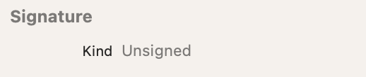
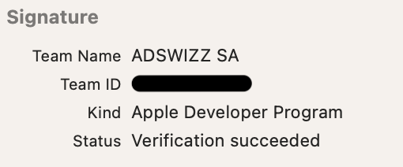
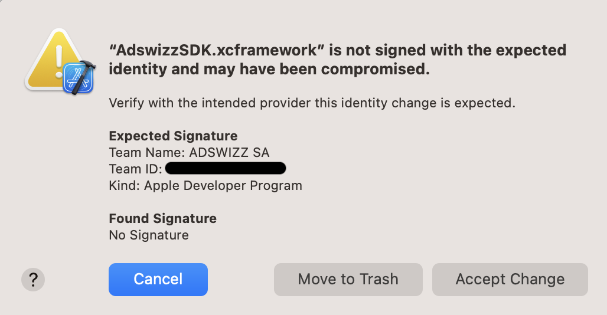

# Code signing

Following Apple recommendation that third party frameworks should digitally sign their code, as of `v7.9.0`, **_AdswizzSDK_** added digital signature for all its binary frameworks. See [Verifying the origin of XCFrameworks](https://developer.apple.com/documentation/xcode/verifying-the-origin-of-your-xcframeworks) for more details on digital signatures.

Next, let's explore how Xcode can automatically verify **_AdswizzSDK_** signed XCFrameworks included within your app, how code signatures work, and the benefits they provide to help protect **_AdswizzSDK_** software supply chain.
Lastly, we describe how **_AdswizzSDK_** XCFrameworks are signed to help keep integrating apps more secure in the context of Privacy Manifests.

## What is a digital signature

Signature verification of binary frameworks is a new feature in `Xcode 15` that provides security for app developers based on code signing done by SDK authors such as **_AdswizzSDK_** developers team.
Although **_AdswizzSDK_** is not required to be signed, Apple highly encourages SDK authors to sign their XCFrameworks.

> "It is important for SDK authors to cryptographically sign SDKs because it allows an app developer to confirm the identity and guarantees that the code has not been altered or tampered with after it was signed."

## How it works

**_AdswizzSDK_** uses the **Adswizz Apple Developer Program** identity for signing. For different developer identities, Xcode provides different levels of features based on the trust in the identity that was used for signing.
The signature resides within the `_CodeSignature` directory of **_AdswizzSDK_** XCFramework and protects the integrity of all the files inside the final binary framework.

## What changed
The **_AdswizzSDK_** `v7.9.0` has brought support for code signing so that you can be confident that the **_AdswizzSDK_** framework you use in your app is the original, validated version and have not been tampered with.

In Xcode you will see a new section in the Inspector that displays the signature status for the xcframeworks included in your app.
This section includes information about the signature, such as the **_AdswizzSDK_**'s identity as author. In **_AdswizzSDK_**'s case, it will show that the xcframework is signed by an Apple Developer Program identity.

> Note that for **_AdswizzSDK_** versions before `7.9.0`, it shows that the status is **unsigned**.

Xcode will keep track of the identity the first time the **_AdswizzSDK_** XCframework is used and verifies that it does not change during later builds or releases. Because Xcode trusts whatever it sees first, check when you first add the framework that the inspector shows it is signed by **ADSWIZZ SA** with team ID **C3N4BPH864**. How it looks like before and after signing:

<div class="container">
  
</div>

<div class="container">
  
</div>

<br clear="left"/>

Note that if the signature is removed, becomes invalid, or changes to a different developer, your app will fail to build with the error *"[name].xcframework is not signed with the expected identity and may have been compromised"*.
However, selecting the error offers an alert explaining that the **_AdswizzSDK_** identity has changed, showing how the expected identity compares to what is present in the new version.

<div style="max-width: 600px;" class="container">
  
</div>

<br clear="left"/>

*This is an example of updating the **_AdswizzSDK_** to a newer version which is not signed anymore. 
In this case, Xcode expected a valid signature because previous versions were signed.*

Your app then has the option to either:
* **Accept Change**, to proceed with the integration. Only do this once AdsWizz has confirmed the change, for example a change to AdsWizz's own **Apple Developer Program** account.
* **Move to Trash**, to remove the framework. Then download it again from the [GitHub repository](https://github.com/adswizz/ad-sdk-ios) at the release tag, or from its GitHub Release.

Xcode also warns if the signing identity has expired or been revoked. In that case, update to the latest **_AdswizzSDK_** release.

In such cases where the integrity of the **_AdswizzSDK_** is unclear, you can always contact us for clarification through Adswizz’s verified public channel(s) if necessary (i.e: your Adswizz Technical Account Manager).

## (Optional) Verify AdswizzSDK signature

To manually verify the signature status for your **_AdswizzSDK_** binary frameworks, open the Terminal and use the `codesign` tool (the `-dv` flag stands for the `--display` and `--verbose` options) with the following syntax:
```bash
codesign -dv AdswizzSDK.xcframework
```
If the XCframework is signed, you will see a similar output to this:
```bash
Executable=<path to the XCFramework Info.plist>
Identifier=AdswizzSDK
Format=bundle
CodeDirectory v=20200 size=202 flags=0x0(none) hashes=1+3 location=embedded
Signature size=9166
Timestamp=3 Apr 2024 at 11:18:29
Info.plist entries=3
TeamIdentifier=C3N4BPH864
Sealed Resources version=2 rules=10 files=78
Internal requirements count=1 size=172
```

## GPG signing

Starting with `v8.0.2`, every **_AdswizzSDK_** release is also signed with GPG (the OpenPGP standard). This is separate from the Apple code signature described above, and covers what the Apple signature can't:

* **The first copy you download.** Xcode trusts whichever signature it sees first. The GPG signature lets you check that first copy against a key AdsWizz publishes outside GitHub.
* **Every way of getting the SDK.** It works the same for Swift Package Manager, CocoaPods and a clone of this repository.

> **Note:** Verification is optional. You can integrate and use **_AdswizzSDK_** without it. It is an extra safeguard if you want to confirm that the frameworks in your app are the ones AdsWizz published and have not been modified.

### How it works

The XCFrameworks themselves are not GPG-signed one by one. Instead, AdsWizz signs a list of their checksums:

1. When a version is built, AdsWizz computes a **SHA-256 checksum for every file inside every XCFramework**, one list per framework.
2. The checksums of those per-framework lists are collected in a single file, `sha256sums.txt`. It also lists checksums of a zip of each XCFramework, which AdsWizz builds when signing but doesn't publish; the verification steps skip those lines.
3. `sha256sums.txt` is signed with the AdsWizz SDK GPG key. The signature is `sha256sums.txt.asc`.

Checking the signature proves that `sha256sums.txt` comes from AdsWizz and hasn't been changed. Checking the checksums then proves that each file inside each XCFramework is exactly the one AdsWizz built. Changing, adding or removing a single file makes the check fail.

### What to expect from 8.0.2 onwards

* **A `CodeSigning` folder in this repository**, next to `Framework`, at every release tag.
* **On each GitHub Release:**
  * every file from the `CodeSigning` folder;
  * the software bill of materials, `bom.json`. The SBOM is not covered by the GPG signature.
* **Versions before 8.0.2** have no `CodeSigning` folder and no GPG signature. They are still covered by the Apple code signature (from `v7.9.0`).
* **When a new .xcframework is published**, it gets its own checksum file automatically.

### The `CodeSigning` folder

```
CodeSigning/
├── AdswizzSDK.xcframework.sha256                   checksums of every file in Framework/AdswizzSDK.xcframework
├── AdswizzSDKCore.xcframework.sha256               … one file per XCFramework in Framework/
├── AdswizzSDKPinpointAnalytics.xcframework.sha256
├── AdswizzSDKPrivacyDataCore.xcframework.sha256
├── AdswizzWatchSDK.xcframework.sha256
├── sha256sums.txt                                  checksums of the files above (and of unpublished zips)
└── sha256sums.txt.asc                              GPG signature of sha256sums.txt
```

Each `<Framework>.xcframework.sha256` has one line per file: the checksum, two spaces, then the file's path from the repository root:

```
e3897c2771e627ba7a086e51d84dff2a907b69c1545ebb731ae3d17ee015a82c  Framework/AdswizzWatchSDK.xcframework/Info.plist
3cee97b3d6422eada98c7be683bb2107dee762cb9b2e0cca43e8a8d2dd8f000e  Framework/AdswizzWatchSDK.xcframework/_CodeSignature/CodeDirectory
...
```

`sha256sums.txt` uses the same format. It lists the zips first, then the per-framework files. The zips aren't published, so `--ignore-missing` in the steps below skips them:

```
95a3c819b472a4e3fbd00998adf9f5f7fdf6de6b26ce70089c619455a211c8d7  AdswizzSDK.xcframework.zip
...
2817fe74db9c3d4ac461cefe6420190b2d36bc9cf0cfd48561f0b5e3a175efd7  AdswizzSDK.xcframework.sha256
...
```

*The values above are from `v8.0.2`. Every release has its own.*

### Verify a release

You need `gpg`, for example from [GnuPG](https://gnupg.org) or `brew install gnupg`. `shasum` is included with macOS.

**1. Import the AdsWizz key (once) and check its fingerprint**

```bash
gpg --keyserver hkps://keys.openpgp.org --recv-keys 60D9F92495C8F7D6C0729540DA609DFBE26F9410
gpg --fingerprint 60D9F92495C8F7D6C0729540DA609DFBE26F9410
```

The fingerprint must be exactly:

```
      60D9 F924 95C8 F7D6 C072  9540 DA60 9DFB E26F 9410
```

**2. Check the files you use**

Run the block that matches how you added **_AdswizzSDK_** to your app.

*Swift Package Manager or a clone of this repository.* Run from the repository root. For Swift Package Manager that is `DerivedData/<YourApp>/SourcePackages/checkouts/ad-sdk-ios`.

```bash
gpg --verify CodeSigning/sha256sums.txt.asc CodeSigning/sha256sums.txt
(cd CodeSigning && shasum -a 256 -c --ignore-missing sha256sums.txt)
shasum -a 256 -c CodeSigning/AdswizzSDK.xcframework.sha256   # repeat for each framework you use
```

*CocoaPods.* `Pods/AdswizzSDK` doesn't include the `CodeSigning` folder. Download `sha256sums.txt`, `sha256sums.txt.asc` and the `.sha256` files of the frameworks you use from the GitHub Release, and check them first:

```bash
gpg --verify sha256sums.txt.asc sha256sums.txt
shasum -a 256 -c --ignore-missing sha256sums.txt
```

Then run from `Pods/AdswizzSDK`:

```bash
shasum -a 256 -c <path to the downloaded files>/AdswizzSDK.xcframework.sha256
```

### Expected output

A good signature looks like this:

```
gpg: Signature made Tue Oct  6 17:54:03 2026 EEST
gpg:                using RSA key 60D9F92495C8F7D6C0729540DA609DFBE26F9410
gpg: Good signature from "AdsWizz (AdsWizz SDK Key) <sdk.team@adswizz.com>" [unknown]
gpg: WARNING: This key is not certified with a trusted signature!
gpg:          There is no indication that the signature belongs to the owner.
      60D9F92495C8F7D6C0729540DA609DFBE26F9410
```

The `WARNING` lines are expected. They only mean that you haven't marked the key as trusted in your own key folder. What matters is `Good signature` and the fingerprint on the last line. Depending on your GnuPG version, that line may start with `Primary key fingerprint:` and show the fingerprint in groups of four.

Good checksums show `OK` for every file:

```
AdswizzSDK.xcframework.sha256: OK
AdswizzSDKCore.xcframework.sha256: OK
...
Framework/AdswizzSDK.xcframework/Info.plist: OK
...
```

### Troubleshooting

| You see | Meaning | What to do |
|---|---|---|
| `BAD signature` | `sha256sums.txt` was changed after AdsWizz signed it. | **Do not use the release.** Contact us. |
| `Can't check signature: No public key` | The file was signed with a different key, or you haven't imported the AdsWizz key. | Do step 1. If it still appears, **do not use the release**. Contact us. |
| `<file>: FAILED` and `WARNING: … did NOT match` | That file is not the one AdsWizz published. | **Do not use the release.** Contact us. |
| `<file>: FAILED open or read` and `WARNING: … could not be read` | A file listed in the `.sha256` file is missing. | **Do not use the release.** Contact us. |
| `no file was verified` | None of the listed files were found: the command was run in the wrong folder. | Run it from the folder given in step 2. |
| A different fingerprint in step 1 | This is not the AdsWizz key. | Don't use it. Contact us. |

To contact us, write to [sdk.team@adswizz.com](mailto:sdk.team@adswizz.com) or reach out to your AdsWizz Technical Account Manager.
