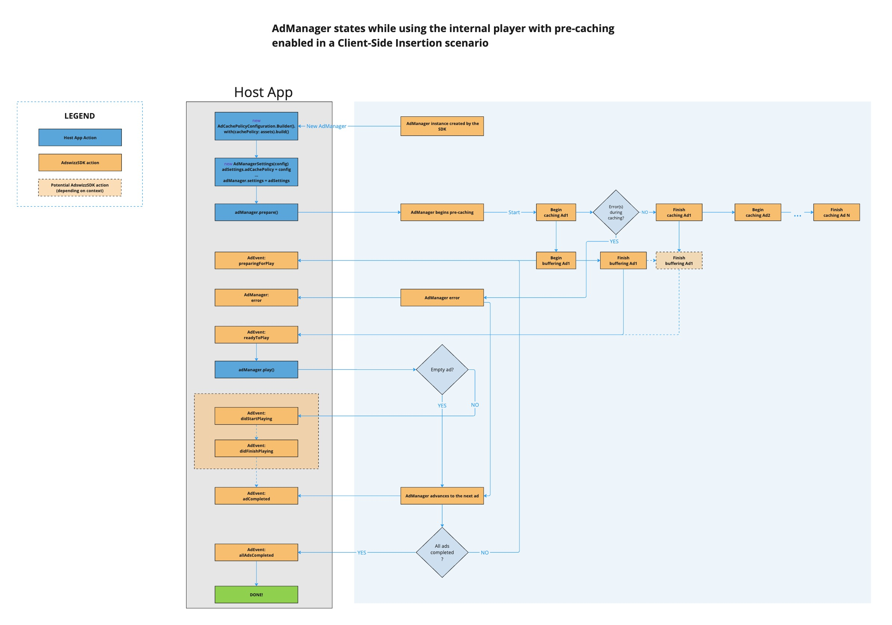
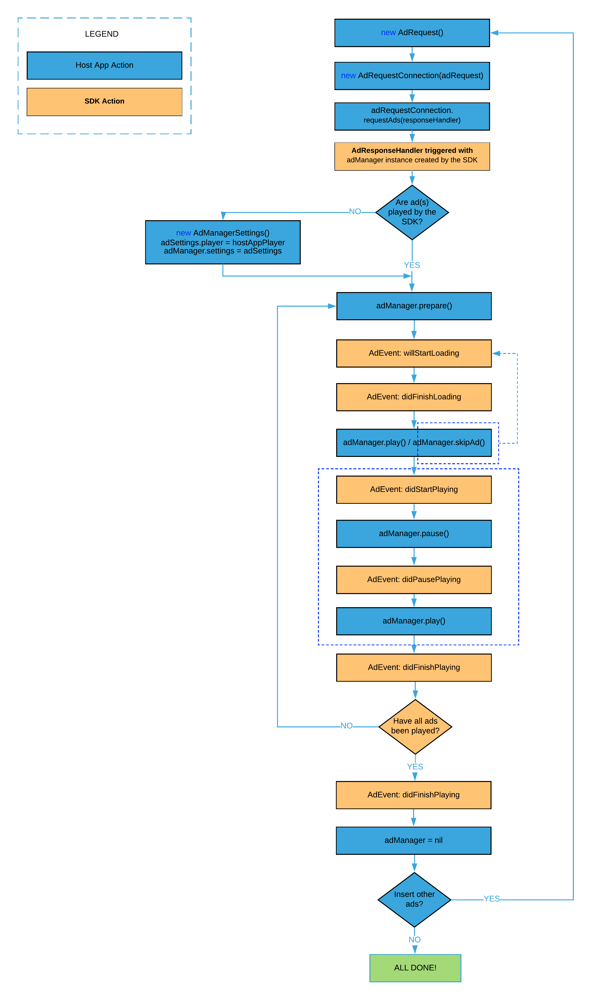

# Client-Side Insertion


In this scenario, AdswizzSDK lets you decide when and where to request ads from an Ad Insertion Server and subsequently play those ads in your application.

## Setting up your zone(s) for ad requests

Following the SDK initialization, the next step is to create and configure one or more **_AdswizzAdZone_** objects before passing them to your **_AdswizzAdRequest_** object.

```swift
var zone: AdswizzAdZone!
do {
      zone = try AdswizzAdZone.Builder()
          .with(zoneId: "ZONEID_PROVIDED_BY_PIM")         // mandatory if 'zoneAlias' is not set
          .with(zoneAlias: "ZONEALIAS_PROVIDED_BY_PIM")   // mandatory if 'zoneId' is not set
          .with(maxAds: maximum_number_of_ads)            // optional
          .with(maxDuration: maximum_duration_in_seconds) // optional
          .build()
} catch {
     print(error)
}
```
_zoneId_ or _zoneAlias_ will be provided to you by your Adswizz Integration Manager.
`maxAds` and `maxDuration` properties are completely optional.

> Note that _zoneId_ and _zoneAlias_ are mutually exclusive and you should not set them both on the same **_AdswizzAdZone_**. Set one or the other, otherwise the `Builder()` will throw an error.

## Your first ad request

Once you've created and configured your **_AdswizzAdZone_** objects, you are ready to create an **_AdswizzAdRequest_** object and configure it. Consider the example below which uses a configured zone from the code snippet above:

```swift
var adRequest: AdswizzAdRequest!
do {
      adRequest = try AdswizzAdRequest.Builder()
              .with(server: "SERVER_PROVIDED_BY_PIM")
              .with(zone: zone)
              .build()
} catch {
     print(error)
}
```

The _Ad server_ will be provided to you by your Adswizz Integration Manager.
If your specific use case involves dealing with multiple zones, your AdsWizz Integration Manager will provide you with all the required zone ids. You will then be able to set and use multiple distinct and unique **_AdswizzAdZone_** objects. Here's an example of multiple zone request:

```swift
let zone1: AdswizzAdZone!
let zone2: AdswizzAdZone!
let zone3: AdswizzAdZone!
var adRequest: AdswizzAdRequest!
do {
      adRequest = try AdswizzAdRequest.Builder()
              .with(server: "SERVER_PROVIDED_BY_PIM")
              .with(zones: [zone1, zone2, zone3])
              .build()
} catch {
     print(error)
}
```
Please note that the order in which you pass the zones is important, as the AdsWizz Ad Server will take that into account during ad selection.

An optional parameter is `duration`, which sets the maximum total duration of ads to be selected, in seconds. It can be used to fine tune the ad delivery and request a specific total duration.

##### Shim zone

If your requirement is that the duration of returned ads should be at least the requested size and not less, you can configure your **_AdswizzAdRequest_** to specify ad fillers that will satisfy the total ad pod *duration*. The Adswizz AdServer will pad the ad response with additional "shim" ads by using the **_AdswizzShimZone_** object:
```swift
var shimZone: AdswizzShimZone!
do {
      shimZone = try AdswizzShimZone.Builder()
          .with(zoneId: "ZONEID_PROVIDED_BY_PIM")         // mandatory if 'zoneAlias' is not set
          .with(zoneAlias: "ZONEALIAS_PROVIDED_BY_PIM")   // mandatory if 'zoneId' is not set
          .with(maxDeadAir: maximum_dead_air_duration_in_seconds) // optional, measured in seconds and only accepts non-zero and positive values.
          .build()
} catch {
     print(error)
}

var adRequest: AdswizzAdRequest!
do {
      adRequest = try AdswizzAdRequest.Builder()
              ...
              .with(shim: shimZone)
              .build()
} catch {
     print(error)
}
```
_zoneId_ or _zoneAlias_ will be provided to you by your Adswizz Integration Manager.
> Similar to the **_AdswizzAdZone_**, that _zoneId_ and _zoneAlias_ are mutually exclusive and you should not set them both on the same **_AdswizzShimZone_**. Set one or the other, otherwise the `Builder()` will throw an error.

The `maxDeadAir` parameter is completely optional and it specifies if the Adswizz AdServer should continue the selection for the "shims" ads, depending on the remaining duration.
e.g situations where the total duration of returned ads is (almost) filled with ads from the other ad zones so the "shim" ad(s) become(s) unnecessary and some "dead air" is acceptable.

For more details, please consult with your Adswizz Integration Manager.

##### Custom request parameters

You can use custom parameters (key-value pairs) in your **_AdswizzAdRequest_** objects, in order to send various information, such as publisher specific IDs, first-party targeting data, etc.
Here is an example:

```swift
let adRequest = try AdswizzAdRequest.Builder()
        ...
        .with(additionalCustomParameters: "key1=URLEncodedValue1&key2=URLEncodedValue2&...")
        ...
```

Note that it is your responsibility to properly URL encode the custom parameters values as well as the keys themselves (if needed).
Failing to do that will result in an error being thrown by the **_AdswizzAdRequest.Builder()_** when attempting to `build()` the request.

It's also worth noting that in your **_AdswizzAdRequest_** you can pass the TCF v2 consent string without adding a custom parameter. Here is an example:
```swift
let adRequest = try AdswizzAdRequest.Builder()
        ...
        .with(userConsentV2: "yourTCFv2String")
        ...
```

##### (Advanced) Enable expected ads reporting

You may enable the reporting on the number of expected ads by setting the `enableExpectedAdsReporting` to `true` in your **_AdswizzAdRequest_** objects. By default `enableExpectedAdsReporting` is `false`.

Here is an example:
```swift
let adRequest = try AdswizzAdRequest.Builder()
        ...
        .with(enableExpectedAdsReporting: true)
        ...
```

Read more about this behavior here: [(Advanced) Handling AdManager reporting for expected ads](#advanced-handling-admanager-reporting-for-expected-ads).

##### AdRequestConnection

Next, you need to create an **_AdRequestConnection_** object and call requestAds with the ad request object.

```swift
let adRequestConnection = AdRequestConnection(for: adRequest)
adRequestConnection.requestAds { [weak self] adManager, error in
     self?.didReceiveResponse(adManager, error)
}
```

Subsequent to this request, the SDK will return an error if the call failed or an **_AdManager_** object if the result was a success.


## Working with AdManager object

If the request to the AdsWizz Ad server was successful, the SDK will return an **_AdManager_** object which you will own. This is the way that the SDK will communicates events back to your application when playing ad(s). 

### Setup AdManager

Once it was obtained, as a first step the **_AdManager_** needs to be set up. This will be done by creating an **_AdManagerSettings_** object and passing it to your newly created **_AdManager_** instance. In this object you can specify if you want to play the ad with the SDK’s internal player or use a player of your choice that must conform to the **_MediaPlayerState_** protocol.
Additionally, you can instruct **_AdManager_** which level of asset quality it should match from the available creatives for an ad. This can be done by setting the appropriate **_AdAssetQuality_** property on your instance of **_AdManagerSettings_**. By default the AdswizzSDK will attempt to select an ad asset that matches the **_.high_** quality.
You can fine tune it by using the other available quality levels such as **_.medium_** or **_.low_**.
Setting the quality level to **_.auto_** will let the SDK choose the best asset (in terms of performance and quality) by taking into account criteria such as current network connection (cellular/WiFi).

Another option to hint to the **_AdManager_** which creative it should choose for an ad is to set the **_preferredMaxBitrate_** property on your instance of **_AdManagerSettings_**. By default it is set to 0 which means that the **_AdManager_** will choose a creative based on the **_AdAssetQuality_** property. Setting a non-zero value for the **_preferredMaxBitrate_** property means that the **_AdManager_** will select the ad asset creative with the highest bitrate less than or equal to the given value. The given value is measured in bits per second. If no ad asset creative bitrate is less than or equal to the given value, the **_AdManager_** will select the one with the closest bitrate to the given value. Note that by setting a non-zero value, the **_AdManager_** will disregard any quality level you set via the **_assetQuality_** property.

**_AdManager_** is also capable of pre-caching the creative assets for all of its ads before/while playing them. Here is how you enable pre-caching:
* create an **_AdCachePolicyConfiguration_** instance using its `Builder` 
* set the appropriate **_AdCachePolicy_** and optionally a `timeoutIntervalForResources` value on your instance of **_AdCachePolicyConfiguration_**. The `timeoutIntervalForResources` default value is 8 seconds
* set the **_AdCachePolicyConfiguration_** instance on your **_AdManagerSettings_** instance 
Note that by default, the **_AdManager_** does not (pre-)cache the creatives for ads.

Optionally, if you also want to support video rendering (in case of video ads), you will have to set an instance of **_AdVideoView_** to the **_videoView_** property on your **_AdManagerSettings_** instance. It does not need to be visible at this point. The actual video rendering is synced with the video ad playback.

To further customize the behaviour of the internal player, you can also set the **_timeoutIntervalBeforeStalling_** property on your instance of **_AdManagerSettings_**. This represents an optional timeout interval measured in seconds if the internal player should detect stalling automatically when the **_AdManager_** plays the ads. By default, this property is 0 which means that detecting stalling automatically is disabled. Enable it by setting a value greater than 0. Note that the recommended value is 3 seconds or more in order to minimize triggering the stalled error too early.

Next, you need to call the _.prepare()_ method on the **_AdManager_** object. This will buffer the ads if you decide to play them with the internal player.
Here is what it looks like:

```swift
import AdswizzSDK

class YourModelClass: AdManagerDelegate, AdManagerDatasource {
   var adManager: AdManager?
.....
func didReceiveResponse(_ adManager: AdManager?, _ error: Error?) {
    ......
    self.adManager = adManager   // Keep a strong reference of this object
    adManager?.delegate = self   // Get notifications from the Ad SDK
    adManager?.datasource = self // Further customise the Ad SDK
    
    let settings = AdManagerSettings()    // Not required
    //settings.assetQuality = .medium     // Optional, defaults to .high
    //settings.preferredMaxBitrate = 3200 // Optional, defaults to 0. If non-zero it will replace the assetQuality value if set
    //settings.player = yourPlayer        // Optional
    //settings.addCachePolicy(.assets)    // Deprecated since v7.8.6. Use the `adCachePolicy` property instead
    //let cachePolicy = AdCachePolicyConfiguration.Builder().with(cachePolicy: .assets).with(timeoutIntervalForResources: 10).build()
    //settings.adCachePolicy = cachePolicy //Optional, by default the AdManager will not use its pre-caching capability
    //settings.videoView = <AdVideoView instance> // Optional, defaults to nil
    //settings.timeoutIntervalBeforeStalling = 4 // Optional, defaults to 0 and it only applies to the internal player. Measured in seconds
    adManager.adManagerSettings = settings

    adManager?.prepare()   // Start buffering the ads in the AdManager
}
......

......
func adManager(_ adManager: AdManager, didReceiveAdEvent event: AdEvent) {
    switch event.event {
      case .readyForPlay:
           adManager.play() //Start playing the next ad in the AdManager
      case .didFinishPlaying:
          break // Current ad has finished playing
      case .adCompleted:
          break // Current ad is completed
      case .allAdsCompleted:
            break // All ads from the AdManager have finished
      default:
          break
    }
}
......

// Called when AdswizzSDK fires urls for VAST tracking events. See `VastTrackingEvent` enum for possible event values.
func adManager(_ adManager: AdManager, ad: AdData, trackingEventUrls event: VastTrackingEvent) -> [URL] {
    //return your custom tracking URLs for `event` which the SDK should fire along with VAST event tracking URLs
}

// Called when AdswizzSDK fires urls for VAST errors. See `VastErrorCode` enum for possible error values.
func adManager(_ adManager: AdManager, ad: AdData, trackingErrorUrls errorCode: VastErrorCode) -> [URL] {
    //return your custom tracking URLs for `errorCode` which the SDK should fire along with VAST error tracking URLs
}

// Called when AdswizzSDK fires urls for impression tracking.
func adManagerImpressionUrls(_ adManager: AdManager, ad: AdData) -> [URL] {
    //return your custom tracking URLs which the SDK should fire along with impression tracking URLs
}
......
}
```

### Start AdManager

If you decided to use the SDK internal player, to start the **_AdManager_** rolling the ads you must call the _.play()_ method inside the **_AdManager_** object. 
If you provide the player, then you only need to start playing the ad in your player and the AdswizzSDK will observe the **_MediaPlayerState_** interface and sense when the ad has finished. In this case, calling **_adManager.play()_** is not necessary.

### AdManagerDelegate protocol

The **_AdManager_** uses familiar Cocoa patterns like delegate and datasource objects to be supplied with data and/or deliver behavior.
To get a communication channel open with your app (model) you need to set up a delegate for the **_AdManager_** that conforms to the **_AdManagerDelegate_** protocol.

#### func adManager(_ adManager: AdManager, didReceiveAdEvent event: AdEvent)

The **_AdManager_** will call this method when an ad event has been triggered. Please consult the **_AdEventType_** enum for a list of possible events from the AdswizzSDK. For more details, please visit the [Ad events explained](#ad-events-explained) section below.

#### func adManager(_ adManager: AdManager, didReceiveAd ad: AdData?, error: Error)

Called when an error happens in the SDK while using the **_AdManager_**. The error can be handled by casting it to either `SDKError`or to a specific `AVPlayer` error (e.g by checking the `NSError` code such as `NSURLErrorTimedOut`, `NSURLErrorFileDoesNotExist`, etc.).

Here are a few cases when the **_AdManager_** will report an error:
  * ad playback failed due to an internal player error
  * ad was skipped with an explicit error. See [skipAd with error](#skipad-with-error) method from [AdManager protocol](#admanager-protocol) section
  * calling `prepare()`, `play()` or `pause()` on the **_AdManager_** instance during a server side scenario (live streaming). More details at [AdStreamManagerDelegate protocol](/iOS/SDKiOS/ServerSideInsertion) when the ad break starts

### AdManagerDatasource protocol

For your application to benefit from additional customization while working with the **_AdManager_** object, the SDK is also able to request data. To be able to customize the behavior, you need to set up a datasource for the **_AdManager_** that conforms to the **_AdManagerDatasource_** protocol.
Through the **_AdManagerDatasource_** protocol, when firing VAST tracking URLs, the SDK can ask for your additional custom tracking URLs which will be fired using the same engine thus ensuring retryability and other improvements under the hood.
The **_AdManagerDatasource_** protocol allows your integration to pass your own custom tracking URLs for the following use cases:

#### func adManager(_ adManager: AdManager, ad: AdData, trackingEventUrls event: VastTrackingEvent) -> [URL]

Called when the **_AdManager_** is about to trigger a VAST event. It passes the **_VastTrackingEvent_** for which the SDK can fire your custom additional URLs. Check the `VastTrackingEvent` enum for possible values.

#### func adManager(_ adManager: AdManager, ad: AdData, trackingErrorUrls errorCode: VastErrorCode) -> [URL]

Called when the **_AdManager_** is about to trigger a VAST error. It passes the **VastErrorCode** for which the SDK can fire your custom additional URLs. Check the `VastErrorCode` enum for possible values.

#### func adManagerImpressionUrls(_ adManager: AdManager, ad: AdData) -> [URL]

Called when the **_AdManager_** is about to trigger impressions.

#### func adManagerCompanionClickTrackingUrls(_ adManager: AdManager, ad: AdData, _ companion: Companion) -> [URL]

Called when the **_AdManager_** is about to trigger companion banner click URLs. It passes the VAST **_Companion_** object loaded by the current ad. When a companion banner is tapped, the SDK can fire your custom additional URLs.

#### func adManagerVideoClickTrackingUrls(_ adManager: AdManager, ad: AdData) -> [URL]

Called when the **_AdManager_** is about to trigger video view click URLs. When the video view is tapped, the SDK can fire your custom additional URLs.

### AdManagerInterstitialEventDatasource protocol

The **_AdManagerInterstitialEventDatasource_** protocol defines the methods used to provide AdswizzSDK with various data during a _livestream ad-replacement_ backed by the **_AdManager_**.
For more details, read the [HLS Interstitials](/iOS/SDKiOS/HLSInterstitials) support.
To be able to customize the behavior, you need to set up the `interstitialDatasource` for the **_AdManager_** that conforms to the **_AdManagerInterstitialEventDatasource_** protocol.

#### func adManager(_ adManager: AdManager, interstitialMediaFileURL ad: AdData) -> URL?

Called when the **_AdManager_** is preparing all ads during the `.prepare()` call and the **_AdManagerSettings_** contains an `adInterstitialEventMonitor` reference.
Use it for the livestream ad-replacement scenario to customize the mediafile URL for each ad in the ad pod during the associated `AVPlayerInterstitialEvent`.
For each ad in the ad pod, the `AdManager` will receive your (custom) media file URLs and use them internally to identify and match the appropriate `AVPlayerItem`instances handled by the `interstitialPlayer` (AVQueuePlayer). Therefore, you should pass the URL which was used to build the associated `AVPlayerItem` before passing them as templateItems when building the  `AVPlayerInterstitialEvent`.

By default, the `AdManager` expects that the `AVPlayerItem`s use and load the MediaFiles from the VAST response.
Implementing this method is not required, e.g if your scheduled `AVPlayerInterstitialEvent` uses the ad's MediaFiles from the VAST response.
    
> **Important**: Note that the `AdManager` will **not observe** the `AVPlayerItem`s from the `interstitialPlayer` (AVQueuePlayer) if it detects a mismatch between the URL you provide here and the URL used to create the `AVPlayerItem` itself. In this case, the `AdManager` **will not initiate any tracking and will not emit any Ad Events** for the respective `AdData`.

### Ad events explained

Once you've obtained an **_AdManager_** instance, set the delegate and called `prepare()`, that **_AdManager_** instance will communicate back to your application through the **_AdManagerDelegate_** protocol. 

The `func adManager(_ adManager: AdManager, didReceiveAdEvent event: AdEvent)` delegate method informs your application that the current ad triggered an event of interest.
Through the **_AdEvent_** interface, the following information can be accessed:
  * **_ad_**: the ad `AdData` for which the event was triggered
  * **_event_**: the actual event `AdEventType` that was triggered

#### AdEvent types
Remember that, regardless if pre-caching is enabled or not, an **_AdManager_** handles and plays ads sequentially starting with the first ad until the last ad (including "empty" ads). Hence, the order of the events is predictable to be able to consistently adhere to a state machine model.
Next, let's explore the types of events that the **_AdManager_**  can trigger by inspecting the **_AdEventType_** enum.

##### preparingForPlay

The **_preparingForPlay_** event signals that the current ad will start loading its creative. You can expect that the **_preparingForPlay_** event to be triggered for each ad managed by the **_AdManager_** (including "empty" ads). This event marks the beginning of the current ad creative lifecycle and that the internal player will start buffering.

##### readyForPlay

The **_readyForPlay_** event is triggered when the player playing the ad has finished loading (buffering) the creative and has enough buffer likely to keep up. Useful when playing ads with the internal player so that you can instruct the **_AdManager_** to start playing by calling the `play()` method. 
Note that this event does not guarantee that it will play without buffering mid ad if network conditions change.

##### didStartPlaying

The **_didStartPlaying_** event signals that the current ad started playing its creative.

##### didPausePlaying

The **_didPausePlaying_** event signals that the current ad was paused. Upon resuming the ad, the **_didStartPlaying_** event will be triggered.

##### firstQuartile

The **_firstQuartile_** event signals that the current ad reached the first quartile from the VAST linear node.

##### midpoint

The **_midpoint_** event signals that the current ad reached its midpoint from the VAST linear node.

##### thirdQuartile

The **_thirdQuartile_** event signals that the current ad reached the third quartile from the VAST linear node.

##### complete

The **_complete_** event signals that the current ad reached the complete quartile from the VAST linear node.

##### didFinishPlaying

The **_didFinishPlaying_** event signals that the current ad has finished playing its creative. Note that this event is not triggered if the **_didStartPlaying_** event has not been previously triggered as well.

##### adCompleted

The **_adCompleted_** event signals that the current ad has finished. It does not guarantee that it played or not. It simply means that the **_AdManager_** is done with this ad. You can expect that the **_adCompleted_** event to be triggered for each ad started (i.e that received the **_preparingForPlay_** event) by the **_AdManager_**, including for "empty" ads.

##### allAdsCompleted

The **_allAdsCompleted_** event signals that the **_AdManager_** has finished all the ads. After **_allAdsCompleted_** event is received, the **_AdManager_** is no longer able to play any ad. To reuse the **_AdManager_** after this point (although not recommended), you would need to first call the [reset()](#reset) method described in the [AdManager protocol](#admanager-protocol) section, and call `prepare()` again.

### Precaching ads in AdManager

Pre-caching the media (creative) assets will enable your app to serve audio ads in poor network conditions or even possibly without a network connection. This will improve the user experience because an ad can play instantly and prevent buffering mid ad.
The **_AdManager_** offers the capability of a caching-like experience, by expanding the size of the buffer to allow for essentially buffering the entire media asset for each ad. Note that pre-caching is only available if you are relying on the internal player. With your own player, it won't have any effect.

You can access the underlaying **_asset_** property of an **_ad_**'s data, which provides additional information for that particular media asset. 
This **_AdAsset_** interface makes it easy to get access to the following information:
  * **_data_**: the asset's track data (byte array). May be missing
  * **_mediaUrl_**: the selected media file URI for the asset. The result of your choice of AdAssetQuality
  * **_mimeType_**: the asset's creative type. For audio ads expect values to include, but not be limited to "audio/mpeg" and "audio/aac"
  * **_expectedContentLength_**: the asset's expected data length in bytes
  * **_state_**: the asset's status. See AdAssetState for all possible states
  * **_delegate_**: asset delegate. Optional. If set, it will notify your app with asset progress during loading

If you enabled the **_.assets_** cache option through your **_AdManagerSettings_** instance, after you set it on the **_AdManager_** object, calling _.prepare()_ on **_AdManager_** instance will trigger the pre-caching mechanism.
Optionally, you can finetune the pre-caching behavior by specifying an appropriate value for the `timeoutIntervalForResources` property set on the **_AdCachePolicyConfiguration_**. However, keep in mind that setting a low value can lead to a premature timeout error. The default value is 8 seconds.

Using the timeout, it allows the **_AdManager_** to react faster and prevent potentially longer delays due to the default `URLSession` timeout for requests (which is approximately 60 seconds or more).

To take full advantage of this behavior we recommend that you call _.prepare()_ in advance, before playing the ads with the internal player. This allows the **_AdManager_** to download and store the media assets for _all_ of its ads and maximizes effectiveness. However, you are not required to adhere to this strategy.

Here is what it looks like with the pre-caching enabled.

```swift
import AdswizzSDK

class YourModelClass: AdManagerDelegate, AdAssetDelegate {
   var adManager: AdManager?
.....
func didReceiveResponse(_ adManager: AdManager?, _ error: Error?) {
    ......
    self.adManager = adManager   // Keep a strong reference of this object
    adManager?.delegate = self   // Get notifications from the AdManager
    
    let settings = AdManagerSettings()
    //let cachePolicy = AdCachePolicyConfiguration.Builder().with(cachePolicy: .assets).with(timeoutIntervalForResources: 10).build()
    //settings.adCachePolicy = cachePolicy  // Instruct the AdManager to use the pre-caching mechanism

    adManager.adManagerSettings = settings

    adManager?.prepare()   // Start pre-caching the ads in the AdManager
}
......

......
// AdManagerDelegate
func adManager(_ adManager: AdManager, didReceiveAdEvent event: AdEvent) {
    switch event.event {
      case .preparingForPlay:
           event.ad?.asset.delegate = self //Optional, get notifications for this ad's asset
      case .readyForPlay:
           adManager.play() //Start playing the next ad in the AdManager
      case .didFinishPlaying:
          break // Current ad has finished playing
      case .adCompleted:
          break // Current ad is completed
      case .allAdsCompleted:
            break // All ads from the AdManager have finished
      default:
          break
    }
}
func adManager(_ adManager: AdManager, didReceiveAd ad: AdData?, error: Error) {
    //Called when AdManager encountered an error while playing or pre-caching the creative for the ad
    //Don't rely only on the AdEvents, this callback can be called at any time during the ad creative lifecyle and usually gives you a better context on the failure
}
......

......
// AdAssetDelegate
func adAsset(_ asset: AdAsset, didFinishDownloadingData data: Data) {
    //At this point the asset data is fully downloaded
    //...
}
    
func adAsset(_ asset: AdAsset, didDownload data: Data, bytesDownloaded: Int64, outOf bytesExpected: Int64) {
    //Called when a new slice of data has been downloaded for the asset.
    //Progress can be calculated as a 0...1 range e.g `bytesDownloaded` / `bytesExpected`
    //...
}
    
func adAsset(_ asset: AdAsset, downloadingFailedWith error: Error) {
    //Called when encountered an error during data's download for the asset
    //...
}
......
}
```

If you want to know more on how the **_AdManager_** handles pre-caching behind the scenes, have a look at the diagram below.



### Handling AdManager with no ads

In some cases the **_AdManager_** you'll receive won't have any playable ads. In this case inspecting the `ads` property on the **_AdManager_** will return a zero count. Read more about this property in the [AdManager properties](#admanager-properties) section. 
A non-playable ad is referred to as being an _empty ad_. The empty ads won't play any media; however, your app still needs to instruct the **_AdManager_** to play them by calling the `play()` method as you would normally do to advance to the next ad like you have seen in the setup section in [Setup AdManager](#setup-admanager).

Here is a simplified setup that highlights handling an **_AdManager_** with no ads:

```swift
import AdswizzSDK

class YourModelClass: AdManagerDelegate {
   var adManager: AdManager?
.....
func didReceiveResponse(_ adManager: AdManager?, _ error: Error?) {
    ......
    self.adManager = adManager   // Keep a strong reference of this object
    adManager?.prepare()   // Start buffering the ads in the AdManager
}
......

......
func adManager(_ adManager: AdManager, didReceiveAdEvent event: AdEvent) {
    switch event.event {
      case .readyForPlay:
           //Start playing the next ad in the AdManager. 
           //Notice that there is no need to check if the ad is empty or not.
           //The SDK will handle it internally and send the appropriate AdEvents just like for a non empty ad.
           adManager.play()
      case .allAdsCompleted:
            //All ads from the AdManager have finished.
            //The AdManager can now be discarded.
            //self.adManager.delegate = nil //Optional
            //self.adManager = nil //Optional
            break 
      default:
          break
    }
}
......
}
```
Important: failing to call `play()` on an **_AdManager_** with no ads it will prevent the AdswizzSDK from correctly tracking and fire opportunities for reporting purposes.

### (Advanced) Handling AdManager reporting for expected ads

Before requesting ads from the the Adswizz server in a [Client-Side Insertion](#client-side-insertion) scenario, on the **_AdswizzAdRequest_** object you can enable **_AdManager_** reporting for the number of expected ads by setting the `enableExpectedAdsReporting` property to `true`. See [Your first ad request](#your-first-ad-request).

When setting the `maxAds` value for an **_AdswizzAdZone_**, the Adswizz server will try to respond with that number of ads.
However, when it cannot fulfill that request, by setting the `enableExpectedAdsReporting` to `true`, the SDK will calculate the difference between the number of expected ads (totalMaxAds) and the number of ads from the response and it will determine how many _empty ads_ there are:
```swift
numberOfEmptyAds = totalMaxAds - adsFromResponse
```

Note that the `totalMaxAds` also takes into account zones that didn't configure a specific `maxAds`, in which case every such zone will count as +1 towards the total number of expected ads.

Read more about _empty ads_ at [Handling AdManager with no ads](#handling-admanager-with-no-ads).

The `numberOfEmptyAds` computed above represents the number of _empty_ ads that will be appended to the ads container of the resulting **_AdManager_**. 
For each _empty_ **_AdData_** the SDK will fire the error tracking URLs via `adManager(_ adManager: AdManager, ad: AdData, trackingErrorUrls errorCode: VastErrorCode) -> [URL]` from `AdManagerDatasource`.

Read more about `AdManagerDatasource` methods and behavior here: [Working with AdManager object](#working-with-admanager-object).

## AdManager life cycle

After requesting your first ad from the AdsWizz ad server, you are ready to play the ads from the AdManager object. Keep in mind that you may receive more than one ad from the server, but you are not required to play them all. If you decide to play multiple ads in your app, you need to listen to the events that the **_AdManager_** sends to your app and decide what is the appropriate action to take. Here is a diagram of the AdManager states. If you want the AdManager to play the ads with the internal player, follow the left diagram. If you want to use your own player, follow the diagram on the right.



### AdManager properties

Once obtained, an **_AdManager_** object has a few properties that could prove useful for your integration.

#### ads

Represents the collection of playable ads (received and parsed from the VAST XML) that are currently stored by the Ad Manager object. This collection can safely be accessed right after the **_AdManager_** object has been obtained, before calling the **_prepare_** method or even during ad playback. A zero count value means the Ad Manager will not play any ad.

Based on the `ads` array, you can access or calculate other metrics such as:

- ad `count` with `adManager.ads.count`
- total ads duration as the total number of seconds for all playable ads currently stored by the **_AdManager_** object i.e by using the following snippet:

```swift
import AdswizzSDK

/// Extend AdManager to obtain potentially useful metrics using the `ads` array
extension AdManager {
    /// The current number of playbable ads
    var adCount: Int {
        return ads.count
    }
        
    /// The total number of seconds for all playable ads
    var totalAdsDuration: TimeInterval {
        return ads.compactMap { $0.duration }.reduce(0, +)
    }
}

```

#### analyticsCustomData

Set an object that conforms to the **_AnalyticsCustomData_** protocol to provide key-value custom attributes to all **_AnalyticsEvent_** instances triggered by the AdswizzSDK for Analytics purposes. Read more here: [AdswizzSDK Analytics](/iOS/SDKiOS/AdswizzAnalytics).

### AdManager operations

Once presented with an **_AdManager_** object you can call different actions on it. Let’s break them down.

### AdManager protocol
#### prepare

You call this method to begin cycling through the ads in the **_AdManager_** object. If you decided to let the SDK handle the playback of the ads, this method ensures that the internal player is starting to buffer enough data so that ad playback starts smoothly. After calling this method, the first begins to load. The SDK will trigger a **_preparingForPlay_** event informing your app that buffering has begun for the ad. If the SDK is playing the ad, you will also get a **_readyForPlay_** event for the first ad. If you are playing the ad, you will not get this message since your player is responsible for starting the buffering process.


#### play

If you decided to let the SDK play the ads you will need to call the **_play_** method on **_readyForPlay_** (recommended). Calling this method while you are handling the ad playback has no effect on the SDK. You can call this method after you paused the AdManager to resume playback. AdManager will trigger a **_didStartPlaying_** event back to your app for confirmation. 

#### pause

If you decided to let the SDK play the ads, you can call the **_pause_** method whenever you need to stop playing the ads in the AdManager. Calling this method while you are handling the ad playback has no effect on the SDK. AdManager will trigger a **_didPausePlaying_** event back to your app for confirmation.

#### skipAd

If you need to skip an ad, you can call **_skipAd_** method to skip the current ad from the AdManager. This method applies even if you decided to take control of the ad playback. If current ad already started to play, your app will receive a **_didFinishPlaying_** event followed by an **_adCompleted_** event, and if the AdManager has a new ad you will receive **_preparingForPlay_** for that one. If no ads are available, an **_allAdsCompleted_** will be sent, signaling that all ads got processed in the AdManager.

#### skipAd with error

For a more advanced skip handling, you can call **_skipAd(with error: Error)_** method to skip the current ad from the AdManager. It follows the same behavior as for the **_skipAd_** method above. However, by passing an `Error` parameter, the **_AdswizzSDK_** will **not** fire any tracking URLs for `skip` VAST events, but instead it will fire the VAST error tracking URLs. Additionally, for the skipped ad it will also call `func adManager(_ adManager: AdManager, didReceiveAd ad: AdData?, error: Error)` callback from [AdManagerDelegate protocol](#admanagerdelegate-protocol) with the same error used in **_skipAd(with error: Error)_**.

#### reset

If you decided to skip all the upcoming ads in the **_AdManager_** object, you can call this method. For each ad you skip, your app will trigger **_adCompleted_**, and an **_allAdsCompleted_** event will be sent at the end. Looping through the ads again will need a call to the **_prepare_** function.
However, it is not recommended for an AdManager to be reused after a `reset()` call, especially if at least one or more ads have already been played. This recommendation helps to avoid/reduce impression duplication for the same ads being played repeatedly.

## AdManager best practices

After you obtain an **_AdManager_** instance object and call `prepare()`, that **_AdManager_** starts its lifecycle to render the ad(s) and begins to communicate to its delegate via [AdManagerDelegate protocol](#admanagerdelegate-protocol). The communication is based on [Ad events](#ad-events-explained) and your model should listen for any such incoming signals and act accordingly.

Here are a few things to consider when working with the **_AdManager_**:
* your application is not required to process all the states for the current ad in the **_AdManager_** via the `adManager(_ adManager: AdManager, didReceiveAdEvent event: AdEvent)` method. Setting a `delegate` on the **_AdManager_** instance is completely optional, however, keep in mind that this is your only communication channel with the **_AdManager_**.
* in some cases, the **_AdManager_** may inform your app that an error occured via the `adManager(_ adManager: AdManager, didReceiveAd ad: AdData?, error: Error)` delegate method from [AdManagerDelegate protocol](#admanagerdelegate-protocol). It is considered best practice to implement this method so that your application is well aware of any such error. However, when an error is received, we do not recommend the following:
    - manually stop or release the reference to the **_AdManager_** unless it is a hard requirement in your application bussiness logic. To clear the **_AdManager_** reference, it is best to wait for the [.allAdsCompleted](#alladscompleted) ad event which signals that the **_AdManager_** has finished all the ads. This way, the **_AdManager_** is able to finish its lifecycle properly and that all edge cases are correctly handled (e.g any pending [empty ads](#handling-admanager-with-no-ads))
    - skip the current ad for which the error was received. If there are more ads to be played, the **_AdManager_** will automatically advance to the next ad by sending the [.preparingForPlay](#preparingforplay) ad event.
* wait for the [.allAdsCompleted](#alladscompleted) ad event to clear and deallocate the **_AdManager_**, typically by setting it to `nil`.
* when you are done with the **_AdManager_** and before deallocate-ing it, calling [reset()](#reset) is optional. Consider [reset()](#reset) as an "invalidation" before setting the reference to nil. See the code snippet below:
    ```swift
    import AdswizzSDK

    ...
    self.adManager.reset() //optional
    self.adManager = nil
    ```

