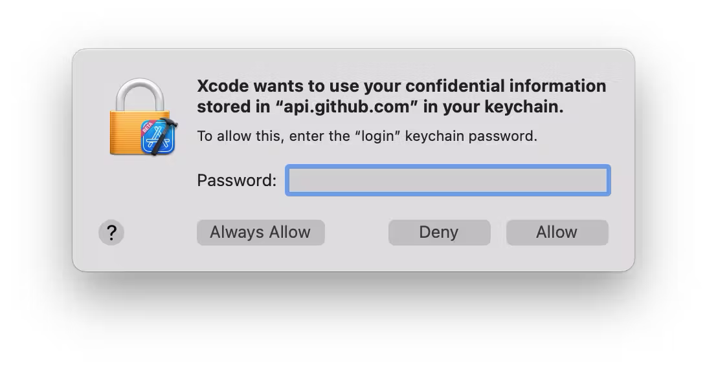
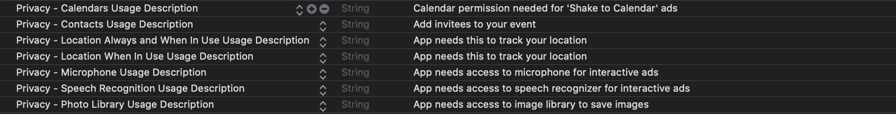

# Get started

The AdswizzSDK facilitates the ad lifecycle management, right from your application. 
Sensing listeners environment, it crafts the overall ad experience for superior addressability and augmented interactivity.

Additionally, in a client-side insertion scenario, it retrieves the ad with its associated assets, and handles the reporting operations.<br>
In a server-side insertion scenario, it takes the pressure off your app by making the interactivity and assets easily available.


## Prerequisites

*   Xcode 15.2+
*   Swift 5.9+ if the integration app uses Swift or Objective-C
*   Framework binaries - either via CocoaPods 1.13.0+, Carthage, Swift Package Manager (v7.9.2+) or archive (manual integration)

## Changelog

Please check [here](iOS/CHANGELOG.md) the latest AdswizzSDK version and all new changes & fixes it comes with. 

## Dependencies

With the release of **_AdswizzSDK_** `v7.10.0`, the dependency of AdswizzSDKPrivacyData.framework (1.0.7) was removed. It was replaced by the **optional** [AdswizzSDKPrivacyDataKit](iOS/SDKPrivacyDataKit/AdswizzSDKPrivacyDataKit) framework suite.

### History
*AdswizzSDKPrivacyData* was a source library which implemented Privacy-Sensitive API that required user permission. *AdswizzSDKPrivacyData* was configured to exclude any sensitive API at build time. This dependency was automatically added if you chose to integrate the SDK using CocoaPods. If you chose the Carthage or manual integration you had to provide it at link time.

> Note that if you are updating from an older version of **_AdswizzSDK_** to version `7.10.0` or newer, you should first consult the [migration guide](iOS/SDKMigrations/v7_10_0.md). Otherwise, if you are new to **_AdswizzSDK_**, keep reading through the next sections below to install the latest version.

## Adding the SDK to your Xcode project

There are several ways to integrate the **_AdswizzSDK_** for iOS into your own project:
- [Swift Package Manager](#swift-package-manager)
- [CocoaPods](#cocoapods)
- [Carthage](#carthage)
- [Manual](#manual)

You should use one and only one of these ways to import the **_AdswizzSDK_**. Importing the SDK in multiple ways loads duplicate copies of the SDK into the project and causes compiler/linker errors.

### Swift Package Manager

To be able to install **_AdswizzSDK_** using Swift Package Manager, please follow the steps detailed below.

#### Authentication

**_AdswizzSDK_** is delivered as an .xcframework from a private Github repository, and as a result, Swift Package Manager needs to be instructed to checkout the binary files using a Github token. You can obtain a token from your AdsWizz partner integration manager. 

Since Xcode 13.3, Swift Package Manager has official support for binary frameworks which are vended from a private Github release. For more details, you can read the discussions on the official [thread](https://forums.swift.org/t/spm-support-basic-auth-for-non-git-binary-dependency-hosts/37878) which started in June 2020.

Next, let's set up the Swift Package Manager authentication mechanism. Please choose one of the authentication methods below.

##### .netrc

The `.netrc` file format is commonly used for the automatic authentication of HTTP requests and usually placed in the user’s home directory (`~/.netrc`). Learn more about netrc by reading the [gnu documentation](https://www.gnu.org/software/inetutils/manual/html_node/The-_002enetrc-file.html).

To use the `.netrc` authentication, make sure you have it under your home directory. If you don't have a .netrc file, go ahead and create one:

```ruby
touch ~/.netrc
```
...and add the following inside:

```ruby
machine api.github.com login adswizz password ADSWIZZ_GITHUB_TOKEN
```

Replace **_ADSWIZZ_GITHUB_TOKEN_** with your token received from AdsWizz.

##### Apple's Keychain

Even though `.netrc` is a great solution which works on Mac and also on Linux, if the integration is done exclusively on Mac (and most **_AdswizzSDK_** integrators do) then your application can leverage Apple's Keychain as alternative. Instead of creating an entry in the `~/.netrc` file, create an internet password instead containing:
- Keychain Item Name: `api.github.com`
- Account Name: GitHub user name
- Password: The personal access token supplied by your Adswizz Technical Account Manager

Xcode (SPM) will read from your Keychain once the permission is granted. Such a dialogue may come up during package resolution.


Once you've completed the authentication setup by choosing one of the methods above, let's add the **_AdswizzSDK_** Swift package and its dependencies.

#### Installation

1. Swift Package Manager is distributed with Xcode. To start adding the **_AdswizzSDK_** to your iOS project, open your project in Xcode and select File > Add Package Dependencies... or select your project in the "Project Navigator" panel, navigate to the "Package Dependencies" tab and click the "+" button. Xcode will open the "Add Package Dependency" dialog.

2. Enter the following URL for the **_AdswizzSDK_** for iOS Swift Package Manager GitHub repo into the search bar:
```ruby
https://ADSWIZZ_GITHUB_TOKEN@github.com/adswizz/ad-sdk-ios
```
Replace ADSWIZZ_GITHUB_TOKEN with the token you received from AdsWizz.
3. You'll see the repository rules for which version of the **_AdswizzSDK_** you want Swift Package Manager to install. Choose the `Up to Next Major Version` as it will use the latest compatible version of the dependency that can be detected from the main branch. Select which project you want Swift Package Manager to add the **_AdswizzSDK_**, then click "Add Package".
4. Choose which of the libraries you want added to your project target. Always select the **_AdswizzSDK_** product. The remaining library products to install are optional (depending on your application needs). AdswizzWatchSDK and AdswizzSDKPinpointAnalytics rely on **_AdswizzSDK_** main binary framework.<br>

> At this point you will also be able to link the optional frameworks from the [AdswizzSDKPrivacyDataKit](iOS/SDKPrivacyDataKit/AdswizzSDKPrivacyDataKit) components. Read more on how to [integrate](iOS/SDKPrivacyDataKit/IntegratingAdswizzSDKPrivacyDataKit#swift-package-manager) components from the **_AdswizzSDKPrivacyDataKit_** module.

Select all that are appropriate, then click "Add Package(s)" for Xcode to resolve the package(s) and link them into your project.

#### AWSCore dependency

The AWSCore dependency is not needed if you only install **_AdswizzSDK_** (and optionally **_AdswizzWatchSDK_**). However, if you also chose to install and link your project against **_AdswizzSDKPinpointAnalytics_** framework, you'll need to install the [AWSCore Swift Package](https://github.com/aws-amplify/aws-sdk-ios) dependency from aws-amplify.

#### Troubleshooting

Although Swift Package Manager is a convenient way to integrate third party libraries such as **_AdswizzSDK_** and its dependencies, you may encounter issues during package resolution due to Xcode or SPM errors. Here are a few suggestions on how to mitigate such errors.

##### Clear Caches

If you want to reinstall the **_AdswizzSDK_** Swift packages or something went wrong during package resolution, we strongly recommend to follow the steps bellow. 

###### 1. (Optional) Remove existing package dependencies

If your project already contains faulty **_AdswizzSDK_** package dependencies (there are Swift Package Manager related errors in your `Issues Navigator` panel from Xcode), make sure to remove them by selecting your project in the `Project Navigator` panel, navigate to the "Package Dependencies" tab and click the "-" button.  

###### 2. Clear Swift Package Manager Caches

> We recommend to always `quit` Xcode (right-click on the Xcode app icon and select "Quit") before you attempt to clear the caches.

Swift Package Manager attempts to cache the packages you add to your project. On your Mac, navigate to the following folders in your user directory:
```bash
~/Library/Caches/org.swift.swiftpm/repositories
~/Library/org.swift.swiftpm
```
...and delete all the `ad-sdk-ios-xxxxxxxx` and/or `ad-sdk-ios-privacydata-core-xxxxxxxx` folders.

For good measure, also navigate to the following folder:
```bash
~/Library/org.swift.swiftpm/security/fingerprints
```
...and delete all the `ad-sdk-ios-xxxxxxxx` and/or `ad-sdk-ios-privacydata-core-xxxxxxxx` JSON files.

And finally, navigate to:
```bash
~/Library/Caches/org.swift.swiftpm/artifacts
```
...and delete all the `https___api_github_com_repos_adswizz_ad_sdk_ios_releases_assets_xxxxxxxxx_zip` entries.

<div class="container" style="max-width: 500px;">
  
  <div class="overlay">~/Library/Caches/org.swift.swiftpm/</div>
</div>

<div class="container"style="max-width: 500px;">
  
  <div class="overlay">~/Library/org.swift.swiftpm/security/fingerprints</div>
</div>
<br clear="left"/>

Alternatively, you can run the following commands to clear the *entire Swift Package Manager cache* on macOS:
```bash
rm -rf ~/Library/Caches/org.swift.swiftpm
rm -rf ~/Library/org.swift.swiftpm
```
> Note that running the commands from above will delete the entire cache used by Swift Package Manager for all your packages and may take a while to restore them by using Xcode options such as `Reset Package Caches`, `Resolve Package Versions` and `Update to Latest Package Versions`. 

###### 3. Clear Derived Data

Delete the entry for your project from `Derived Data` because Xcode also keeps its packages in:
```bash
~/Library/Developer/Xcode/DerivedData/your-project/SourcePackages/checkouts/
```

This should remove all traces of **_AdswizzSDK_** and its dependency packages, and you can try to install them again by following the [Installation](#installation) steps from above.

##### Xcode options

Restore **_AdswizzSDK_** and its dependency packages by using Xcode options such as `Reset Package Caches`, `Resolve Package Versions` and `Update to Latest Package Versions`. Read more on the [SPM documentation](https://github.com/swiftlang/swift-package-manager/blob/main/Documentation/Usage.md).

### CocoaPods

The **_AdswizzSDK_** is delivered as an xcframework, so another way to integrate it is through CocoaPods. The recommended version for Cocoapods is 1.13.0 or newer. If you already have a Podfile, you just need to add the following line:

```ruby
pod 'AdswizzSDK',            :git => "https://ADSWIZZ_GITHUB_TOKEN@github.com/adswizz/ad-sdk-ios.git"
```
Replace **_ADSWIZZ_GITHUB_TOKEN_** with the token you received from AdsWizz. You can obtain a token from your AdsWizz partner integration manager. After modifying the podfile, run `pod install`. You will be prompted to enter a username. Enter any valid email address. Don't leave this value empty or the install will fail. When prompted for a password, enter the token repository provided by AdsWizz. Once authorization is successful, external dependencies will be added automatically. 

> At this point you will also be able to link the optional frameworks from the [AdswizzSDKPrivacyDataKit](iOS/SDKPrivacyDataKit/AdswizzSDKPrivacyDataKit) components. Read more on how to [integrate](iOS/SDKPrivacyDataKit/IntegratingAdswizzSDKPrivacyDataKit#cocoapods) components from the **_AdswizzSDKPrivacyDataKit_** module.

### Carthage

The **_AdswizzSDK_** can also be delivered using Carthage. The recommended version for Carthage is 0.38.0 or newer.

#### Cartfile

Type in the following lines inside your Cartfile:

```ruby
binary "https://raw.githubusercontent.com/adswizz/ad-sdk-ios/master/AdswizzSDK.json"
github "aws-amplify/aws-sdk-ios"
github "https://github.com/adswizz/ad-sdk-ios"
```
> **Note**
> The `github "aws-amplify/aws-sdk-ios"` line is only needed if you also consider integrating **_AdswizzSDKPinpointAnalytics_**. For more details, please visit the [Integrating AdswizzSDK Pinpoint Analytics](iOS/SDKPinpointAnalytics/IntegratingAdswizzSDKPinpointAnalytics) section. 

#### Authentication

Because the **_AdswizzSDK_** is under a private repository, it needs an authentication mechanism to access it. We'll use `.netrc` for it. If you don't have a .netrc file under your home directory, go ahead and create one:

```ruby
touch ~/.netrc
```
...and add the following inside: 

```ruby
machine github.com login adswizz password ADSWIZZ_GITHUB_TOKEN
machine raw.githubusercontent.com login adswizz password ADSWIZZ_GITHUB_TOKEN
```
Replace **_ADSWIZZ_GITHUB_TOKEN_** with your token received from AdsWizz. 

#### Run Carthage update
    
You are now ready to install **_AdswizzSDK_** with Carthage. Open Terminal.app, navigate to the folder where your Cartfile is located, and run the following command: 
```ruby
carthage update --use-xcframeworks --use-netrc
```
If the command runs succesfully, Carthage will create a `Build` folder with all the **_AdswizzSDK_** binaries.

#### Project Setup

Carthage requires that the needed frameworks be linked manually to the project. After completing the [Run](#Run-carthage-update) step above, drag and drop to copy the `AdswizzSDK.xcframework` and `AdswizzSDKCore.xcframework` binary frameworks into your application `Frameworks` group, and be sure to link and embed them.

> At this point you will also be able to link the optional frameworks from the [AdswizzSDKPrivacyDataKit](iOS/SDKPrivacyDataKit/AdswizzSDKPrivacyDataKit) components. Read more on how to [integrate](iOS/SDKPrivacyDataKit/IntegratingAdswizzSDKPrivacyDataKit#carthage) components from the **_AdswizzSDKPrivacyDataKit_** module.

### Manual

Unzip the **_AdswizzSDK_** archive, which contains the **_AdswizzSDK.xcframework_** binary. Drop the **_AdswizzSDK.xcframework_** file in your project’s Frameworks directory. Make sure that **_AdswizzSDK.xcframework_** is listed in the **_Embedded Binaries_** section of your target.<br>
Optional components from **_AdswizzSDKPrivacyDataKit_** can be added as submodules from the https://github.com/adswizz/ad-sdk-ios repository by selecting the appropriate tag and add the approapriate **_.xcodeproj_** files to your workspace or project.

## Changes in your Info.pList file

After adding AdswizzSDK.xcframework to your application, unless you will pass the required settings programmatically when the AdswizzSDK is initialized (**_installationId_**, **_playerId_** and **_appStoreId_**), you’ll also need to add some keys in Info.pList. Let’s split these in to two categories:
For more details about these settings please consult [SDK initialization and setup](#sdk-initialization-and-setup).

1. Settings for the framework:
    1. Add "**_AdswizzAdSDKInstallationId_**" as a string setting. This is a unique string provided by your AdsWizz Integration Manager. If not provided programmatically, this setting is **mandatory** and, if not set in your app’s Info.pList, the initialize method of the AdswizzSDK will throw an error.
    

    2. Add the "**_AdswizzAdSDKPlayerId_**" string setting. This is a unique string provided by your AdsWizz Integration Manager. If not provided programmatically, this setting is **mandatory** and, if not set in your app’s Info.pList, the initialize method of the AdswizzSDK will throw an error.
    
    
    3. (Optional) Add the "**_AdswizzAdSDKAppStoreId_**" string setting. This value is an automatically generated ID assigned to your app in AppStore Connect. It can be found in your AppStore Connect page for your app under App Information -> General Information -> Apple ID. If not provided programmatically, this setting is **optional** and, if not set in your app’s Info.pList either, AdswizzSDK will not throw an error, however, during initialization, it will attempt to obtain the AppStoreId for your app using Apple's public lookup API call.
    
    
2. Settings for permissions(**optional**):
    1. Add a **_NSCalendarsUsageDescription_** entry. There are interactive ads that, once acted upon, add events in the Calendar. Note that in order to support it, you should also link the **_AdsiwzzSDKPrivacyDataCalendar.framework_** from the [AdswizzSDKPrivacyDataKit](iOS/SDKPrivacyDataKit/AdswizzSDKPrivacyDataKit) components. Read more on how to [integrate](iOS/SDKPrivacyDataKit/IntegratingAdswizzSDKPrivacyDataKit#installation) these optional framework components.
    2. Add **_NSContactsUsageDescription_** entry. As events are added to the Calendar, the user might be interested in inviting friends along. For this, the SDK requires access to the Contacts and Calendar permissions. Note that in order to support it, you should also link the **_AdsiwzzSDKPrivacyDataContacts.framework_** from the [AdswizzSDKPrivacyDataKit](iOS/SDKPrivacyDataKit/AdswizzSDKPrivacyDataKit) components. Read more on how to [integrate](iOS/SDKPrivacyDataKit/IntegratingAdswizzSDKPrivacyDataKit#installation) these optional framework components.
    3. Add a **_NSLocationWhenInUseUsageDescription_** entry. One of the best targeting criteria for ads is users's location. The SDK only updates location when in the foreground. For this, the SDK requires access to Location - While the app is in use. Note that in order to support it, you should also link the **_AdsiwzzSDKPrivacyDataLocation.framework_** from the [AdswizzSDKPrivacyDataKit](iOS/SDKPrivacyDataKit/AdswizzSDKPrivacyDataKit) components. Read more on how to [integrate](iOS/SDKPrivacyDataKit/IntegratingAdswizzSDKPrivacyDataKit#installation) these optional framework components.
    4. Add a **_NSLocationAlwaysAndWhenInUseUsageDescription_** entry. To enhance the location-based targeting capability, the SDK can leverage the location information when the app is running in background. For this, the SDK requires access to Location - Always. Note that in order to support it, you should also link the **_AdsiwzzSDKPrivacyDataLocation.framework_** from the [AdswizzSDKPrivacyDataKit](iOS/SDKPrivacyDataKit/AdswizzSDKPrivacyDataKit) components. Read more on how to [integrate](iOS/SDKPrivacyDataKit/IntegratingAdswizzSDKPrivacyDataKit#installation) these optional framework components.
    5. Add a **_NSMicrophoneUsageDescription_** entry. Interactive voice ads depend on the user being able to interact with the ad, through voice. For this, the SDK requires access to the Microphone. Note that in order to support it, you should also link the **_AdsiwzzSDKPrivacyDataMicrophone.framework_** from the [AdswizzSDKPrivacyDataKit](iOS/SDKPrivacyDataKit/AdswizzSDKPrivacyDataKit) components. Read more on how to [integrate](iOS/SDKPrivacyDataKit/IntegratingAdswizzSDKPrivacyDataKit#installation) these optional framework components.
    6. Add a **_NSSpeechRecognitionUsageDescription_** entry. Once the user interacts with an interactive voice ad, the SDK needs to convert voice into text, in order to comprehend the command. For this, the SDK will require access to SpeechKit. Note that in order to support it, you should also link the **_AdsiwzzSDKPrivacyDataSpeech.framework_** from the [AdswizzSDKPrivacyDataKit](iOS/SDKPrivacyDataKit/AdswizzSDKPrivacyDataKit) components. Read more on how to [integrate](iOS/SDKPrivacyDataKit/IntegratingAdswizzSDKPrivacyDataKit#installation) these optional framework components.
    7. Add a **_NSPhotoLibraryUsageDescription_** entry. One of the actions users can perform on an interactive ad is saving a coupon or a banner to the photo library. For this, the SDK requires access to the Photo Library. Note that in order to support it, you should also link the **_AdsiwzzSDKPrivacyDataPhotos.framework_** from the [AdswizzSDKPrivacyDataKit](iOS/SDKPrivacyDataKit/AdswizzSDKPrivacyDataKit) components. Read more on how to [integrate](iOS/SDKPrivacyDataKit/IntegratingAdswizzSDKPrivacyDataKit#installation) these optional framework components.
    8. Add a **_NSMotionUsageDescription_** entry. For better targetting AdsWizz can use CMMotionActivityManager to determine what activity is the user engaged in. For this, the SDK requires access to the device’s motion data. Note that in order to support it, you should also link the **_AdsiwzzSDKPrivacyDataMotion.framework_** from the [AdswizzSDKPrivacyDataKit](iOS/SDKPrivacyDataKit/AdswizzSDKPrivacyDataKit) components. Read more on how to [integrate](iOS/SDKPrivacyDataKit/IntegratingAdswizzSDKPrivacyDataKit#installation) these optional framework components.
    9. Add a **_NSUserTrackingUsageDescription_** entry. If you want to use the AdswizzSDK tracking framework to assist you in asking users's consent for accessing IDFA, add this in your app's Info.plist. Note that in order to support it, you should also link the **_AdsiwzzSDKPrivacyDataIDFA.framework_** from the [AdswizzSDKPrivacyDataKit](iOS/SDKPrivacyDataKit/AdswizzSDKPrivacyDataKit) components. Read more on how to [integrate](iOS/SDKPrivacyDataKit/IntegratingAdswizzSDKPrivacyDataKit#installation) these optional framework components.

    


## SDK initialization and setup

To properly integrate the AdswizzSDK into your app, you first need to initialize the AdswizzSDK with an optional configuration.
There are two mandatory string settings that allow AdswizzSDK to be initialized properly: **_installationId_** and **_playerId_**. 
**_appStoreId_** is optional. If not provided, during initialization the SDK will attempt to fetch it remotely using Apple's public lookup API.

You can either set them in your Info.plist file with the **_AdswizzAdSDKInstallationId_** key, **_AdswizzAdSDKPlayerId_** and **_AdswizzAdSDKAppStoreId_** respectively (see [Changes in your Info.pList file](#changes-in-your-infoplist-file)), or set them programmatically in which case the Info.plist values will be overridden.

To programmatically set the **_installationId_**, **_playerId_** and **_appStoreId_** string settings you use a configuration object which is an instance of **_AdswizzSDKConfig_**.

Note that there is also a `completion` block available for the `initialize()` method. It is optional but it indicates precisely when the **_AdswizzSDK_** has completed the initialization. The `completion` block is always called on the main thread.

The recommended place to initialize the AdswizzSDK is in your **_AppDelegate_** class on **_didFinishLaunchingWithOptions_** function. Here is a snippet of what this might look like:


```swift
import UIKit
import AdswizzSDK

@UIApplicationMain
class AppDelegate: UIResponder, UIApplicationDelegate {
......
func application(_ application: UIApplication, didFinishLaunchingWithOptions launchOptions: [UIApplication.LaunchOptionsKey: Any]?) -> Bool {
  //the configuration object is optional, unless you want to override the Info.plist values
  //or simply didn't add the string settings in your app's Info.plist
  let config = AdswizzSDKConfig(playerId: "yourPlayerId", installationId: "yourInstallationId", appStoreId: "yourAppAppleID")
  do {
     try AdswizzSDK.shared.initialize(with: config, completion: { [weak self] in //completion block is optional
        print("AdswizzSDK is initialized")
     })
  } catch {
     print(error)
  }
.......
}
.......
}
```

Alternatively, use the `async` variant if your model supports async context:

```swift
import UIKit
import AdswizzSDK

@UIApplicationMain
class AppDelegate: UIResponder, UIApplicationDelegate {
......
func application(_ application: UIApplication, didFinishLaunchingWithOptions launchOptions: [UIApplication.LaunchOptionsKey: Any]?) -> Bool {
  Task { @MainActor in
      //the configuration object is optional, unless you want to override the Info.plist values
      //or simply didn't add the string settings in your app's Info.plist
      let config = AdswizzSDKConfig(playerId: "yourPlayerId", installationId: "yourInstallationId", appStoreId: "yourAppAppleID")
      do {
        try await AdswizzSDK.shared.initialize(with: config)
        print("AdswizzSDK is initialized")
      } catch {
        print(error)
      }
  }
.......
}
.......
}
```

Your AdsWizz Integration Manager will provide you with unique SDK installation ids that you need to add in your Info.pList under the **_AdswizzSDKInstallationId_** key and **_AdswizzSDKPlayerId_** respectively. You are now ready for your first ad request in a client-side scenario, playing a live stream in the server-side insertion approach or playing podcasts.

